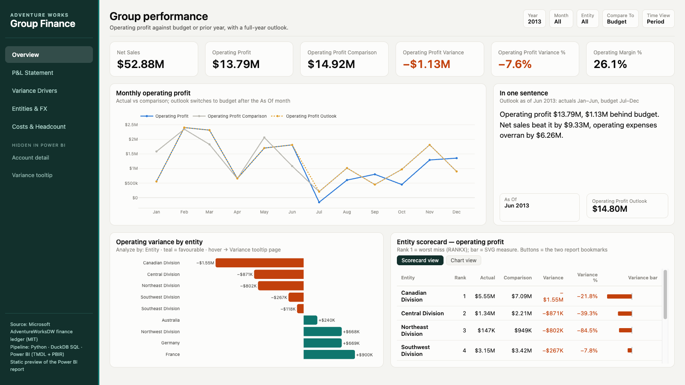
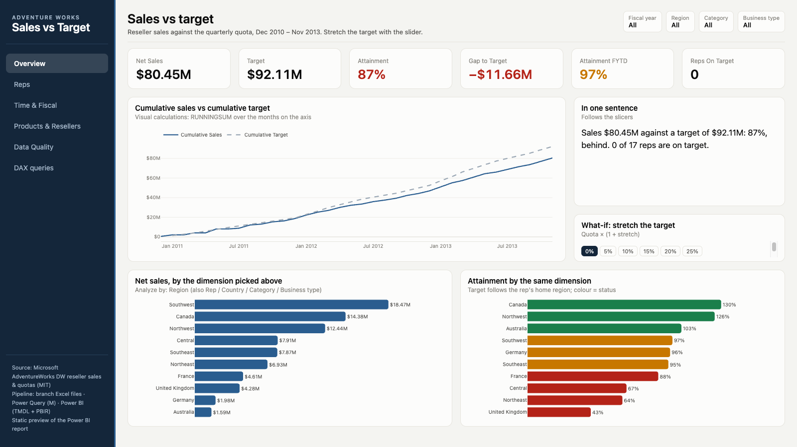
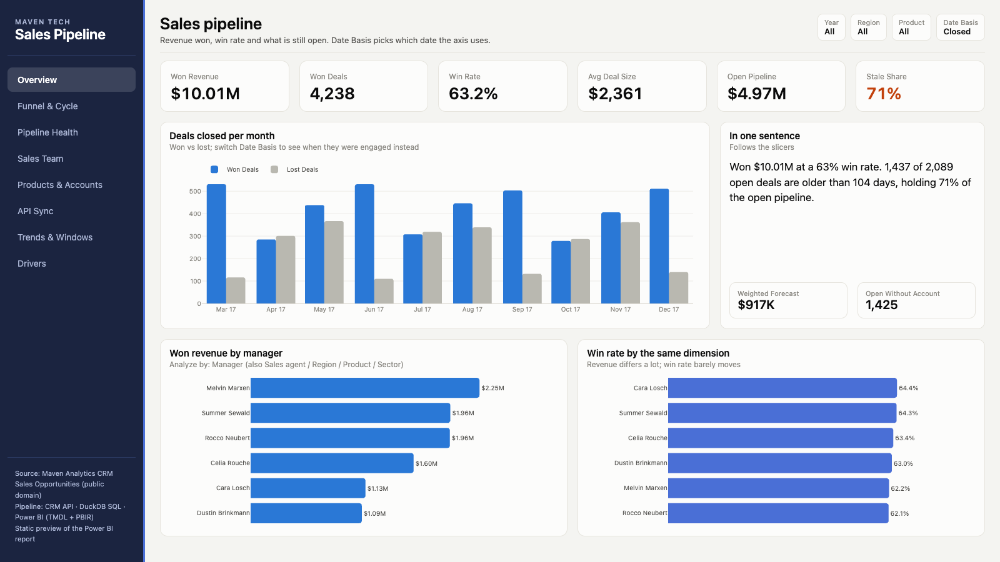
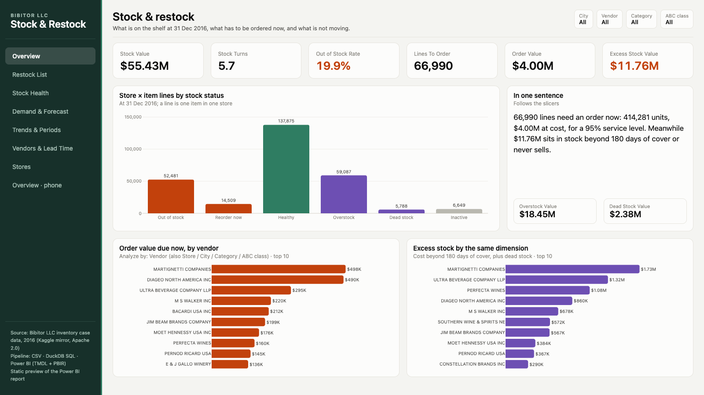
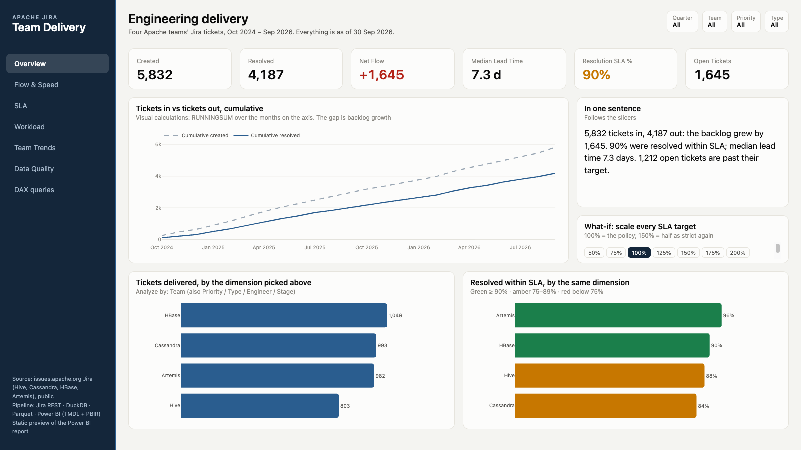
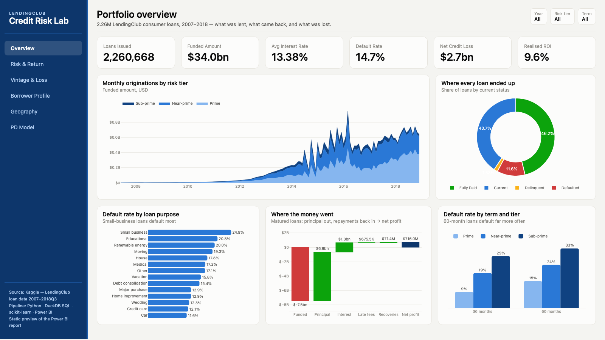
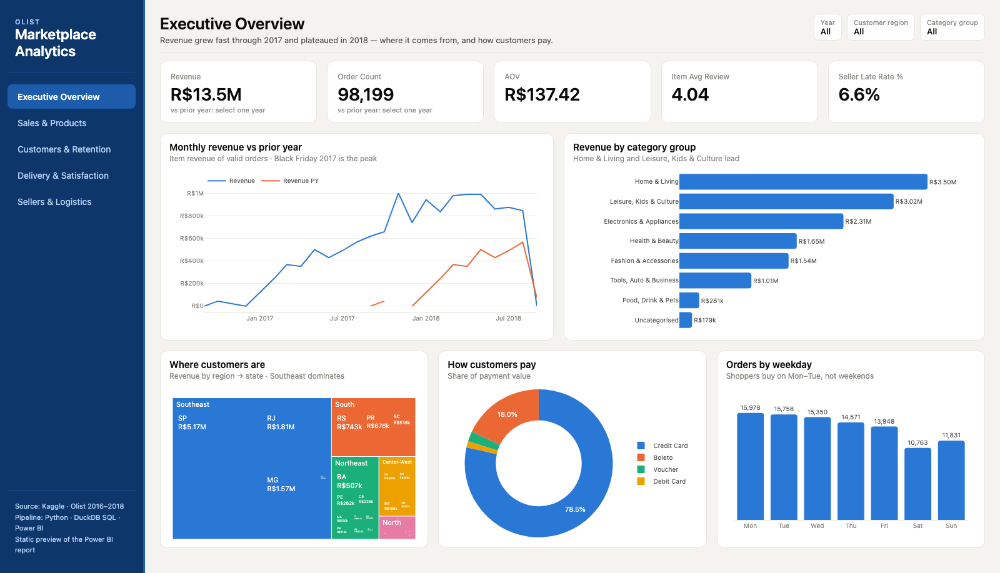
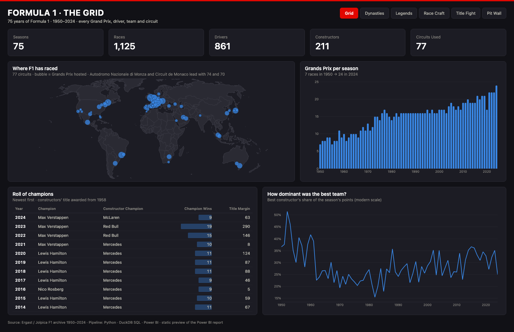

# Power BI Portfolio — Nauval Zulfikar

Eight end-to-end Power BI projects on public data. Each one starts from a business question, cleans the source data, builds a star-schema model with DAX, and ends in a report. Every project is a Power BI Project (PBIP: TMDL model + PBIR report) under version control, with Best Practice Analyzer checks and data-quality tests.

Open any `.pbip` file in Power BI Desktop. Each folder's README explains the data, the model, and how to rebuild it.

| Project | Business question | Headline finding |
|---|---|---|
| [Group Finance: Actual vs Budget](finance-variance/) | Did a 9-entity, 4-currency group hit budget, and how much of the miss is exchange rates? | Sales beat budget by 21% but operating profit missed by $1.13M; currency explains only $69K of it |
| [Sales vs Target](sales-target/) | Are 17 reps in 3 branches on quota, built from each branch's messy Excel files? | $80.45M against $92.11M quota (87%); no rep on target over three years |
| [CRM Sales Pipeline](crm-pipeline/) | How much of the open pipeline is real, rebuilt from a CRM API with full history? | 71% of the $4.97M open pipeline is stale deals |
| [Inventory Restock](inventory-restock/) | What should 79 stores order now, and where is cash stuck? | $4.00M order due at a 95% service level while $11.76M sits in slow or dead stock |
| [Team Delivery KPIs](team-kpi/) | Are four engineering teams delivering on time, built from their real Jira history? | Backlog grew by 1,645 tickets in two years; only 53% of P1 tickets met their 7-day target |
| [Credit Risk Lab](lendingclub-risk/) | Did higher interest rates on 2.26M LendingClub loans pay for the extra defaults? | Every grade made money: F/G earned about 15% lifetime ROI vs 7.4% for A, once only matured loans are counted |
| [Olist Marketplace](olist-analytics/) | What drives reviews and repeat buying on a Brazilian marketplace with ~100k orders? | Orders a week late average 1.7★ vs 4.3★ when early; 97% of customers buy only once |
| [F1 Analytics](f1-analytics/) | Who were the best drivers once the car is taken out, across 75 years of Formula 1? | Car-adjusted, the top five are Fangio, Stewart, Clark, Prost and Senna; pole now wins 49% of races vs 34% before 1989 |

## Group Finance: Actual vs Budget
Consolidated P&L with intercompany eliminations and minority interest. Variance split into exchange-rate and operational parts; calculation group for YTD, prior-year and YoY.

## Sales vs Target
Power Query consolidates three inconsistent Excel layouts and a wide quota sheet, with a log of every row set aside and why. Fiscal calendar, attainment and risk bands, row-level security by branch.

## CRM Sales Pipeline
Incremental extractor from a HubSpot-style REST API into a versioned warehouse; incremental refresh; API sync health page.

## Inventory Restock
Safety stock, reorder point and order quantity per store and item, recalculated when the user changes service level or review period. Composite-model variant on PostgreSQL; mobile layout.

## Team Delivery KPIs: Jira to Power BI
Four Apache teams' public Jira, replayed from full change history so every field is as of 30 Sep 2026. Each team's workflow mapped onto shared stages; lead and cycle time, SLA per priority, workload per engineer, and a data-quality page that accounts for every ticket.

## Credit Risk Lab: LendingClub 2007–2018
$34.0bn across 2.26M consumer loans. Matured-loan metrics only, vintage curves, loss given default by grade, and a probability-of-default model (AUC 0.691 out-of-time) feeding expected loss on the live book.

## Olist Marketplace Analytics
Nine relational CSVs into a star schema; delivery vs review score, monthly cohort retention, seller concentration and freight burden by distance. Customer lifetime value and a sales forecast feed the model; paginated seller scorecard.

## F1 Analytics: 75 years of Formula 1
1,125 Grands Prix and 589,081 timed laps. Every era re-scored on today's points system; a fixed-effects regression separates driver skill from car quality; dominance, reliability and pit-lane trends.

---
Contact: zulfikar.nauval1998@gmail.com · [LinkedIn](https://linkedin.com/in/nauval-zulfikar)
