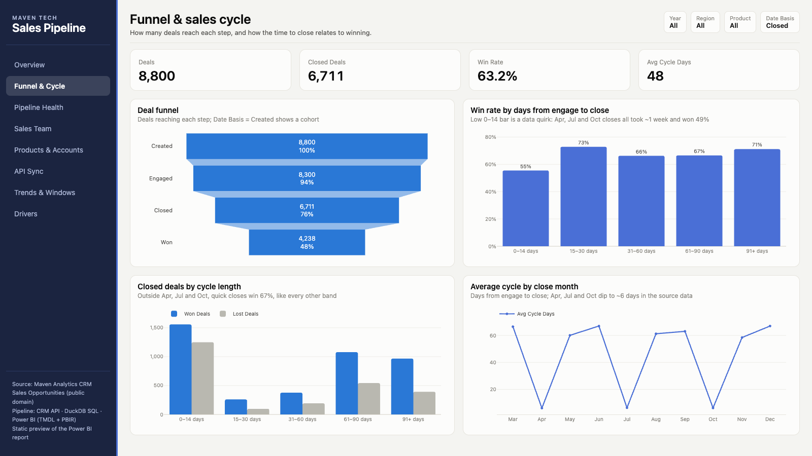
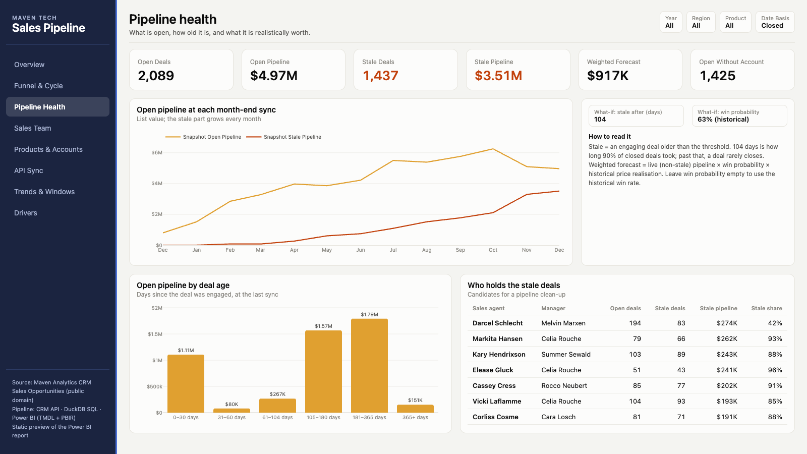
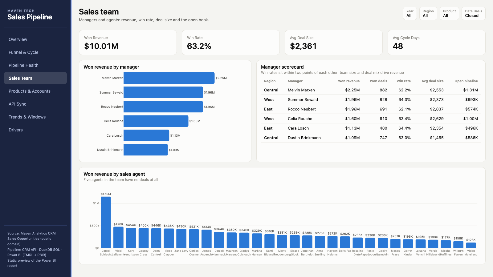
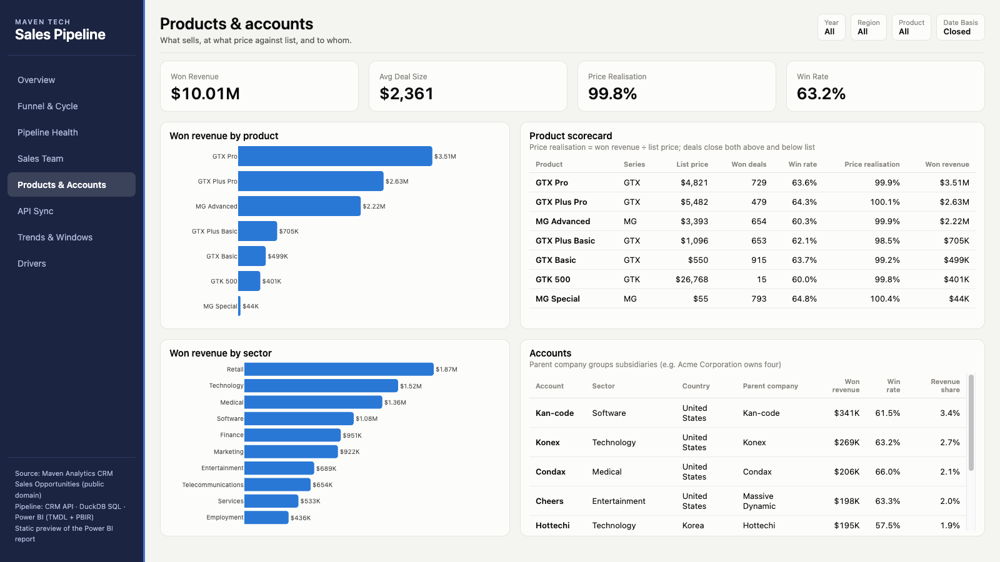
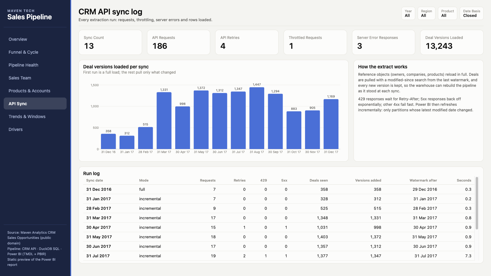
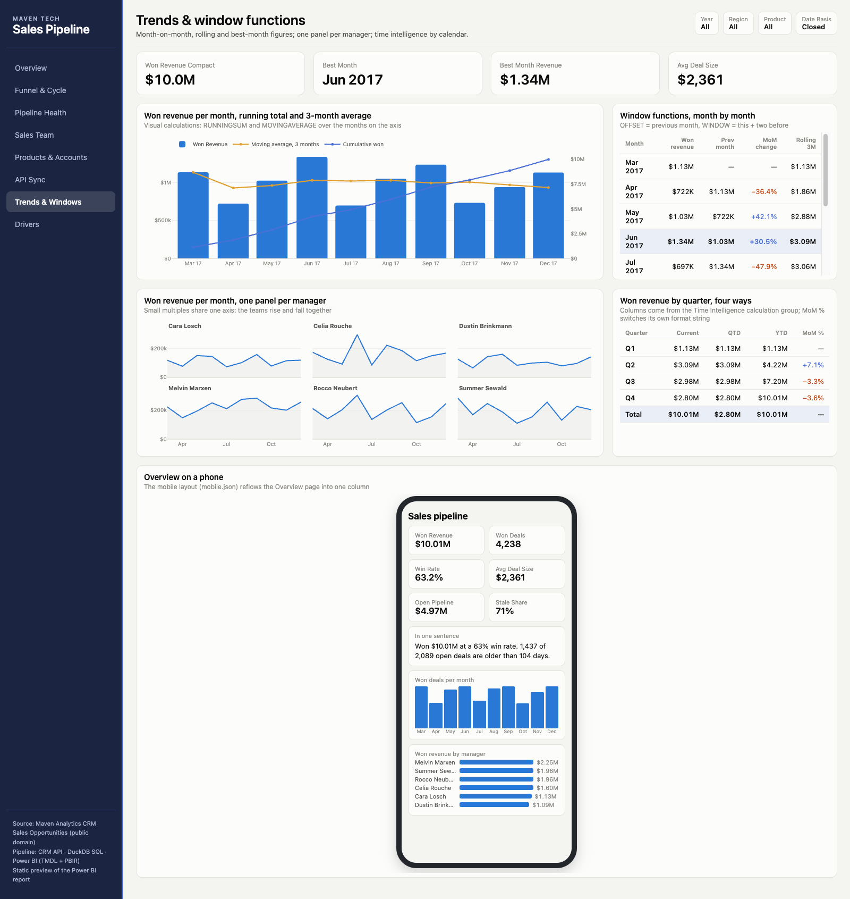
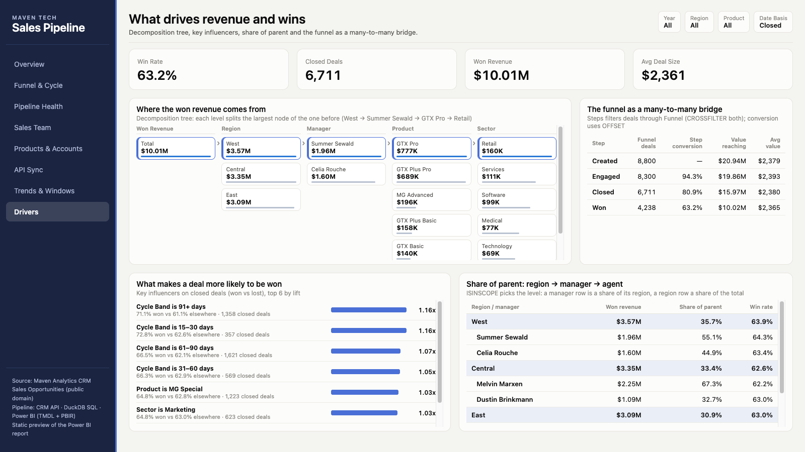
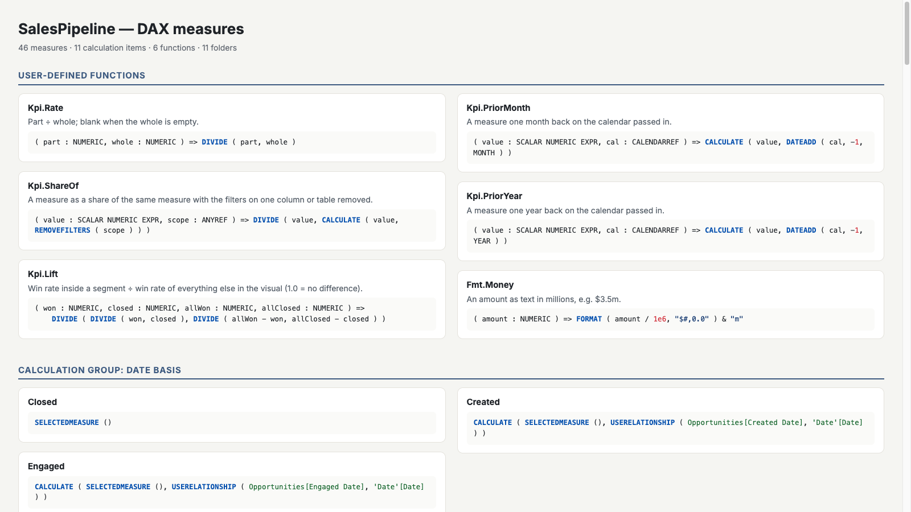

# Sales Pipeline: CRM API to Power BI

A B2B sales pipeline report fed from a CRM API. An incremental extractor pulls deals from a HubSpot-shaped REST API every month end. A DuckDB warehouse keeps every version of every deal, so it can rebuild the pipeline as it stood on each sync date. Power BI sits on top, with incremental refresh. The report answers four questions:

1. **How much did we win,** at what win rate, and who won it?
2. **Where do deals drop out,** and does a longer sales cycle change the odds?
3. **How much of the open pipeline is real?** How much is old deals nobody has closed?
4. **Can the data be trusted?** What did each API sync load, and did it hit throttling or errors?


## What the data shows (Mar–Dec 2017)

| | |
|---|---:|
| Won revenue | **$10.01M** from 4,238 deals |
| Win rate | **63.2%** (4,238 won of 6,711 closed) |
| Open pipeline at 31 Dec 2017 | 2,089 deals, $4.97M at list price |
| …of which stale (engaging > 104 days) | **1,437 deals, $3.51M (71%)** |
| Weighted forecast of the live part | $917K |

- **Most of the open pipeline is stale.** 104 days is how long 90% of closed deals took. Past that point a deal rarely closes, yet 1,437 engaging deals are older than that. The monthly snapshots show the stale part climbing from 0 in January to $3.51M in December, while open value peaked at $6.25M in October. A pipeline clean-up would cut the headline pipeline by more than two thirds.
- **Win rate barely differs between people or products.** All six managers sit between 62.1% and 64.4%, and products between 60% and 65%. Revenue differences come from team size and deal mix, not from closing skill. Melvin Marxen's team leads with $2.25M; Dustin Brinkmann's has more deals than three other teams but the lowest average deal size ($1,465).
- **Cycle length does not predict the outcome.** At first glance, deals closed within two weeks win only 55%. That turns out to be a quirk of the source data: every deal closed in April, July and October closed within about a week and won 49%. Outside those three months, quick closes win 67%, the same as every other band. The report states this on the chart instead of selling it as a finding.
- **1,425 deals have no account.** 1,088 of them are still open, so they cannot be routed or grouped by customer. That is a CRM hygiene issue worth fixing at the source.
- **Prices hold.** Won deals realise 99.8% of list price on average, so discounting is not where revenue leaks.

## Report pages

| Page | What it shows |
|---|---|
| **Overview** | KPIs; deals won vs lost per month; a one-sentence summary that follows the slicers; revenue and win rate by a dimension the user picks (sales agent / manager / region / product / sector). |
| **Funnel & Cycle** | Created → engaged → closed → won funnel; win rate and won/lost by days from engage to close; average cycle by month. |
| **Pipeline Health** | Open vs stale pipeline at each month-end sync; open value by deal age; which agents hold the stale deals; what-if sliders for the stale threshold and the forecast win probability. |
| **Sales Team** | Revenue by manager and agent; a manager scorecard. |
| **Products & Accounts** | Revenue by product and sector; price realisation against list; top accounts with their parent company. |
| **Account Value** | Pareto of won revenue by account with the cumulative share (58 of 85 accounts make 80%); an A/B/C class per account that follows the slicers; accounts per revenue band from a disconnected *Account Segment* table. |
| **API Sync** | One row per extraction run: requests, retries, 429s, 5xx responses, deals seen, versions added, watermark. |
| **Trends & Windows** | Monthly won revenue with a running total and 3-month moving average (visual calculations); a month-by-month table built on the window functions OFFSET, WINDOW and INDEX; a dashed linear trend (`LINESTX`) projected three months ahead; small multiples, one panel per manager; a quarter matrix whose columns come from the calendar-based Time Intelligence group. |
| **About & Data** | A data-flow diagram (API → DuckDB → Parquet → Power BI) and the source data dictionary, loaded by Power Query. The (i) buttons on Pipeline Health and Funnel open this page. |
| **Deal Detail** *(hidden, drillthrough)* | Right-click an agent or account → Drill through: the open deals behind it, oldest first, with a Back button. The clean-up call list. |
| **Agent Tooltip** *(hidden, tooltip page)* | 320 × 240 page shown on hover over the agent / manager bars: win rate, stale share, open deals. |
| **Drivers** | A decomposition tree of won revenue (region, manager, product, sector, account size); key influencers on won vs lost; a Sankey (AppSource custom visual) of where deals go, created → engaged → won / lost / still open; a region → manager → agent matrix where each row is a share of its parent (ISINSCOPE); the funnel as a many-to-many bridge. |
| **Diagnosis** | Why revenue fell in Q4 2017: month-over-month change, a volume / mix / price bridge per product (Q3 → Q4), a decomposition tree of the October drop, a stage-to-stage transition matrix for October, and a z-score of each agent's stale share. A button drills through to Deal Detail. |

The Overview and Pipeline Health pages also have a phone layout (`mobile.json` per visual): one column, KPIs two across, then the main charts.

### Report UX, filters and accessibility

All of this is written by `src/build_report.py`; nothing is edited by hand.

- **Filters at three levels.** Report: `Agent[Has Deals] = TRUE` (drops the five agents with no deals), locked. Page (Pipeline Health): `Stage[Is Open] = TRUE`, locked. The forecast's win rate and price realisation use `REMOVEFILTERS ( 'Date', Stage )`, so this filter does not turn them blank. Visual filters stay where they were (key influencers on closed deals, the Time Intelligence matrix).
- **Edit interactions.** On Pipeline Health, clicking an age band filters the agent tables; the KPI cards are set to *none* (`visualInteractions` in `page.json`).
- **Bookmarks and selection groups.** Two grouped tables share one slot on Pipeline Health. The buttons *Stale only* and *All open* are bookmarks that only switch which group is visible (`suppressData`, so the reader's filters stay).
- **Drillthrough and tooltip pages.** *Deal Detail* binds to `Agent[Sales Agent]` and `Account[Account]`; *Agent Tooltip* is attached to `bar_revenue_by` and `col_agents`. Both pages are hidden from navigation.
- **Hierarchy drill.** The Overview monthly chart uses the `Date[Calendar]` hierarchy (Year → Quarter → Month), expanded to month.
- **Conditional formatting.** Manager scorecard: *vs region* font colour comes from the measure `Win Rate vs Region Color` (green above the region, red below). Data bars on Stale Share and on deal age. Icon set (circles) on Account ABC.
- **Analytics lines.** Trend lines on the month-end snapshot chart. On the cycle-by-month chart: a constant line at 104 days, plus an average line. The average line is a reference line whose value is `[Avg Cycle Days]` at the visual total, so it is weighted by deals.
- **Accessibility.** Every visual gets alt text, taken from its title and subtitle or, for untitled visuals, from its fields. Tab order follows reading order: page title, KPIs, then charts and tables top-to-bottom and left-to-right, then the header slicers and the navigation. The generator asserts WCAG AA contrast (≥ 4.5:1) for every text colour; the old secondary grey (3.5:1) was replaced. Bar colours: blue passes 3:1. Amber (open) and grey (lost) do not, so those charts carry data labels and a legend, and colour is never the only cue.
- **Export.** `exportDataMode = AllowSummarized`: readers can export what a visual shows but not the underlying rows. This is a report-wide setting; Power BI has no per-role export switch, so it also covers the External Partner audience.
- **Object-level security guard.** The External Partner role cannot see `Account[Annual Revenue]`, `Account[Employees]` or the sync tables. `build_report.py` fails the build if a visual on any page except API Sync references them. This is a static check of the generated JSON, not *View as role* in Desktop.
- **Paginated report.** `reports/paginated/Stale Deals.rdl` (RDL 2016) is written by the same script: stale deals per agent, grouped by manager with a page break per manager, for printing and the monthly review. The DAX dataset points at the published model through a placeholder workspace. It is checked as well-formed XML only and has not been opened in Power BI Report Builder.
- **Not done: Service dashboard.** A pinned dashboard exists only in the Power BI service. There is no published workspace here, so there is none.

Header slicers on every page: **Year**, **Region**, **Product** and **Date Basis**. Date Basis switches the date axis between the closed, engaged and created date.

| | |
|---|---|
|  |  |
|  |  |
|  |  |
|  | |

## How it works

```
CRM REST API (HubSpot v3 shape: bearer auth, cursor paging, modified-since search, 429/5xx)
  → incremental extractor: watermark on last-modified, every deal version appended to raw
  → DuckDB SQL: staging (typo fixes) → star schema + month-end pipeline snapshots
  → 13 data tests (all must pass, or nothing is exported)
  → Parquet marts
  → Power BI semantic model (TMDL, incremental refresh) + report (PBIR)
```

### Extraction (`src/extract.py`)

- **Reference objects reload in full:** owners, companies and products are small.
- **Deals load incrementally.** Each run searches for deals modified on or after the last watermark. It uses "on or after", not "after", so a change made on the watermark day is never missed. The first run is a full load of 358 deals; the 12 later runs pull only what changed, at 7–19 requests each.
- **Every version is kept.** A CRM only knows a deal's current state. Appending each version (keyed on deal + modified time) lets the warehouse answer "what did the pipeline look like on 30 June?".
- **Retries.** 429 waits for the server's `Retry-After`. 5xx and connection errors back off exponentially. Other 4xx errors fail fast, because retrying a bad request never helps. Every run is logged with its request, retry and error counts, and that log is the API Sync page.

### Warehouse (`sql/`)

- **Staging** fixes the source defects, one rule each: product "GTXPro" → "GTX Pro", sector "technolgy" → "Technology", country "Philipines" → "Philippines".
- **`fact_opportunity`**: current state, one row per deal, with cycle days, age and the bands used on the charts.
- **`fact_pipeline_snapshot`**: for each sync date, the latest version of each deal known at that date (58,908 rows).
- **`fact_funnel`**: one row per deal per funnel step reached.
- **`fact_stage_transition`**: for each sync, every deal's stage at the previous sync next to its stage now (`(new)` if it was not there yet); deals already closed are left out (28,478 rows).
- `dim_date` runs to April 2018 so the trend line can be projected past the last close date.

### Semantic model

- **27 tables, 21 relationships, 81 measures, 7 user-defined functions, 3 roles, 2 perspectives**, compatibility level 1702. Every measure has a description and a format string.
- **Incremental refresh** on both fact tables:
  - *Opportunities* keeps 3 years and refreshes the last 15 months. The table is partitioned on created date, and deals can close up to about a year after they are created. *Detect data changes* polls the latest modified date, so a partition is only refreshed when a deal in it changed.
  - *Pipeline Snapshots* keeps 3 years and refreshes only the latest month, since past snapshots never change.
  - `RangeStart` / `RangeEnd` are the standard DateTime parameters, and the partition query filters on them.
- **Calculation group** *Date Basis* (closed / engaged / created), using `USERELATIONSHIP` on inactive date relationships.
- **Field parameters** *Analyze By* (columns) and *Metric* (measures), and **what-if parameters** for the stale threshold and the win probability.
- **Row-level security:**
  - *Sales Manager* is dynamic. An access table maps a login to a manager; a blank manager means a regional VP who sees the whole region.
  - *West Region* is a static role.

### Power Query (`expressions.tmdl`, M tables)

The marts are cleaned in SQL, but the model also carries a Power Query path that reads the **raw Maven CSVs** (`data/raw/`, parameter `RawFolder`). It exists to check the warehouse against the source, and every step has a readable name.

- **Staging queries, not loaded** (`raw_pipeline`, `raw_accounts`, `raw_teams`, `raw_pipeline_errors`): plain M expressions, so nothing lands in the model. The loaded tables reference them (`Source = raw_pipeline`) the way *Reference* does in the Power Query editor.
  - `raw_pipeline`: Promoted Headers → Kept Columns → Dropped Blank Rows → Typed → Errors Replaced → Removed Error Rows → Fixed Typos (GTXPro) → Filled Account ("(no account)").
  - `raw_pipeline_errors`: *Keep Errors* on the same typed table, for auditing what the main query drops.
  - `raw_teams`: Trim + Clean on headers and values, Rename (`sales_agent` → `Sales Agent`…), Typed, Remove Duplicates.
- **Source Reconciliation** (table, API Sync page): raw deals and close value per stage, *Group By* → *Append* (raw + total row) → *Merge* with the mart totals → difference columns. All 8 rows show a difference of 0.
- **Agent Login Check**: *Split Column* on the agent name (first / last) builds the expected login e-mail, *Merge* with the agent table and the RLS access table. 35 agents, 0 mismatches.
- **Sync Run Events**: *Unpivot* of the sync log into one row per run per response type (answered first time / 429 / 5xx). The three parts add up to the request count exactly, so the API Sync page shows them as a stacked column.

Correction to the original plan: it assumed the teams file has a header `'Sales agent '` with a trailing space. It does not; the header is `sales_agent`. The trim/clean steps are kept as a guard, but on this file they change nothing.

### Two variants of the model: local and Fabric

`build_model.py` writes two models from the same code:

| | `SalesPipeline.SemanticModel` (local) | `SalesPipeline.Fabric.SemanticModel` |
|---|---|---|
| Source | Parquet files (`DataFolder`) + raw CSVs (`RawFolder`) | `Sql.Database(SqlEndpoint, LakehouseDb)` on a Fabric Lakehouse SQL endpoint |
| Storage | all Import | *Pipeline Snapshots* DirectQuery; the 7 dimensions it uses Dual; the rest Import |
| Aggregation | — | *Snapshot Agg*, hidden Import table, `alternateOf` sums/count over Pipeline Snapshots by date, agent, stage and age band |
| Incremental refresh | Import partitions | *Opportunities* hybrid: Import history + latest partition in DirectQuery |
| Relationships | 21, all regular | 25; 24 regular, 1 limited (*Funnel → Opportunities*, because Opportunities is hybrid). The build prints this classifier |

All 7 dimensions are Dual (the plan said 4), so no relationship between a DirectQuery fact and its dimensions becomes limited.

**Query folding.** The SQL source folds: `Table.SelectRows` on `RangeStart`/`RangeEnd` should become a `WHERE created_date >= … AND created_date < …` in the native query. That is what we *expect*. It has **not been observed**: there is no Fabric Lakehouse behind `SqlEndpoint` yet, so "View native query" has never been run. The Power Query parts are checked by Microsoft's `powerquery-parser` (`tools/m-validate`, 28/28 and 21/21 expressions parse) and by TOM, not by running them.

### Thin report on a shared model

`powerbi/PipelineReview.Report` is a *thin report*: four pages (Overview, Pipeline Health, Sales Team, About & Data, plus the two hidden pages) with no model of its own. It connects `byConnection` to the published dataset `SalesPipeline` in the workspace *Sales Pipeline [Prod]*.

- **Local model** (the main `.pbip`): the report and the model ship together. Good for building and for one author.
- **Shared model**: one certified dataset, many thin reports. RLS, measures and refresh live in one place, so two reports cannot disagree on "win rate".
- **Why no dataflow:** the cleaning already happens once, in the DuckDB warehouse, and the Lakehouse would be the shared layer in Fabric. A dataflow would be a third copy of the same transformations.

The workspace does not exist; the thin report validates against the PBIR schema only.

### Measures, calculated columns and calculated tables

All three are used, each where it fits:

- **Calculated tables** (DAX): *Steps*, *Stale Threshold*, *Win Probability*, the field parameters.
- **Calculated columns** on *Account*, only where a column is needed (an axis, a slicer, a fixed grouping):
  - `Lifetime Won Revenue = CALCULATE ( [Won Revenue] )`: context transition, the row becomes a filter.
  - `Deal Count = COUNTROWS ( RELATEDTABLE ( Opportunities ) )`.
  - `Static ABC`: A/B/C on all-time revenue, so it can sit in a slicer.
  - Account ID is the table key, so the two context-transition columns do not depend on each other.
- **Measures** for anything that should follow the slicers. `Account ABC` is the measure twin of `Static ABC`: it re-ranks accounts inside the current Year/Region/Product selection. A column can't do that, because it is computed once at refresh.
- In the Fabric variant *Account* is Dual, and a Dual table cannot hold aggregating calculated columns, so the three columns are left out there. They would move into the Lakehouse view.

New measures:

| Measure | Pattern |
|---|---|
| Active Accounts | `DISTINCTCOUNT` over won deals |
| Accounts Touched | `CALCULATE ( COUNTROWS ( Account ), Opportunities )`: the expanded table carries the filter to Account |
| Discount Leakage, Catalog Value Won | `SUMX` row by row; `RELATED ( Product[List Price] )` |
| Avg Revenue per Account | `AVERAGEX ( VALUES ( Account[Account] ), [Won Revenue] )` |
| Above-Average Deal Revenue | `FILTER` inside `CALCULATE`. The average is stored in a `VAR` first. Written inline, `[Avg Deal Size]` would be re-evaluated for each deal (context transition), and each deal would be compared with itself |
| Won Revenue Large Accounts | `KEEPFILTERS`, so a Size Band slicer intersects instead of being overwritten |
| Region Win Rate, Win Rate vs Region | `ALLEXCEPT ( Agent, Agent[Region] )`, on the manager scorecard |
| Revenue Covered by RLS, RLS Coverage | `TREATAS ( VALUES ( 'Manager Access'[Manager] ), Agent[Manager] )`: a relationship that exists only in the query. Should read 100% |
| Top 10 Accounts Revenue, Account Cumulative Share, Account ABC | table functions `TOPN`, `WINDOW`, `ADDCOLUMNS` over `ALLSELECTED ( Account[Account] )` |
| Selected Metric | the *Metric* field parameter on the Overview bar chart |

About *Selected Metric*: Power BI Desktop would take the *Metric* field-parameter column directly in the chart's Y well. `pbir validate`, however, rejects a column in a measure-only role. So the chart uses `SWITCH ( SELECTEDVALUE ( Metric[Metric Order] ) … )`, whose format string follows the pick. The slicer is still the field parameter.

**DAX query files** (`powerbi/SalesPipeline.SemanticModel/DAXQueries/`, for DAX query view):
- `accounts-touched.dax` checks that the expanded-table measure equals `DISTINCTCOUNT` on every manager.
- `keepfilters.dax` shows replace vs intersect side by side.
- `ols-test.dax` is the object-level-security test for *External Partner*.

The expected results are written in each file, computed in DuckDB. **None has been run in Power BI yet.**

### Problem → DAX tool, in this model

| Problem | Tool | Where |
|---|---|---|
| Same measures by closed, engaged or created date | `USERELATIONSHIP` in a calculation group | *Date Basis* |
| MTD/QTD/YTD/prior period without writing each measure 8 times | calendar-based time intelligence + calculation group | *Time Intelligence* |
| Share of the level above in a hierarchy | `ISINSCOPE` + `REMOVEFILTERS` (`Kpi.ShareOf`) | Share of Parent |
| Previous / rolling / best month on the axis | `OFFSET`, `WINDOW`, `INDEX` | Trends |
| Do the RLS rows cover every manager? | `TREATAS` (virtual relationship) | RLS Coverage |
| Respect the user's slicer inside a fixed filter | `KEEPFILTERS` | Won Revenue Large Accounts |
| Compare with the region, whatever agent filter is on | `ALLEXCEPT` | Region Win Rate |
| Count accounts reached through deals | expanded table as filter | Accounts Touched |
| Steps filter deals through a bridge | `CROSSFILTER ( …, BOTH )` in the measure | Value Reaching Step |
| Rank and Pareto that follow the slicers | `ADDCOLUMNS` / `TOPN` / `WINDOW` over `ALLSELECTED` | Account ABC, Account Cumulative Share |
| One chart, user picks the measure | field parameter + `SWITCH` with a dynamic format string | Selected Metric |

### Why this design

Storage mode, table by table:

```
Is the table small, or does it change at most daily?        → Import   (dimensions, Opportunities history, Sync Runs)
Is it big and needed up-to-the-minute, on a SQL source?      → DirectQuery (Pipeline Snapshots in the Fabric variant)
   └ a dimension joined to both Import and DirectQuery facts → Dual     (Date, Account, Product, Agent, Stage, bands)
   └ most visuals ask for totals, not single deals           → + Import aggregation (Snapshot Agg)
Do only the newest rows need to be live?                     → Hybrid incremental refresh (Opportunities)
Is the data already Delta tables in OneLake?                 → Direct Lake (not built here: no Lakehouse yet)
```

The local model is all Import, because the data is 8,800 deals and 59k snapshot rows, about 1 MB of Parquet. The Fabric variant shows how the same model scales without changing a measure.

### Performance

- **Removed `Modified At` from the model.** It only fed change detection for incremental refresh, and the `pollingExpression` reads it from the source itself (`List.Max`), so the model no longer stores it. Partition queries drop it with `Table.RemoveColumns`.
- **Every helper column is hidden**: sort-by columns, keys and band bounds. The build fails if a sort-by column is visible. Every numeric column has a format string.
- **Highest-cardinality columns** (counted in DuckDB, a proxy for VertiPaq dictionary size):
  - Opportunity ID: 8,800 values, needed as the key.
  - close value: 2,051.
  - price realisation: 2,124.
  - Nothing else is above 430.
- **Not measured:** VertiPaq Analyzer and Server Timings need Power BI Desktop / DAX Studio on Windows. No storage size or query timing in this README is measured.
- **Visual calculation limits**, as documented by Microsoft:
  - Visual calculations (Rank, running sum, moving average) exist only on their visual. They cannot be reused by another visual or by the model.
  - They can only use fields that are on the visual.
  - The pbir validator flags them as INVALID_FORMAT warnings.

### AI in this project

- **What an LLM wrote.** The Python generators (`build_model.py`, `build_report.py`, `build_preview.py`), and through them every TMDL and PBIR file, were written with an LLM (Claude). No TMDL or PBIR file is edited by hand.
- **How it is checked, by machines:**
  - 13 SQL data tests on the warehouse.
  - Reference and best-practice rules in `build_model.py`.
  - Microsoft TOM (`Model.Validate`, round-trip).
  - Microsoft's Power Query parser.
  - `pbir validate` against schema and model.
  - The DuckDB twin (`build_preview.py`), which recomputes every number on the screenshots independently of DAX.
- **What a person still has to check:** run the DAX query files in DAX query view, open the report in Desktop, and compare the visuals with the HTML twin. That has not happened yet.

### Data that may go to an LLM

- **Scope for Copilot / AI tools is the *Sales* perspective:** deals, pipeline, products, agents and accounts. The *Data Ops* perspective (API log, RLS table, reconciliation) is not part of it.
- **Object-level security** (*External Partner*) hides *Sync Runs*, *Sync Run Events*, *Agent Login Check* and the accounts' revenue and headcount. Anything that queries the model as that role, an AI tool included, cannot see them.
- *Manager Access* holds login e-mails. It is a hidden table and is outside the *Sales* perspective.
- **Rule for MCP / modelling agents:** a Power BI modelling MCP server may only connect to a development copy of the model, never to the published production dataset. The data here is public-domain sample data, but the rule is written for the real CRM it imitates.

### Power BI methods, beginner to expert

| Level | Method | Where |
|---|---|---|
| Beginner | Star schema, one-to-many relationships, a marked date table, sort-by columns, display folders | Semantic model |
| Beginner | Cards, bar/column/line charts, tables, slicers; KPI row on every page | All pages |
| Beginner | Hierarchies: *Calendar* (Year > Quarter > Month > Date) and *Sales Team* (Region > Manager > Agent) | Date, Agent |
| Intermediate | Inactive relationships switched on with `USERELATIONSHIP` inside the *Date Basis* calculation group | Every date axis |
| Intermediate | Field parameter (*Analyze By*) and what-if parameters (stale threshold, win probability) | Overview, Pipeline Health |
| Intermediate | Row-level security: dynamic (*Sales Manager*, login → manager table) and static (*West Region*) | Roles |
| Intermediate | Perspectives (*Sales*, *Data Ops*) and synonyms for Q&A / Copilot (`cultures/en-US.tmdl`) | Model |
| Intermediate | Matrix with a calculation group on columns | Trends |
| Advanced | DAX user-defined functions (`functions.tmdl`): `Kpi.Rate`, `Kpi.ShareOf`, `Kpi.Lift`, `Kpi.PriorMonth`, `Kpi.PriorYear`, `Fmt.Money`, called by the measures | Model |
| Advanced | Calendar-based time intelligence: a *Gregorian* calendar on Date drives the *Time Intelligence* calculation group (Current, MTD, QTD, YTD, Prior Month, MoM %, Prior Year, YoY %) | Trends |
| Advanced | Dynamic format strings: *Won Revenue Compact* switches $M/$K; MoM % and YoY % calculation items set their own format | Trends |
| Advanced | Visual calculations: `RUNNINGSUM`, `MOVINGAVERAGE`, `RANK` | Trends, Sales Team |
| Advanced | Small multiples (line chart split by manager) | Trends |
| Advanced | Mobile layout for the Overview page | Overview |
| Advanced | Incremental refresh with change detection on both fact tables | Model |
| Expert | Window functions `OFFSET` (previous month, step conversion), `WINDOW` (rolling 3 months), `INDEX` (best month) | Trends, Drivers |
| Expert | `ISINSCOPE` share of parent across a 3-level matrix | Drivers |
| Expert | Many-to-many through a bridge: *Steps* → *Funnel* → *Opportunities* with `CROSSFILTER(…, BOTH)` inside the measure, not on the relationship | Drivers |
| Expert | AI visuals: decomposition tree and key influencers | Drivers |
| Expert | Object-level security: *External Partner* cannot see the Sync Runs table or account revenue and headcount | Roles |
| Expert | Best-practice rules in `build_model.py` (every reference resolves, descriptions, format strings, keys, hidden foreign keys), then Microsoft TOM 19.117 and `pbir validate` in CI (`.github/workflows/ci.yml`) | Build |

### Data tests (`sql/90_tests.sql`)

- 8,800 unique deals; won revenue reconciles to the source ($10,005,534); stage counts match.
- Won deals have a value and close on or after they are engaged; lost deals carry no value.
- Every deal maps to a product, agent and account (or the explicit "no account" row), and the source typos are gone.
- The last snapshot equals the current state, and no deal ever moves backward between snapshots.
- The watermark only moves forward; only the first sync is a full load.
- RLS seeds reference real managers and regions.
- Every deal open at one sync shows up in the stage transitions at the next one.
- The 90th percentile of engage-to-close is 104 days, the default stale threshold.

### Every DAX measure

`reports/dax.html` lists every measure, calculation item and user-defined function with its description and format string, generated from the TMDL by `../tools/dax_gallery.py`.

[](reports/screenshots/dax.png)

### Diagnosis walkthrough: the Q4 2017 dip

Won revenue fell from $2.98M in Q3 to $2.80M in Q4 (−$180K). The bridge splits that into **volume −$145K** (fewer deals won), **mix −$54K** (the won deals shifted towards cheaper products) and **price +$19K**. The three effects add up to the change exactly (*Bridge Check* = 0). So prices held; fewer deals closed.

The drop is concentrated in October, which fell 41% from September; November and December recovered. The decomposition tree puts most of October's drop in the East region. The plan for this page said "October → November", but November was a rise, so the walkthrough uses September → October and Q3 → Q4 instead. The October transition matrix shows where open deals went: of 2,409 deals in Engaging at the end of September, 2,287 were still there at the end of October, 54 were won and 68 lost.

No agent stands out on stale deals: the highest z-score is +1.31 (Hayden Neloms), below the usual cut-off of 2.

Other analysis measures: *P90 Cycle Days* (`PERCENTILEX.INC`, 104 days) now sets the default stale threshold instead of a hard-coded number; *Accounts to 80%* and the A/B/C class drive the Pareto; *Revenue Trend Forecast* fits a straight line with `LINESTX` over the monthly won revenue.

## Dev lifecycle (pbi-kit)

The shared CI/CD kit is vendored at `tools/pbi-kit` (BPA rules + runner, DAX tests, fabric-cicd deploy, CI template, docs). Project-specific parts: `bpa/project-rules.json`, `powerbi/parameter.yml`, the asserted DAX tests in `powerbi/SalesPipeline.SemanticModel/DAXQueries/test-*.dax`, and `.github/workflows/ci.yml`.

### Who does what

| Role | Owns | Works in |
|---|---|---|
| Data engineer | `src/extract.py`, `src/mock_crm.py`, `sql/`, `src/pipeline.py` (13 SQL tests) | git, branch → PR |
| Modeler (central BI) | `src/build_model.py` → both semantic models, `bpa/project-rules.json`, DAX tests | git, branch → PR; Tabular Editor for BPA/C# scripts on Windows |
| Report author (sales ops) | `src/build_report.py` → `SalesPipeline.Report`, `PipelineReview.Report` | git; or Power BI Desktop on a branch |
| Workspace admin | workspaces `Sales Pipeline [Dev/Test/Prod]`, service principal, GitHub environments `Test`/`Prod` (approvers) | Power BI Service / Entra ID / GitHub settings |

### Ownership pattern

`SalesPipeline` (semantic model) belongs to **central BI**: measures, RLS roles and refresh live there, and only the modeler changes them. `PipelineReview` is a **thin report owned by sales ops**: it binds to the published `SalesPipeline` and has no model of its own, so sales ops can change pages without touching a measure, and two reports cannot disagree on "win rate". A change to a measure goes through a PR that central BI reviews; a change to a page in the thin report does not need them.

### Daily git flow

```bash
git switch -c feat/win-rate-note                 # 1 branch per change
# edit src/build_model.py (never the generated TMDL)
uv run python src/build_model.py                 # regenerate
git diff powerbi/                                # review the TMDL, it is plain text
tools/pbi-kit/bpa/bpa.sh powerbi/SalesPipeline.SemanticModel/definition --rules bpa/project-rules.json
python3 tools/pbi-kit/dax-tests/daxtest.py powerbi/SalesPipeline.SemanticModel/DAXQueries --offline
git commit -am "Win Rate: describe the blank case" && git push -u origin HEAD   # → PR, CI must pass
```

Lineage tags are deterministic (the n-th tag of a build), so rebuilding without a change leaves `git diff` empty and a one-measure edit shows as a one-measure diff. A real one, from changing the description of *Win Rate*:

```diff
--- a/powerbi/SalesPipeline.SemanticModel/definition/tables/_Measures.tmdl
+++ b/powerbi/SalesPipeline.SemanticModel/definition/tables/_Measures.tmdl
@@ -25,7 +25,7 @@
 		displayFolder: Deals
 		lineageTag: ffa151c2-b9bf-501f-8741-013b2649ed94
 
-	/// Won ÷ closed (won + lost). Open deals are not counted.
+	/// Won ÷ closed (won + lost). Open deals are not counted; blank when nothing closed.
 	measure 'Win Rate' = Kpi.Rate ( [Won Deals], [Closed Deals] )
 		formatString: #,0.0%;-#,0.0%;#,0.0%
 		displayFolder: Deals
```

Adding a new object still shifts the tags generated after it (they are numbered by position). That only matters to Power BI if a renamed object must keep its identity; this project regenerates everything from code.

### CI/CD: what runs and why this option

`.github/workflows/ci.yml`: **data tests** (pipeline + 13 SQL tests) → generate models → **BPA** (both models, fails on any error) → **TOM** validate → M parser → **DAX tests offline** → PBIR build + validate → HTML twin → `parameter.yml` check → *(main only)* **deploy Test** (fabric-cicd) → refresh → **DAX tests online** (asserts = the SQL test numbers) → **approval** (GitHub environment `Prod`, required reviewers) → **deploy Prod**.

Of the four Fabric CI/CD options (`tools/pbi-kit/docs/cicd-options.md`), this project uses **Git + fabric-cicd from GitHub Actions**:
- Everything in the model is generated from Python, so the repo is already the source of truth; Fabric Git integration would add a second writer (the Service) to the same files.
- A deployment pipeline alone cannot run the data tests, BPA or DAX asserts before Prod; the Actions job can, and stops the release when one fails.
- One small team, one repo: no Azure DevOps to maintain. fabric-cicd swaps `DataFolder`/`RawFolder`/`SqlEndpoint`/`LakehouseDb` per environment from `powerbi/parameter.yml`; a deployment pipeline would need the same as deployment rules, clicked per stage.
- Fabric Git integration on the `dev` workspace stays useful for people who edit in the Service (12-s9/12-s10 below).

### BPA

`tools/pbi-kit/bpa/bpa.sh` runs the 71 Microsoft rules + 3 kit rules + `bpa/project-rules.json` on TOM (no Tabular Editor needed). Project rule `PROJ_CRM_WIN_RATE_CLOSED_ONLY` (error): a measure named "… Win Rate" must build on `[Win Rate]` or `[Closed Deals]`, never `[Deals]`, which includes open deals.

| | error | warning | info |
|---|---:|---:|---:|
| SalesPipeline before | 8 | 134 | 179 |
| SalesPipeline after | 0 | 113 | 179 |
| SalesPipeline.Fabric before | 8 | 139 | 156 |
| SalesPipeline.Fabric after | 0 | 118 | 156 |

Fixed in `src/build_model.py`: `Close Value`/`Open Value` (and the snapshot versions) summarize by none; 1-decimal percentages use `#,0.0%;-#,0.0%;#,0.0%`; day counts use `#,0`. Ignored on purpose (annotation `BestPracticeAnalyzer_IgnoreRules`, reasons in `BPA_IGNORE`): the 4 text measures (no format string), `Won Revenue Compact` and `Selected Metric` (dynamic format strings), `Agent Stale Z-Score`, `Win Rate Lift`, `Last Sync` (signed / ratio / date formats). Left as warnings: whole-number percentages (`0%`, on purpose), hidden-FK and floating-point warnings, `ISAVAILABLEINMDX` and other model-size hints. Results: `evidence/bpa-*.json` (before: `evidence/bpa-before-*.json`).

### DAX tests

`DAXQueries/test-key-totals`, `test-stage-counts`, `test-stale-default` (`.dax` + `.assert.json`) assert numbers that `sql/90_tests.sql` already proves on the warehouse: 8,800 deals, $10,005,534 won, 4,238 won / 2,473 lost / 1,589 engaging / 500 prospecting, win rate 63.15%, P90 = stale default = 104 days. Offline they pass syntax, structure and model-reference checks; **the asserts have not been executed** (that needs the published model). `SalesPipeline` has RLS roles, so the online step needs a user token (`PBI_ACCESS_TOKEN`): Microsoft rejects service principals on `executeQueries` for RLS models.

### Steps left for you (Service / Desktop)

1. **12-s8 repo + PR:** create the GitHub repo, push, open a PR (e.g. a new Pareto measure), let `ci` pass, merge.
2. **12-s15 branch protection:** `main` requires a PR and the status check `ci` (`tools/pbi-kit/ci/branch-protection.md`).
3. **14-s5 service principal:** app registration + federated credential for GitHub OIDC, tenant settings "Service principals can use Fabric APIs", add it as Member of the Test/Prod workspaces (`tools/pbi-kit/docs/service-principal.md`).
4. **Workspaces:** create `Sales Pipeline [Dev]`, `[Test]`, `[Prod]`; GitHub environments `Test` (vars `FABRIC_WS_TEST`, `PBI_DATASET_NAME=SalesPipeline`; secrets `AZURE_CLIENT_ID`, `AZURE_TENANT_ID`, `PBI_ACCESS_TOKEN`) and `Prod` (var `FABRIC_WS_PROD`, required reviewers).
5. **14-s7 parameter.yml:** replace the placeholder share paths / endpoints in `powerbi/parameter.yml` with real ones; `deploy.py --dry-run` shows which file each one hits.
6. **14-s6 / 14-s8 / 14-s9:** merge to `main` → the workflow deploys Test, refreshes, runs the DAX asserts, waits for approval, deploys Prod.
7. **12-s9 / 12-s10 Fabric Git:** connect `Sales Pipeline [Dev]` to branch `dev`, folder `powerbi/`; change one thing in the Service → Commit; change one in the repo → Update.
8. **12-s16 / 12-s17 deployment pipeline:** Dev → Test → Prod pipeline on the three workspaces, Compare, deployment rules for `DataFolder` / `SqlEndpoint`.
9. **12-s11 / 12-s12 / 12-s13 Tabular Editor (Windows):** run `tools/pbi-kit/te/format-check.csx`; run `tools/pbi-kit/bpa/te2-bpa.ps1 -Model powerbi/SalesPipeline.SemanticModel/definition -ProjectRules bpa/project-rules.json` and compare with `evidence/bpa-SalesPipeline.json`.
10. **14-s4:** the four options are in `tools/pbi-kit/docs/cicd-options.md`; the choice is above.

Not run here: the workflow itself (only YAML-parsed), any publish, refresh or online DAX query, Tabular Editor.

## Honest notes

- **The API is a local stand-in** (`src/mock_crm.py`). No public CRM has real pipeline data. The mock speaks the parts of HubSpot's CRM v3 protocol an extractor has to get right: bearer auth, cursor paging, a modified-since search, a rolling rate limit and a deterministic 502 every 53rd request. Pointing the extractor at a real HubSpot portal needs a private-app token and the same property names. That has not been tested here.
- **The history is replayed.** The source only dates two events per deal (engaged and closed). The mock reconstructs each deal's state on a given day from those dates. So "created" = engaged date, and the 500 deals still in Prospecting have no date at all. They first appear on the export date, 31 Dec 2017, which is why the 0–30 day age band holds 518 deals.
- **No lead source.** The dataset has no lead-source field, so the report cuts by agent, manager, region, product and sector instead.
- **Incremental refresh is designed and validated, not benchmarked.** The model reads Parquet files, and file sources do not *query-fold*: Power BI still reads the whole file and filters it afterwards. The partitioning, rolling window and change detection all work, but the speed benefit needs a source that folds, such as a SQL database. Swapping the source is a change to one M expression. Incremental refresh also only partitions after publishing to the Power BI service; Desktop loads the `RangeStart`–`RangeEnd` window.
- **Power Query is parsed, not run.** The M is checked by Microsoft's parser and TOM; no query has been executed by the Power Query engine.
- **Never opened in Power BI Desktop.** Everything was built and checked on a Mac. The DAX is validated for structure only: TOM parses it and every reference resolves, but no query has run against the model.
- **The AI visuals in the HTML twin are approximations computed in Python.** The decomposition tree there splits the largest node at each level; key influencers is a plain lift (win rate in the segment ÷ win rate outside it, closed deals only). Power BI fits its own model, so its ranking may differ. In this data every factor sits within about 20% of 1.0x, so no factor predicts a win strongly.
- **The mobile layout is unverified.** `mobile.json` uses pbir's percent-of-canvas positions; `pbir validate` does not check those files.
- **The Sankey is an AppSource visual.** It is registered in `report.json` (`publicCustomVisuals`) by its GUID (Microsoft Sankey 3.5.0.0). The visual package itself is fetched by Power BI on open, so its rendering has not been seen here.
- **`pbir validate` warns on visual calculations.** It reports the three visual calculations (Rank, Cumulative won, Moving average, 3 months) as INVALID_FORMAT, because it expects every field to be `Table.Field`. It is a warning, not an error.
- **The trend line is a straight line through 10 months.** It rises about $400 a month, which is flat; the three months after December 2017 are a projection, not a forecast with any skill. Power BI's built-in forecast (analytics pane) was not used because that chart has several series, and it only works on a single-series line.
- **The variance bridge and trend numbers come from Python.** The expected results in `powerbi/queries/variance-bridge.dax` and `trend-forecast.dax` were computed in the HTML twin; the DAX queries have not been run.
- **YoY % is mostly blank.** Deals only close from March to December 2017, so there is no prior year to compare with.
- **The source data has quirks** (see the cycle-length finding above). Maven's dataset is partly synthetic, so patterns that are too regular are flagged rather than reported.

## Run it

```bash
uv sync
uv run python src/pipeline.py        # download → API syncs → warehouse → tests → parquet
uv run python src/build_model.py     # powerbi/SalesPipeline.SemanticModel + SalesPipeline.Fabric.SemanticModel (TMDL)
uv run python src/build_report.py    # powerbi/SalesPipeline.Report + PipelineReview.Report (PBIR) + pbir validate
(cd tools/m-validate && npm ci) && node tools/m-validate/validate.mjs powerbi/SalesPipeline.SemanticModel/definition
uv run python src/build_preview.py   # reports/dashboard.html (offline HTML twin)
python3 ../tools/dax_gallery.py .    # reports/dax.html
```

To run the extractor by hand against the mock API:

```bash
uv run python src/mock_crm.py &      # http://127.0.0.1:8765
uv run python src/extract.py --as-of 2017-12-31
```

Open `powerbi/SalesPipeline.pbip` in Power BI Desktop. The semantic model reads `data/marts/*.parquet`.

**Built on a Mac, without Power BI Desktop.** The model is checked with Microsoft's Tabular Object Model: `tools/tmdl-validate` deserialises it, prints the refresh policies, runs `Model.Validate()` and round-trips the TMDL. The report passes `pbir validate` for schema and field references. It has **not yet been rendered in Power BI Desktop**, so visual details may need a touch-up on first open.

The screenshots come from `reports/dashboard.html`. It is an HTML twin of the report's default state (all years, regions and products; Date Basis = Closed; Analyze By = Manager; stale after 104 days; historical win rate), computed in DuckDB with the same rules as the DAX.

## Source & licence

The data is Maven Analytics' [CRM Sales Opportunities](https://mavenanalytics.io/data-playground) dataset, in the public domain. The download is pinned by SHA-256 so the numbers never drift. Maven Tech is a fictitious company.
