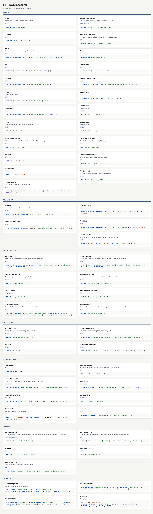

# F1 Analytics: 75 years of Formula 1

End-to-end analytics project on the Kaggle dataset
[Formula 1 World Championship (1950–2024)](https://www.kaggle.com/datasets/rohanrao/formula-1-world-championship-1950-2020):
14 raw CSVs → DuckDB SQL warehouse → Python statistics → Power BI report.

```
Kaggle CSVs ──► sql/10_staging ──► sql/20_marts (star schema) ──► sql/30_analytics
                                                  │
                                src/driver_skill.py (fixed-effects regression)
                                                  │
                                sql/90_tests (13 data-quality checks, build fails on any)
                                                  │
                    ┌─────────────────────────────┴───────────────────────────┐
         data/marts/*.parquet                                        reports/insights.html
                    │                                                (Plotly, 8 findings)
     src/build_model.py → powerbi/F1.SemanticModel (TMDL, 25 tables, 32 relationships, 92 measures, 4 UDFs, 3 roles)
     src/build_report.py → powerbi/F1.Report (PBIR, 7 pages)
```

## Run

```bash
uv sync
uv run python src/pipeline.py          # download (no Kaggle key needed), build, test, export
uv run python src/analysis.py          # reports/insights.html
uv run python src/build_model.py       # Power BI semantic model
uv tool install pbir-cli && uv run python src/build_report.py   # Power BI report (~5 min)
```

## Workflow

```
Kaggle CSVs ─► DuckDB SQL (staging, marts, tests) ─► Parquet marts ─┐
data/raw/*.csv ─────────────────────────────────────────────────────┼─► PBIP: F1.SemanticModel (TMDL) + F1.Report (PBIR)
                                                                    │        opened and refreshed in Power BI Desktop
                                                                    └─► Publish to a workspace ─► Power BI app
```

Everything left of PBIP is code in this repo and runs on any OS. Desktop (Windows) is only needed to refresh, look and publish;
the publish/app step and the workspace link belong to the Service phase and are not done yet.

## Shared model

`F1.SemanticModel` is meant to be published **once** as a shared model; reports bind to it (thin reports with a live connection)
instead of each carrying their own copy of the data. A dataflow is deliberately not used: the only consumer of the cleaned data is this one
model, the cleaning already lives in versioned SQL, and a dataflow would add a second place where the same logic could drift.

## Storage mode decision

| Mode | What it means | F1 tables |
|---|---|---|
| Import | Data compressed into the model, fastest queries, refresh to update | **All tables** (Parquet marts ~4 MB, lap times 589k rows) |
| DirectQuery | Every visual queries the source live | none: Parquet files aren't a DirectQuery source |
| Dual | Import + DirectQuery, picked per query | none: only useful next to DirectQuery tables |
| Direct Lake | Reads Delta tables in OneLake directly (Fabric) | candidate variant for the Service phase, not built |

When would it change? `Lap Times` is the only table that grows fast (one race weekend adds ~1,200 rows). If it moved to a SQL
database and passed tens of millions of rows, it would be the first candidate for DirectQuery or Direct Lake, with the dimensions as Dual.

## Power Query

Most tables load a Parquet mart that SQL already shaped. Four are shaped in Power Query itself, so the M is the logic
(`src/build_model.py`, `PQ_TABLES`; the same M is written to `powerquery/*.pq` and parsed by `tools/m-check`, Microsoft's Power Query parser):

| Query | Load | Steps |
|---|---|---|
| `RawFolder` | parameter | path of `data/raw/`, next to `DataFolder` |
| `Sprint Raw` | **disabled** (staging) | `Csv.Document` → `Table.PromoteHeaders` → `\N` replaced by null in every column |
| `Status Lookup` | **disabled** (staging) | `status.csv`, promoted and typed |
| `Sprint Results` | table | references `Sprint Raw`: select columns → `Text.Trim` → `try Number.From … otherwise null` → `Table.ReplaceErrorValues` → keep rows with points ≥ 0 → split `1:30.013` on `:` into minutes and seconds → derived `Sprint Seconds` → merge `Status Lookup` → rename to Title Case → types → sort (14 named steps) |
| `Session Results` | table | append (`Table.Combine`) of Grand Prix results (from the Parquet mart) and `Sprint Results`, with a `Session` column = Race / Sprint, so sprint points count. A SQL test checks that GP + sprint points equal the final standings for every driver-season since 2021 (89 of 89) |
| `Points Systems` | table | Enter Data (the deflated, base64 JSON Power BI writes), one row per scoring system with P1..P10 across; Era typed only on each family's first row → `Table.FillDown` → `Table.UnpivotOtherColumns` into Position / System Points. Feeds the *Re-scored* column on Title Fight |
| `Race Pace` | table | lap times Parquet → drop pit laps → `Table.Group` by race and driver: median lap, laps timed. Race pace table on Pit Wall |

Staging queries are TMDL shared expressions, which Power BI never loads. All M opens in the Advanced Editor.

**Query folding**: neither CSV nor Parquet folds (there is no engine behind a file to translate steps to), so *View Native Query*
stays greyed out on every step. The practical rule that follows: choose columns and filter rows in the first steps, before any work,
which is the order every query above uses.

## Open in Power BI (Windows)

1. Copy the whole folder to Windows, then regenerate the model with that machine's path:
   `uv run python src/build_model.py --data-dir "C:\path\to\f1-analytics\data\marts"`
   (or open the report and change **Transform data → Edit parameters → DataFolder**).
2. Open `powerbi/F1.pbip` in Power BI Desktop and click **Refresh**.
3. The Grid page map uses Azure Maps: enable it under *File → Options → Security* if prompted.

## Report pages

| Page | Question |
|---|---|
| **Grid** | 75 years at a glance: circuits map, races per season, roll of champions, dominance trend |
| **Dynasties** | Which constructors ruled each decade (ribbon chart with a metric picker, wins heatmap, title haul) |
| **Legends** | Hall of fame, longevity vs strike rate, car-adjusted skill ranking, wins grouped by nationality / driver / last team |
| **Race Craft** | Win probability by grid slot per era, the reliability revolution, circuit almanac |
| **Title Fight** | Pick a season: cumulative points round by round (Actual / Modern points bookmark toggle), Deneb bump chart of championship positions, final standings (GP + sprint points, re-scored with any historic points system, and a what-if win value) |
| **Pit Wall** | Pick a race (1996+): lap-by-lap race story, laps led, pit-lane time by team, median race pace |
| **Season Lens** | Pick a driver: career season by season (points vs last season, share of the season's wins), win rate through the Period calculation group, one season round by round, and who won that season |
| **Market** | The driver market: rookies vs returning drivers per season, Pareto of wins (36 of 861 drivers take 80% of the wins), dynamic ABC classes of constructors (follow the era slicer), cohort retention by debut decade, churn per season, drivers per win-rate band (disconnected table), constructors' rank-band transition matrix (season N → N+1) |
| **Why** | Pick a constructor and season (default Red Bull 2024): points / DNF rate / grid change vs last season, per-driver waterfall, race funnel (entered → win), key influencers on DNFs, decomposition tree of modern points (era → team → driver), built-in forecasts of pit-lane and lap time with a LINESTX trend |
| *Driver Profile* (hidden, drillthrough on Driver Name) | One driver: titles, wins, skill, career by season and team, team-mate duels, Wikipedia link; Back button |
| *Circuit Card*, *Season Card* (hidden, 320 × 240 tooltips) | Hover a circuit on the Grid map / a season on the dominance line: lap record and holder, pole win rate / champion, races, winners, top-team share |

### Audience & requirements

| Audience | What they need | Where |
|---|---|---|
| Fans | the big picture in one screen, champions, legends | Grid (KPIs → map and trends → champions table), Legends |
| Journalists | a season or a race explained, numbers they can quote | Title Fight, Pit Wall, Driver Profile |
| Team analysts | reliability, grid conversion, team-mate comparisons, constructor share | Race Craft, Dynasties, Season Lens, Driver Profile |

Headline KPI per page: Grid = Races / Drivers; Dynasties = Avg Top Team Share; Legends = Driver Titles Won; Race Craft = Pole Conversion and DNF rates; Title Fight = Champion and Avg Title Margin %; Pit Wall = Race Winner and Median Pit Lane Time; Season Lens = Best Season Points.

### Layout, accessibility and interaction

- **3-30-300 (Grid)**: KPI cards on top answer "how big" in 3 seconds; map, races per season and the dominance line take 30 seconds; the roll of champions table is the 300-second detail. The page fits one 1280 × 720 screen, no scrolling.
- **Accessibility**: `build_report.py` asserts WCAG contrast before it writes anything: body text #FFFFFF 16.9:1, secondary #C3C2B7 9.5:1, muted #898781 4.7:1 on the #1C1C24 card; every data colour ≥ 3:1; white text on the darkest heat-map cell (#2F6FC8) 5.0:1. Race outcomes use a colour-blind-safe set (blue / light blue / orange / purple / grey / pink, no red-green pair) and carry % data labels, so colour is never the only cue. Every visual gets alt text (its title + subtitle, or the measure for a card) and a tab order top-to-bottom, left-to-right.
- **Help built in**: an (i) button next to each page title shows how to use the page on hover; the car-adjusted skill chart has a header tooltip that explains the model.
- **Interactions**: Legends' achievement slicer does not filter the all-time KPI cards and the scatter only highlights the skill bars; Race Craft's era slicer only drives the grid chart, with a Reset filters button (clear all slicers). The Dynasties ribbon drills Era → Decade → Season.
- **Filters**: visual level (slicer defaults, Top N), page level (Pit Wall: `Race[Has Lap Data] = TRUE`), report level (`Season[Year] < 2025`, completed seasons only; the data currently ends in 2024 so it changes no number today).
- **Mobile**: Grid and Title Fight have a phone layout (single column: header, slicers, KPI cards first, then charts).
- **Media**: the Grid page background is a faint start-grid drawing (85% transparent); the Driver Profile has an image visual (chequered-flag logo) and a Wikipedia URL column categorised as Web URL. Both images are drawn by `build_report.py` itself (stdlib PNG writer), no external files.
- **Custom visual**: the bump chart is Deneb (AppSource, Vega-Lite spec stored in the visual). Desktop asks to import Deneb on first open.

### Security in the visuals

`Driver[Dob]` is hidden from the Public role (CLS) and `Driver Skill` only exists for the internal roles (OLS). Export is set to *summarized data only*: a reader can export what a visual shows, never the underlying rows. None of this was opened in Power BI Desktop; it is TMDL/PBIR written by script and checked with TOM and `pbir validate`.

## Model skeleton

| Kind | Tables |
|---|---|
| Facts (one row per event) | Results, Qualifying, Pit Stops, Lap Times, Standings, Sprint Results, Session Results (race + sprint appended) |
| Dimensions | Calendar, Season, Race, Circuit, Driver, Constructor |
| Aggregates (pre-computed in SQL / Power Query) | Team Season, Teammate H2H, Grid Conversion, Race Pace, Driver Skill |
| Calculated / disconnected | Calendar (DAX), Win Bands (segmentation), Points Systems (Enter Data), Dynasty Metric and Legends By (field parameters), Period (calculation group), Team Access (security, **synthetic**) |

Every table is Import (see the storage decision below). `_Measures` holds the 92 measures in display folders.

### Relationship review

All relationships are many-to-one, single direction (dimension filters fact); `build_model.py check()` fails the build if one is
bidirectional or if more than one is inactive. Id columns and sort helpers are hidden.

| From (many) | To (one) | Note |
|---|---|---|
| Results, Qualifying, Pit Stops, Lap Times, Standings, Sprint Results, Session Results, Race Pace | Race, Driver (+ Constructor where the fact has one) | the star |
| Race[Race Date] | Calendar[Date] | the date table |
| Calendar[Year] | Season[Year] | Season reaches Race **through Calendar** (Season → Calendar → Race → Results) |
| Race[Circuit Id] | Circuit | |
| Team Season, Teammate H2H | Season, Constructor (+ Driver) | |
| Teammate H2H[Teammate Id] | Driver[Driver Id] | **inactive**: Driver's second role (the team-mate), switched on by USERELATIONSHIP in `Teammate Points Delta` |
| Grid Conversion[Grid Era] | Race[Race Era] | **many-to-many** (both columns repeat), Race filters Grid Conversion |
| Driver Skill | Driver | |

**Calendar routing.** Race used to point at Season directly; it now goes through Calendar so that time intelligence works on a marked
date table (Calendar: `dataCategory: Time`, unique Date key, continuous 1950-01-01 … 2024-12-31). Measures that shift time
(Points PY, Win Rate Prev Season, F1.PrevSeason, DNF Rate 5Y Avg) also clear `Season`: a Season[Year] filter would otherwise
keep pinning the dates to the current season. An F1 season is a calendar year, so DATESYTD = season-to-date.
The `F1 Calendar` (calendar-based time intelligence) tags Year, Month and Date on the same table; `Points STD (Cal)` uses it.

**Limited relationship.** Grid Conversion ↔ Race is many-to-many, which Power BI treats as a *limited* relationship: no blank
row is added for unmatched values, and the join happens at query time instead of being materialised. Fine here (6 eras).

**Calculated column or measure?** `Results[Is Home Race]` and `Circuit[Races in Data]` are calculated columns because they are fixed per
row and are meant for slicers and filters; anything that must react to the report's filters (rates, shares, ranks) is a measure.
`Calendar` and `Win Bands` are calculated tables: both are generated, not loaded.

### Performance notes

- Fact tables keep only the columns a measure or visual uses (Lap Times: 7 columns over 589k rows); all text shaping is in SQL.
- Every numeric column has `summarizeBy: none` and the model sets `discourageImplicitMeasures`, so visuals only use explicit measures.
- Sort helpers (Race Label Order, Grid Band Order, Month Number, …) are hidden and wired with `sortByColumn`.
- No bidirectional relationships; the one many-to-many is single direction.
- Measured timings need Performance Analyzer in Desktop (Windows); none are claimed here.

### Storage decision tree (F1)

```
Source supports DirectQuery? ── no (Parquet files) ──► Import
        │ yes (e.g. Lap Times moved to SQL)
        ▼
Data too big to import, or must be live? ── no ──► Import
        │ yes
        ▼
In Fabric OneLake as Delta? ── yes ──► Direct Lake      ── no ──► DirectQuery for the big fact, dimensions Dual
```
Relationship design follows the same pattern: a true many-to-one gets a regular relationship; two facts at different grains that share
a non-unique key (Grid Conversion by era) get a limited many-to-many instead of a bridge, because the key has only six values.

### Security roles

| Role | Rule |
|---|---|
| Ferrari Analyst | static RLS: `Constructor[Constructor Name] = "Ferrari"`; Results, Qualifying, Pit Stops etc. follow through the relationships |
| Team Analyst | dynamic RLS: the constructors listed for `USERPRINCIPALNAME()` in `Team Access` |
| Public | OLS: the `Driver Skill` table is hidden (experimental model); CLS: `Driver[Dob]` is hidden (personal data) |

`Team Access` is **synthetic**: three example.org e-mails mapped to Ferrari, Mercedes and Red Bull, only to show the pattern.
The roles are defined in TMDL and validated by TOM; testing them with *View as* needs Power BI Desktop.

### Incremental refresh

`RangeStart` / `RangeEnd` parameters filter `Lap Times` (by race date) and `Results` (by season); `Lap Times` carries a refresh policy:
keep 30 years, refresh the last year. The Parquet source does not fold, so in the Service each partition still reads the files and
filters locally; the policy shows the setup, the speed-up needs a folding source (SQL).

## Modelling notes

- **Modern points**: every result is re-scored 25-18-15-12-10-8-6-4-2-1 so eras compare.
- **Car-adjusted skill** (`src/driver_skill.py`): `finish_percentile ~ driver + team_season`, ridge-shrunk sparse least squares
  over 17,745 results. The team-season effect absorbs car quality; drivers are identified through team-mate chains.
  Ranked only with 40+ modelled races. Cross-era gaps are indicative (early fields were small and unreliable).
- **Status groups**: 140 raw retirement reasons collapsed into 7 outcomes (finished, lapped, mechanical, crash, …).
- **Pit stops** measure pit-lane time (entry to exit); stops over 60 s are flagged as red-flag/repair, not routine.

### Market and Why: definitions that differ

- **Rookies / Returning / Churn cards** count the *period counted*: the era or season picked, or **2023** when every season is
  selected (over 75 seasons everyone would be a rookie, and 2024's leavers are not known yet). The *Period Counted* card says which.
- **Churn** = drivers whose last season falls in the period ÷ drivers in the period; 2024 is left out of the churn line.
- **Drivers for 80% of Wins** counts drivers best-first while the wins of everyone strictly ahead stay under 80% (ties count together).
- **ABC**: A = constructors making up the first 70% of modern-scale points, B = next 20%, C = last 10%, by where each team's slice starts.
- **Re-scored Champion** re-scores every finish with a historical points system; **What-if Champion** keeps today's scale and only
  changes the value of a win. Two scenarios, two cards, labelled separately.
- **Forecasts** on the Why page are Power BI's built-in exponential smoothing (3 seasons; the 95% band is the default). `forecastLength`
  is written straight into `visual.json` (pbir's property catalog lacks it) and has not been checked in Desktop.
  The HTML twin draws a plain linear projection instead and says so.
- **Key influencers / decomposition tree** are AI visuals computed by Power BI at render time; the twin shows the underlying
  rates and totals as plain bars.

## AI use

- The pipeline, the model generator (`src/build_model.py`), the report generator (`src/build_report.py`), the HTML twin and most
  measure descriptions and page subtitles were drafted with an AI coding assistant (Claude), working from a written method plan.
- Nothing in the report is generated by an LLM at run time. Every number quoted in a subtitle, card or this README comes from code:
  DuckDB over `data/marts`, computed with the same rules as the DAX, and the twin recomputes them on every build.
- Checks that guard the AI-written code: 13 SQL tests in `pipeline.py`, the DAX reference check in `build_model.py`, Microsoft's TOM
  serializer, `pbir validate`, the Power Query parser and the Playwright review of the twin (see Verification).
- Not yet done: a person opening the report in Power BI Desktop and reviewing each page (see the last Verification bullet).

## Every DAX measure

`reports/dax.html` lists every measure, calculation item and user-defined function with its description and format string, generated from the TMDL by `../tools/dax_gallery.py`; `src/dax_notes.py` adds three notes on top (window functions, VAL vs EXPR parameters, problem → tool).
`powerbi/F1.SemanticModel/DAXQueries/` holds four saved DAX queries for Desktop's DAX query view, each with the result it should return (computed in DuckDB by `src/dax_queries.py`).

[](reports/screenshots/dax.png)

## Dev lifecycle (pbi-kit)

The PBIP folder is generated by `src/build_model.py` (+ `src/build_report.py`) and is the source of truth; the shared toolkit
is vendored at `tools/pbi-kit/` (BPA runner, DAX test runner, fabric-cicd wrapper, CI template).

### Who does what (12-s1)

| Layer | Lives in | Owner | Checked by |
|---|---|---|---|
| Data pipeline | `sql/*.sql` + `src/pipeline.py` (DuckDB) | analyst | 13 SQL asserts in `sql/90_tests.sql` |
| Semantic model | `src/build_model.py` → `powerbi/F1.SemanticModel` (TMDL) | analyst (model owner) | BPA, TOM validate, DAX tests |
| Report | `src/build_report.py` → `powerbi/F1.Report` (PBIR, bound `byPath`) | analyst / report author | `pbir validate` |
| Review | GitHub pull request | reviewer | TMDL/PBIR diff + CI result |
| Deploy | `.github/workflows/ci.yml` → fabric-cicd | service principal (OIDC) | approval on the `Prod` environment |
| Consumers | Prod workspace / app | — | RLS roles `Team Analyst`, `Ferrari Analyst`, `Public` |

### Repo (12-s6)

Git repo with one commit per coverage phase. `.gitignore` keeps `data/raw`, the DuckDB warehouse, mart parquet, `.venv`,
`.pbi/localSettings.json`, `cache.abf`, `unappliedChanges.json` and dotnet `bin/ obj/` out — only text definitions are versioned.

### Daily flow: change → diff → commit (12-s7)

```bash
git switch -c feat/avg-grid-decimals
# edit src/build_model.py, then regenerate
uv run python src/build_model.py
git diff --stat powerbi
tools/pbi-kit/bpa/bpa.sh powerbi/F1.SemanticModel/definition --rules bpa/project-rules.json
python3 tools/pbi-kit/dax-tests/daxtest.py powerbi/F1.SemanticModel/DAXQueries --offline
git commit -am "Avg Grid: two decimals"
```

Real diff of a one-measure change (`evidence/12-s7-diff.txt`) — one line, nothing else moves:

```diff
 	/// Average starting grid slot.
 	measure 'Avg Grid' = AVERAGE ( Results[Grid Position] )
-		formatString: #,0.0
+		formatString: 0.00
 		displayFolder: Qualifying
 		lineageTag: d27f238b-400c-57ce-9752-918a1e9f8945
```

`lineageTag`s are `uuid5(kind/table/object)`, so a rebuild without changes is a zero-line diff; CI regenerates the model and
fails on `git diff --exit-code` (only `expressions.tmdl`, which holds the machine's folder path, may differ).

### Best Practice Analyzer

Central runner, kit rules + `bpa/project-rules.json`. Before → after (`evidence/bpa-before.txt` → `evidence/12-s12.txt`):

| | error | warning | info |
|---|---|---|---|
| before | 60 | 245 | 270 |
| after | **0** | 187 | 247 |

- Fixed in the generator: `summarizeBy: none` on every numeric column (48 errors — no visual uses an implicit aggregation),
  descriptions on the 23 undocumented measures, `#,0.0%` percent format, `QUOTIENT` instead of `/` in `Driver[Debut Decade]`.
- Ignored with `BestPracticeAnalyzer_IgnoreRules` (`PROVIDE_FORMAT_STRING_FOR_MEASURES`, `INTEGER_FORMATTING`) on 12 text measures
  (ABC Class, Champions (driver · team), Circuit Lap Record (+ Holder), Period Counted, Race Winner Label, Re-scored Champion,
  Season Range Label, Skill Color, Top Driver of Decade, Top Team of Selection, What-if Champion) — they return text or a hex colour.
- Left as warnings: 42 ISAVAILABLEINMDX, 39 floating point (lap times, rates), 39 visible fact columns (race tables show them),
  21 integer formats that are deliberate (`0.000` seconds, `+0.0` deltas, lat/long), 12 percent formats (`0%`, `+0.0%`), 9 calculated tables.
- Custom rule `F1_RATE_SAFE_DIVISION` (severity 3): measures named `*rate|share|conversion|probability|%` must divide with
  `DIVIDE` or the `F1.Rate` / `F1.Share` UDFs — narrow slicers (one-race drivers, pre-2011 pit data) give zero denominators.
  0 violations; proven to fire (exit 1) on a scratch copy where `Win Rate` was rewritten as `[Wins] / [Starts]`.

### DAX tests (14-s9)

`DAXQueries/ci-*.dax` + `.assert.json`, written by `build_model.py` from `src/dax_queries.py`; expected values come from DuckDB:

| test | asserts |
|---|---|
| `ci-champions` | Driver Titles Won: Fangio 5, Schumacher 7, Hamilton 7, Verstappen 4 (same list as the SQL test); titles awarded = seasons = 75 |
| `ci-key-measures` | Races 1,125 · Starts 25,143 · Wins 1,128 (shared drives) · Points (Modern Scale) 113,523 |
| `ci-data-integrity` | 0 duplicate result IDs, 0 results without driver/race, 0 seasons without champion, 0 percentiles outside [0, 1] |

`--offline` (syntax, structure, model references, assert shape): 7/7 pass. Online (`executeQueries` on the Test workspace) needs a
user token because the model has RLS.

### Environments (14-s7)

`deploy/parameter.yml` rewrites `DataFolder` (Parquet marts) and `RawFolder` (`sprint_results.csv`, `status.csv`) per environment.
`deploy.py --dry-run` Test and Prod: 2 items (F1 model + report), both find values matched, fabric-cicd validation OK
(`evidence/deploy-dry-run.txt`). Nothing has been deployed.

### Ownership pattern

`F1.SemanticModel` is the one shared model owned by the analyst; `F1.Report` is a thin report bound `byPath`, so fabric-cicd
publishes the model first and rebinds the report to it. Other reports connect live to the published model instead of copying it.

### Team flow: 4 CI/CD options, why Git + fabric-cicd (12-s18, 14-s4)

| option | what it is | verdict for F1 |
|---|---|---|
| Fabric Git integration | workspace ↔ branch sync, Commit / Update from the Service | used for the Dev workspace (12-s9, 12-s10): edits in the Service come back to git |
| Deployment pipelines | Dev → Test → Prod stages in the Service, rules per stage | shown once (12-s16, 12-s17), but no BPA gate and no PR review |
| Azure DevOps + Tabular Editor CLI | the course's build pipeline | same gates, second platform to run |
| **Git + fabric-cicd + GitHub Actions** | publish from the repo with Python, `parameter.yml` per env | **chosen**: repo already on GitHub, generator is Python, approval = environment reviewer |

Solo: `main` + short `feat/<phase>` branches, CI required. A team adds required reviewers on the same workflow.

### Steps left for you (Service)

1. **12-s8** Create the GitHub repo, `git push -u origin main`; each phase from now on is a `feat/<phase>` branch + PR.
2. **12-s14** Open the first PR → Actions runs `ci.yml`: job `ci` (BPA → TOM → DAX → PBIR, committed files only) and
   job `data` (kagglehub download ~20 MB, cached in `data/raw` → SQL tests → regenerate + drift); check both go green.
   Checked on a local clean clone: `ci` passes with only the repo; the generators need the gitignored warehouse,
   which is why they sit in `data` (`evidence/clean-clone-ci.txt`).
3. **12-s15** Settings → Branches → protect `main`: require PR + status check `ci`.
4. **12-s9** Create workspace `F1 Dev` → Workspace settings → Git integration → connect to this repo, branch `main`, folder `powerbi`.
5. **12-s10** Change one measure description in the Service → Source control → Commit; change one in the repo → Update all.
6. **12-s16** Create deployment pipeline `F1` with stages Dev → Test → Prod, assign `F1 Dev` to Dev, deploy to Test.
7. **12-s17** Compare Dev vs Test in the pipeline; add a deployment rule on the Test stage for parameters `DataFolder` / `RawFolder`.
8. **14-s5** Entra ID: register an app, add a federated credential for this repo (OIDC), add it as Member of the Test/Prod workspaces,
   enable "Service principals can use Fabric APIs"; store `AZURE_CLIENT_ID` / `AZURE_TENANT_ID` in the `Test` and `Prod` environments.
9. **14-s6** Set `FABRIC_WS_TEST` / `FABRIC_WS_PROD` / `PBI_DATASET_NAME` (= `F1`) variables; merge to `main` → deploy-test runs.
10. **14-s7** Replace the `\\pbi-gw01\f1\...` shares in `deploy/parameter.yml` with your gateway paths.
11. **14-s8** Settings → Environments → `Prod` → required reviewer (the approval between Test and Prod).
12. **14-s9** Add secret `PBI_ACCESS_TOKEN` (user token; RLS model) so the three `ci-*` DAX tests run against Test.

## Verification

- `pipeline.py` runs 13 SQL tests (row reconciliation, referential integrity, known champion counts: Fangio 5, Schumacher 7, Hamilton 7, Verstappen 4, GP + sprint points = standings).
- `node tools/m-check/check.mjs powerquery` parses every Power Query query with `@microsoft/powerquery-parser`.
- `node src/review_twin.mjs <phase>` opens the HTML twin in Playwright and checks every page (no sideways table scroll, no clipped text, no empty slicer, no always-100% column); screenshots in `evidence/`.
- `build_model.py` checks every DAX column/measure reference; `tools/tmdl-validate` parses the model with Microsoft's TOM serializer
  (`dotnet run --project tools/tmdl-validate`).
- `build_report.py` runs `pbir validate` and fails on any error (one known pbir false positive, the lineChart `Series` role, is ignored).
- The Power BI report has **not** been rendered in Power BI Desktop yet (built on macOS). Open it once on Windows and review each page.
