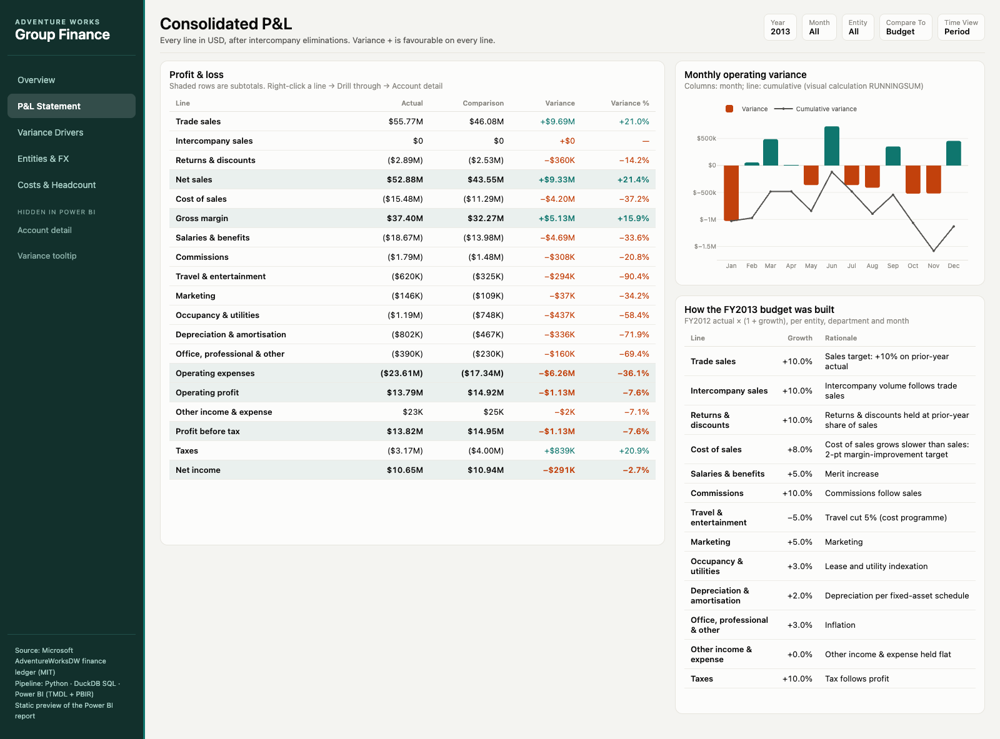
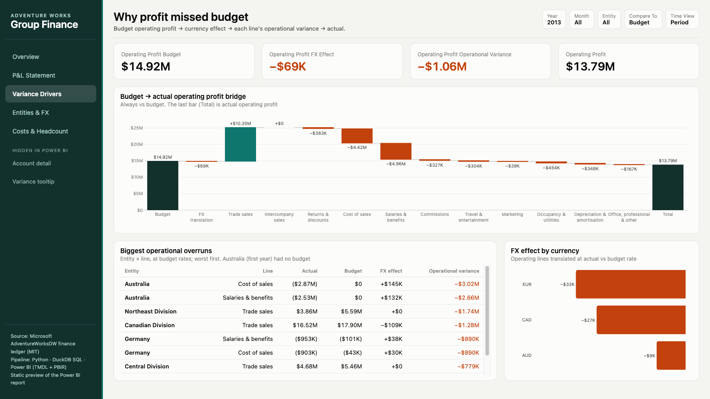
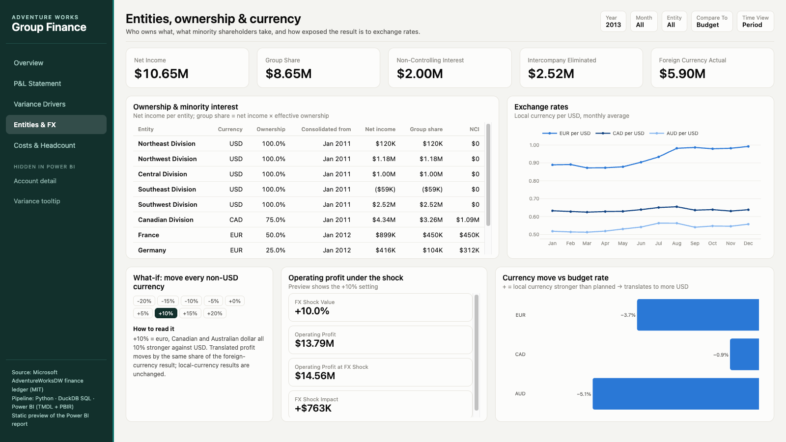
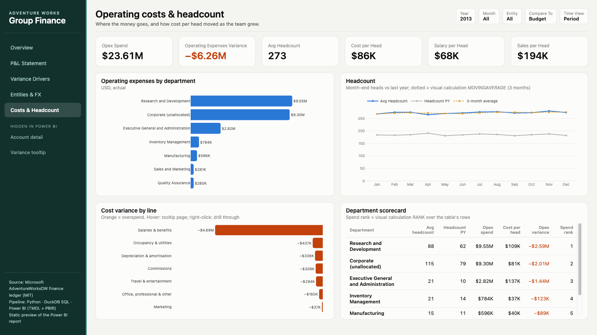
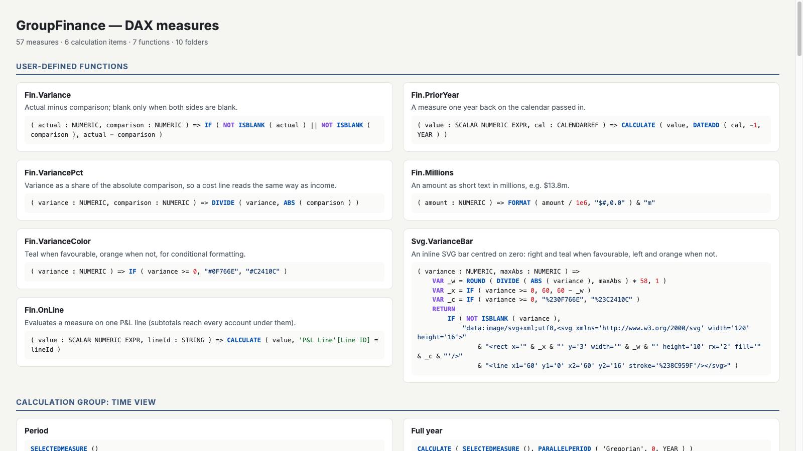

# Group Finance: Actual vs Budget (Power BI)

A consolidated P&L for a multi-entity, multi-currency group. Built from Microsoft's AdventureWorksDW finance ledger: 9 operating entities in USD, CAD, EUR and AUD plus a group-eliminations entity, with intercompany sales and minority shareholders. It answers four questions:

1. **Did we hit budget?** If not, which entity and which P&L line caused it?
2. **How much of the miss is exchange rates,** and how much is something management controls?
3. **What do minority shareholders own,** and how much intercompany trade drops out on consolidation?
4. **Where does the cost go,** and how did cost per head move as the team grew?


## What FY2013 shows

| | Actual | Budget | Variance |
|---|---:|---:|---:|
| Net sales | $52.88M | $43.55M | **+$9.33M** |
| Gross margin | $37.40M | $32.27M | +$5.13M |
| Operating expenses | ($23.61M) | ($17.34M) | **−$6.26M** |
| Operating profit | $13.79M | $14.92M | **−$1.13M (−7.6%)** |
| Net income | $10.65M | $10.94M | −$0.29M |

- **Sales beat budget by 21%, but profit still missed.** Operating expenses ran 36% over budget, and salaries alone account for −$4.69M of that. Average headcount went from 185 to 273, a 48% rise, against a budgeted 5% merit increase.
- **Exchange rates explain almost none of the miss.** Of the −$1.13M, currency movements account for −$69K. The other −$1.06M is operational. EUR, CAD and AUD were all weaker against USD than the budget rate assumed.
- **Canada is the biggest single shortfall at −$1.55M,** driven by trade sales $1.3M under budget. Central and Northeast divisions follow. France, Germany and Northwest division come in ahead.
- **Australia has no budget for 2013 because 2013 was its first year.** Its whole cost base therefore appears as variance. The report says this rather than hiding it.
- **Minority shareholders.** Minority shareholders take $2.00M of the $10.65M net income: Canada is 75% owned, France 50%, Germany 25%, and Australia 37.5% through a holding chain. $2.52M of intercompany sales is eliminated on consolidation.

## Report pages

| Page | What it shows |
|---|---|
| **Overview** | KPIs (including how many entities are behind budget) and monthly operating profit: the line shows whichever series is picked in the *Metric* slicer (actual, comparison, outlook, variance, FX effect, operational variance, prior month) against the comparison. A dynamic one-sentence summary that names the biggest miss. A full-year outlook card: operating profit outlook, opex outlook (budget after the As Of month) and an opex trend forecast (straight line on the last 12 months). A variance bar whose dimension the user picks (entity / department / P&L line), entities counted per variance band (big miss / miss / on plan / beat), and an entity scorecard with rank, status (on track / watch / off track) and share of the region's variance. |
| **P&L Statement** | Full consolidated P&L matrix with subtotal rows, coloured by favourable/unfavourable; **+** expands a line into its accounts (*P&L Drill* hierarchy). Key lines with ▲/▼ arrows, monthly operating variance on the *Fiscal Calendar* hierarchy (drill up to quarter / year), and a *Budget assumptions* table with each operating-expense line's growth (*Driver Growth*, via `TREATAS`). |
| **Variance Drivers** | Waterfall from budget profit, through the FX effect and each line's operational variance, to actual profit, next to a decomposition tree of the operational variance (excl. FX, so its root equals the *Operational variance* card) split Entity → P&L line → Department. Biggest overruns by entity and line, a Pareto of the opex overrun by account (the title says how many accounts make 80%), FX effect by currency, and an *All misses, revenue + cost (no netting)* card: every operating account that missed, revenue shortfalls and cost of sales included. That card is larger than the Pareto's opex overrun because the Pareto counts operating-expense accounts only; both labels say so. |
| **Entities & FX** | Ownership, group share and minority interest per entity, its currency group (a Desktop *group*) and whether it has a budget (calculated column). Exchange rates with a trend line. A what-if slider that moves every non-USD currency ±20%, and a filled map of operating variance by country (Azure Maps). |
| **Costs & Headcount** | Opex by department, headcount vs last year with a 3-month moving average, closing heads vs the (SYNTHETIC) year-end plan by region, cost/salary/sales per head, rolling-12-month opex, a department table ranked by spend with each department's share, cost variance by line, and accounts in ABC spend classes. |
| **Reforecast** | The entities' FY2013 reforecast files (SYNTHETIC, combined in Power Query) against actual and budget: monthly operating profit, who submitted and when (late flag), actual vs reforecast by entity. |
| *Account detail* (hidden, drillthrough) | Right-click a P&L line → Drill through. KPIs for that line (including cut-off drift: actual by period − actual by posting date, and accounts posted), its accounts ranked by variance with an inline SVG bar, the journal postings behind them, the variance outliers (account × entity × month cells above the 95th percentile of |variance %|), variance by month with a running total, and by entity. Back button. |
| *Variance tooltip* (hidden, 320 × 240) | Report-page tooltip on the variance bars: Actual, Comparison, Variance and Variance % for the hovered bar. |

Header slicers on every page: **Year**, **Month**, **Entity**, **Compare To** (budget, prior year or forecast) and **Time View** (period, QTD, YTD, full year, prior year, YoY %).

In the HTML twin the hidden pages sit under "Hidden in Power BI" in the side bar (`#account`, `#tooltip`). The drillthrough is shown for one example line (the operating-expense line furthest behind budget) and the tooltip for one example entity.

## Power BI methods used, beginner to expert

| Level | Method | Where |
|---|---|---|
| Beginner | Star schema, relationships, sort-by columns, hierarchies (*Fiscal Calendar*, *Entity Tree*, *P&L Drill*) | Model: 23 tables, 19 relationships |
| Beginner | Measures in display folders, format strings, descriptions on every measure | 97 measures |
| Beginner | `COUNTROWS` / `DISTINCTCOUNT`, `SWITCH(TRUE())`, `RELATED` / `RELATEDTABLE`, one justified calculated column | *Entities Behind Budget*, *Accounts Posted*, *Variance Status*, *Group Share*, `Entity[Has Budget]` |
| Beginner | Slicers, KPI cards, bar / line / column charts, table, matrix | All pages |
| Beginner | Conditional formatting (favourable / unfavourable colour measures) | Tables, matrix, bars |
| Intermediate | Time intelligence: QTD, YTD, prior year, YoY %, prior quarter, prior month, MoM %, rolling 12 months, semi-additive closing balance | *Time View* calculation group, *Opex Rolling 12M*, *Heads Closing* |
| Intermediate | Filter context: `KEEPFILTERS`, `REMOVEFILTERS`, `ALLEXCEPT`, `FILTER` inside `CALCULATE`, `USERELATIONSHIP` on an inactive relationship (role-playing *Date*) | `Fin.OnLine`, *Share of Group Opex*, *Share of Region Variance*, *Overrun Only*, *Actual by Posting Date* |
| Intermediate | What-if parameter (FX shock ±20%) and field parameter (*Analyze By*) | Entities & FX, Overview |
| Intermediate | Static and dynamic row-level security (`PATHCONTAINS` on an entity hierarchy) | Roles *Europe Finance*, *Entity Manager* |
| Intermediate | `RANK` / `RANKX` measures (dense, `ALLSELECTED`) shown in tables | *Entity Variance Rank* (`RANK`), *Account Variance Rank* (`RANKX`) |
| Advanced | `TREATAS` (virtual relationship) and window functions `OFFSET` / `WINDOW` / `INDEX` | *Driver Growth*, *Operating Profit PM*, *Variance Running Total*, *Biggest Miss Entity* |
| Advanced | Many-to-many (limited) relationship to a plan at region grain | *Headcount Plan* ↔ *Entity* |
| Advanced | Storage modes: Import, DirectQuery, Dual, Direct Lake; composite model; user-defined aggregation (`alternateOf`); incremental refresh (`RangeStart`/`RangeEnd` + `refreshPolicy`) | Three model variants, see *Semantic model* |
| Intermediate | Bookmarks + buttons: scorecard view ↔ chart view | Overview entity panel |
| Advanced | Calculation group with a dynamic format string per item (YoY % shows as %) | *Time View* |
| Advanced | Dynamic format string on a measure ($M vs $K by size) | *Operating Profit Variance* |
| Advanced | Drillthrough page with Back button | *Account detail* |
| Advanced | Report-page tooltip wired to visuals | *Variance tooltip* |
| Advanced | Visual calculations: `RUNNINGSUM`, `MOVINGAVERAGE`, `RANK` | P&L monthly combo chart, headcount line, department table |
| Advanced | SVG image measure (`dataCategory: ImageUrl`) drawn in a table | *Entity / Account Variance Bar* |
| Advanced | Perspectives and Q&A synonyms | *Variance Analysis*, *Treasury & FX*, *People Cost* |
| Advanced | Translations (id-ID culture: tables, folders, measures) | `cultures/id-ID.tmdl` |
| Expert | DAX user-defined functions, including a `CALENDARREF` parameter | 7 functions (`Fin.*`, `Svg.VarianceBar`) |
| Expert | Calendar-based time intelligence (`calendar` object on the Date table) used by the calculation group | *Gregorian* calendar |
| Expert | Object-level security: hides tables and a column from a role | Role *External Auditor* |
| Expert | TMDL KPI (status graphic + target expression) | *Operating Profit* |
| Intermediate | Power Query connectors: Parquet, `Csv.Document` (raw pipe-delimited export), `Folder.Files` (forecast folder), `Sql.Database` (Lakehouse) | `FX Daily Raw`, `Forecast`, every partition |
| Intermediate | Power Query shaping: skip title rows + promote headers, locale-aware types (en-US / de-DE), split column, fill down, replace values, unpivot, group by, merge, append, index / conditional / custom columns | `Parse Forecast File`, `Forecast`, `FX Rates` |
| Advanced | Staging query (not loaded) + Reference queries, error rows kept in their own query | `FX Daily Raw` → `FX Rates`, `FX Rate Errors` |
| Advanced | Parameters + source switch (`SourceMode` Local ↔ Lakehouse), folding-first step order | `expressions.tmdl`, every partition |
| Intermediate | Edit interactions (filter / highlight / none), page and report filters (locked), drill-down on a hierarchy axis, expand/collapse in a matrix | Overview, Variance Drivers, Costs, P&L — see *Report design* |
| Intermediate | Group (Desktop "Groups" = calculated column with `GroupingMetadata`), Analytics-pane trend line | `Entity[Currency Group]`, Exchange rates |
| Advanced | Decomposition tree, Azure Maps filled map | Variance Drivers, Entities & FX |
| Advanced | Accessibility: dynamic alt text measures, keyboard tab order, ▲/▼ symbols next to colour, contrast checked; phone layout | *Alt Text …* measures, *Variance Arrow* |
| Advanced | Pareto 80/20 with a cumulative share measure over `ALLSELECTED` and a dynamic title measure | *Overrun Cumulative %*, *Accounts to 80% Overrun*, *Pareto Title* — Variance Drivers |
| Advanced | ABC classification that follows the slicers (A = first 70% of opex, B = next 20%, C = rest) | *Spend Class* — Costs & Headcount |
| Advanced | Dynamic segmentation: disconnected band table + count measure | `Variance Band` table, *Entities in Band* — Overview |
| Advanced | Percentile outliers: `PERCENTILEX.INC` P95 of \|variance %\| per account × entity × month, used as a visual-level measure filter and as a conditional-formatting background rule | *Variance P95*, *Is Variance Outlier*, *Outlier Cells*, *Outlier Fill* — Account detail |
| Expert | Forecast with `LINESTX`: straight line on the last 12 months of opex, projected after the As Of month, next to the budget-based outlook | *Opex Trend Forecast*, *Opex Outlook* — Overview |
| Advanced | Generative AI for the analyst: monthly variance commentary drafted by a local LLM, every $ amount checked against the supplied figures | `src/commentary.py` → `reports/commentary_FY2013.md` (DRAFT) |
| Expert | Model and report as code: TMDL + PBIR generated from Python, best-practice rules, TOM validation, CI | `src/`, `tools/tmdl-validate`, `.github/workflows/ci.yml` |


| | |
|---|---|
|  |  |
|  |  |

## Report design: interactions, filters, accessibility, phone layout

Everything here is written into the PBIR by `src/build_report.py`. None of it has been opened in Power BI Desktop.

**Edit interactions** (`visualInteractions` in `page.json`)
- Overview: a bar in *Operating variance by …* filters the entity scorecard but does **not** filter the seven KPI cards or the one-sentence headline (`NoFilter`), so the totals stay the page totals.
- Variance Drivers: a row in *Biggest operational overruns* **highlights** its bars in the bridge; the bridge, the overruns table and the decomposition tree leave *FX effect by currency* alone.

**Filters**
- Report level: `Date[Year] >= 2011` (Advanced filter), locked in view mode.
- Costs & Headcount page: `P&L Line[Is Operating] = True`, locked.
- Visual level: the operating-detail filters on the variance visuals, Line ID on *Key lines*, opex lines on *Budget assumptions*.

**Drill**
- P&L matrix rows = *Line*, then the *Account* level of the *P&L Drill* hierarchy, with expand/collapse buttons (`rowHeaders.showExpandCollapseButtons`). The twin shows the worst operating-expense line expanded.
- *Monthly operating variance* uses *Fiscal Calendar* Year → Quarter → Month on the axis, opened at month; the header arrows drill up.

**Object-level security and the P&L page.** The *External Auditor* role can't see the *Budget Drivers* table, which *Driver Growth* reads. That measure now sits only in the *Budget assumptions* table, not in the matrix, so for an auditor one visual fails and the matrix still works. *View as* role was **not** run (needs Desktop).

**Accessibility**
- Alt text on every visual. Key visuals use a measure, so the text follows the slicers: *Alt Text Operating Profit*, *Alt Text Biggest Miss*, *Alt Text Opex*, *Headline Insight*. The rest use title + subtitle.
- Tab order: page content top-to-bottom, left-to-right, then the side panel (navigation, brand, footer).
- Colour is never the only signal: *Variance Arrow* puts ▲ (favourable) or ▼ (unfavourable) before the %, in the scorecard and in *Key lines*.
- Contrast (WCAG 2.1, computed): teal `#0F766E` on the canvas `#FCFCFB` = **5.33 : 1**, orange `#C2410C` = **5.04 : 1**. Both pass AA for normal text (4.5 : 1); neither reaches AAA (7 : 1).

**Phone layout** (`mobile.json` per visual)
- Overview: title, four KPIs (2 × 2), the one-sentence headline, the variance bar.
- P&L Statement: title, year slicer, *Key lines*, monthly variance. The full matrix is left off the phone.

**Azure Maps.** The country map needs the tenant setting *Use Azure Maps visual* (admin portal) on, and sends country names to the Azure Maps service. The twin draws the same countries with Plotly.

**Deneb (IBCS chart).** `powerbi/deneb/ibcs_variance.json` is a Vega-Lite spec in IBCS notation (actual solid, budget outline, ΔBU bars in teal/orange with labels). It renders in vega-embed (`evidence/preview-C-deneb.png`). It is **not** in the report: Deneb is an AppSource custom visual, and adding it can't be checked without Desktop.

**Export and Analyze in Excel.** `report.json` sets `exportDataMode = AllowSummarized`: users can export the summarised data behind a visual, not the underlying rows. Analyze in Excel connects Excel's PivotTables to the published model (Service → *Export → Analyze in Excel*); it uses the measures and the *Time View* calculation group, and the roles still apply. Not tried: nothing is published.

**3-30-300 check** (3 seconds to the headline, 30 to the cause, 300 to the detail)
- 3 s: KPI cards and the one-sentence headline on the Overview.
- 30 s: the variance bar and scorecard (which entity), then Variance Drivers (which line, how much is FX).
- 300 s: drillthrough to Account detail and the journal postings; the decomposition tree for ad-hoc splits.

**Not done (honest)**
- **Dashboards in the Service** (pinned tiles, alerts): a dashboard isn't part of a PBIP, and nothing is published.
- **Binning *Variance %*:** Desktop bins need a column, and *Variance %* is a measure. Not done; the *Currency Group* group and the trend line were added instead, which does not count as the bin.
- **Deneb in the report:** spec only, see above.

## Analysis measures: what they show and their limits

- **Pareto** (*Overrun Cumulative %*): in FY2013 every one of the 23 operating-expense accounts overran the budget; 5 of them make up 80% of the $6.26M overrun, and *Salaries* alone is 63% of it. The cumulative share is computed over `ALLSELECTED ( Account[Account] )`, so it follows the slicers.
- **ABC** (*Spend Class*): an account is A while the spend of the larger accounts before it is under 70% of the total, B under 90%, C after. Salaries is 67% of opex on its own, so FY2013 has only two A accounts.
- **Variance bands**: the band limits live in the `Variance Band` table (disconnected, `DATATABLE`), so changing them is a data change, not a DAX change. Entities without a budget (Australia in FY2013) have no variance % and are in no band; the bars add up to the budgeted entities.
- **Outliers** (*Is Variance Outlier*): the 95th percentile is taken over every account × entity × month cell in the current filters (`ALLSELECTED ()`), so on the drillthrough page it is the cells of the drilled line. With a tiny budget a cell's variance % is huge: under Salaries & benefits the P95 is 963%, and the flagged cells are mostly Germany, whose salary budget is a fraction of its actual cost. The flag finds the odd cells; whether they matter still takes a look at the amounts. On the *Accounts under the selected line* table a background rule (*Outlier Fill*, light red when *Outlier Cells* > 0) shades every account that holds at least one flagged cell, and an *Outliers* column gives the count; the separate outlier table lists the cells themselves. Under Salaries & benefits all 3 accounts hold flagged cells (5, 4 and 6 of the 15), so all three rows are shaded there; on lines with more accounts the shading separates them.
- **Trend forecast** (*Opex Trend Forecast*): `LINESTX` fits a straight line on the 12 months up to the As Of month and adds it for the months after. The plan was to compare it with *Operating Profit Outlook*; it is an opex projection, so the card compares it with *Opex Outlook* (the same budget-based method on the opex line) and shows the operating profit outlook next to it. As of Jun 2013 it gives $26.60M against an opex outlook of $20.54M, and FY2013 actual opex came in at $23.61M. The line overshoots because opex steps up in Jan 2013 (Australia consolidated), and a straight line reads that step as growth. It is a naive baseline, not a forecast to plan on.

## Variance commentary with a local LLM (DRAFT) and AI governance

`src/commentary.py` drafts three sentences per month of FY2013 and writes `reports/commentary_FY2013.md`.

- **What reaches the model:** only aggregated `mart.variance_cube` rows (month × entity × P&L line totals), reduced in Python to about ten figures per month (operating profit, budget, variance, FX vs operational split, year to date, worst / second-worst / best entity, worst line). Amounts are formatted and their sign is put into words before they are sent, so the model does no arithmetic. No journal postings, no account detail, no `Entity Access` emails, nothing from the RLS tables.
- **Which model:** `qwen3:8b` on Ollama on this machine (`localhost:11434`, thinking off), nothing leaves it. `COMMENTARY_MODEL` switches it.
- **Gate, not a label:** a draft is only written if it passes two checks.
  - *Numbers:* every `$` amount must be one of the figures supplied for that month; percentages are rejected.
  - *Attribution:* an entity or P&L-line amount must sit in a sentence that names that entity or line, and a sentence about the overall / total / group result may only carry group-level figures. This is what an earlier `gemma3:4b` run got wrong: it called Salaries & benefits' $502K "the overall P&L" in February, and invented "$559K" in March.
  - A month that fails is regenerated up to 3 times with the rejected amounts and sentences fed back. If it still fails, the LLM text is dropped and a fixed template sentence built from the same figures is used, marked as such in the file. The script asserts every written month passes both checks.
  - Committed run: 12 of 12 months pass; all 12 passed on the first try, none needed a retry or the template. The retry and template paths were exercised with a stub model that always answers with an invented amount (all 12 months fell back to the template and passed).
  - Limits: the checks are string rules. They catch invented or misattributed amounts, not a wrong verb ("favourable" for a miss) or a misleading emphasis.
- **Status:** still a DRAFT. Nobody has reviewed it. It needs a finance reviewer before it goes anywhere.
- **Power BI MCP server:** connecting an LLM to the semantic model through a Power BI MCP server was not set up here. If it is, it should use a read-only identity that RLS applies to (e.g. the *External Auditor* role, which OLS already strips of the budget drivers, access list and budget source), and never the model owner's account. Then the model can only see what that role sees.

## How it works

```
AdventureWorksDW CSVs (pinned commit)
  → DuckDB SQL: staging → star schema → variance cube
  → 19 data tests (all must pass, or nothing is exported)
  → Parquet marts
  → Power BI semantic model (TMDL) + report (PBIR)
```

### Accounting rules

- **Signed amounts.** Income is positive and cost is negative. Every variance is actual minus comparison, so positive always means favourable, on every line.
- **Chart of accounts.** The source account tree carries +/− operators. The sign of each account is the product of the operators up to Net Income. Every account maps to exactly one P&L line, and a recursive bridge rolls the lines up into subtotals.
- **Currency translation.**
  - Actuals use the monthly average rate.
  - The budget uses a *budget rate*: the prior December's average, i.e. the rate in force when the budget was signed off.
  - **FX effect** = actual − actual at budget rate.
  - **Operational variance** = actual at budget rate − budget.
  - The two always add up to the total variance; a test checks this.
- **Intercompany elimination.** A group-eliminations entity reverses intercompany sales (account 4500) against cost of sales. Group revenue drops and gross margin is unchanged; both are tested.
- **Ownership.** Effective ownership multiplies down the ownership chain. Group share = result × effective ownership. Non-controlling interest is the remainder.
- **Ledger cleanup.** AdventureWorks shifts its sample dates, so month-end postings drift between the 27th and the 1st. The fiscal period is the month containing the posting date + 5 days. Six duplicated source rows are summed.

### Power Query (data intake)

Most tables load a Parquet mart the SQL pipeline already shaped. Two are shaped in Power Query instead, because that is where the work happens in a real finance team: files arrive from entities and rates arrive raw.

- **`FX Rates`** is built from the raw daily rates, not from the SQL mart.
  - `FX Daily Raw` (staging, not loaded): `Csv.Document` on `FactCurrencyRate.csv` (pipe-delimited, no header) → rename columns → keep 3 → split `"2010-12-29 00:00:00.000"` at the space → types with an explicit en-US locale → merge `DimCurrency.csv` for the currency code → keep EUR/CAD/AUD.
  - `FX Rates` = Reference of it: drop rows with errors → group by currency × month (average) → merge with itself to pull the prior December's average as the budget rate → keep 2011–2013.
  - `FX Rate Errors` = Reference of it: the rows that failed to type, with the error message, so rejected rows are counted rather than lost.
  - `mart.fx_rates` (SQL) does the same arithmetic; it is the reference the PQ result should match.
- **`Forecast`** combines the entities' reforecast files from `seeds/forecast/` (`Folder.Files`).
  - The function `Parse Forecast File` handles one file: skip 2 title rows, promote headers, fill down the entity name (the US file holds 5 divisions, the name only on each block's first row), `"n/a"` and `"-"` → null, drop `Total`, add a row index, unpivot `Jan..Dec`, and type the amounts with the file's own culture (the German file uses `;` and a decimal comma, `de-DE`).
  - The table query appends every file, trims/cleans names, splits `"CA01 - Canadian Division"` into code and name, adds `Fiscal Year`, `Period` and an `Is Late Submission` flag (after 10 January), and merges to `Entity` (name → key) and `P&L Line` (name → line ID).
  - `stg.forecast` / `mart.forecast` in SQL parse the same files; two tests check that every row resolves and that the months add up to each row's `Total`.
- Every step has a descriptive name (`#"Skip title rows"`, `#"Unpivot months"`, …) and does one thing, so the Applied Steps pane reads like a recipe.
- **This M has not been executed.** TOM accepts it as text; no Power Query engine ran on the Mac. The SQL twins are what the tests run.

**Parameters** (`expressions.tmdl`): `DataFolder` (Parquet marts), `RawFolder` (raw CSVs), `ForecastFolder`, `SourceMode` (`"Local"` or `"Lakehouse"`), `SqlEndpoint`, `LakehouseDb` (`finance_lh`).

**Lakehouse source and folding.** With `SourceMode = "Lakehouse"` every Parquet partition reads the same table from the Fabric Lakehouse SQL endpoint through `Sql.Database`. The steps after `Source` are the ones that fold to SQL (row filter on `Period` for `GL`, `Table.SelectColumns`, `Table.TransformColumnTypes`), so they come first and the whole query becomes one `SELECT … WHERE`. `Parquet.Document` never folds; that is fine for 500 KB of local files. No Lakehouse exists yet, so the Lakehouse branch has not run.

**Refresh order.** `uv run python src/pipeline.py` first (downloads raw CSVs, rebuilds the marts and the forecast twin, runs the tests), then Refresh in Power BI. In the Service only the semantic model refreshes; the pipeline has to run before it (or the Lakehouse has to be loaded) for new numbers to show.

### Semantic model

- **23 tables, 19 relationships, 100 measures** in display folders, **7 DAX user-defined functions**, compatibility level 1702.
- **Hierarchies:** *Fiscal Calendar* (Year → Year Quarter → Month Year), *Entity Tree* (Region → Country → Entity), *P&L Drill* (Detail Line → Account).
- **Calculation group** *Time View*: Period / QTD / YTD / Full year / Prior year / YoY %, built on the *Gregorian* calendar (calendar-based time intelligence).
- **Field parameters** *Analyze By* (entity / department / P&L line) and *Metric* (the operating-profit series on the Overview line).
- **What-if parameter** for the FX shock, and an **As Of** table for the rolling outlook.
- **Row-level security:**
  - *Entity Manager* uses an access table with `PATHCONTAINS` on the entity hierarchy, so a manager of a holding sees all its subsidiaries.
  - *Europe Finance* is a static region role.
  - *External Auditor* uses object-level security: the budget-driver and access tables and the `Budget Source` column are invisible to it.
- **3 perspectives**, Q&A synonyms (en-US linguistic metadata) and an **id-ID translation**.
- `build_model.py` refuses to write the model if a measure reference doesn't resolve or a best-practice rule fails (a subset of Tabular Editor's BPA: every measure has a description and a format string, relationships point at key columns, foreign keys are hidden, sort-by columns exist).

#### Three model variants, four storage modes

`build_model.py` writes the same tables, measures and roles three times. Only storage and sources differ.

| Table(s) | `GroupFinance` (local) | `GroupFinance.Fabric` | `GroupFinance DL` | Why |
|---|---|---|---|---|
| GL (ledger, 45k rows, 526 KB Parquet) | Import + incremental refresh | Import + incremental refresh | Direct Lake | Small and read by every visual: Import is fastest. |
| GL Journal (one row per posting, 25k rows) | Import | **DirectQuery** | Direct Lake | Only the drillthrough reads it. In a real ledger it is the big table, so it stays at the source. |
| GL Journal Agg (hidden) | — | Import, `alternateOf` → GL Journal | — | Answers period × entity × department × account totals without a DirectQuery round trip. |
| Date, Entity, Account, Department | Import | **Dual** | Direct Lake | They filter both Import GL and DirectQuery GL Journal. Dual stops a slicer from turning an Import query into a DirectQuery one. |
| Other mart tables | Import | Import | Direct Lake | Small lookups. |
| Calculated tables (field parameters, Compare To, As Of Month, FX Shock), `_Measures` | Import (calculated) | Import (calculated) | Import (calculated) | DAX tables have no source to read from. |

- **Live connection** is the fourth way a report can reach data. It is not a table mode: a thin report connects to the published `GroupFinance` model and stores no data at all (planned for the Service phase).
- **Composite model:** the Fabric variant mixes Import (GL) and DirectQuery (GL Journal) in one model. Relationships from Dual dimensions to both stay regular.
- **Aggregation, honest note:** the journal is already at roughly one posting per period × entity × department × account (24,973 lines → 24,969 groups). So `GL Journal Agg` shows the wiring; it saves almost nothing at this grain. Whether Power BI actually uses it can only be seen in a DAX Studio trace (*Aggregate Rewrite Attempt*), which needs Windows. That has **not** been checked.
- **Direct Lake** (`GroupFinance DL`): every mart table is an `entity` partition (`mode: directLake`) on the `finance_lh` Lakehouse through one `DatabaseQuery` expression.
  - It has no calculated column, because Direct Lake doesn't allow them; `Has Budget` is left out. The Fabric variant leaves it out too: there `Entity` is Dual, so the column would also have to work as DirectQuery, and a `RELATEDTABLE` scan does not.
  - It has no refresh policy; framing replaces it.
  - *As Of Month* is built with `CALENDAR` instead of reading `Date`.
  - No Lakehouse exists yet, so this variant has only been checked by TOM.
- **Incremental refresh** on `GL`:
  - `RangeStart` / `RangeEnd` (DateTime) filter `Period` right after the source, so the filter folds to the Lakehouse.
  - `refreshPolicy` keeps 5 years and refreshes the last 2 months, the monthly close pattern.
  - `pollingExpression` = max `Posting Date` per partition, so a late journal re-refreshes its month.
  - Only the Service applies the policy. Desktop loads the `RangeStart`–`RangeEnd` window.

#### Why this design (decision tree)

1. **Does the data fit in memory and refresh in time?** GL is 45k rows (526 KB). Yes → **Import**. Most finance P&L models land here.
2. **Is there a detail table too big or too fresh to import?** The posting-level journal in a real ERP is. → **DirectQuery** for that table only, giving a **composite** model. The dimensions it shares with Import tables become **Dual**.
3. **Do the common visuals only need totals of that detail?** → add an **aggregation** table in Import that answers them.
4. **Does the data already sit as Delta tables in OneLake on Fabric capacity?** → **Direct Lake**: Import-like speed with no copy and no scheduled import. That is the `GroupFinance DL` variant.
5. **Does another team only need to report on it?** → a **live connection** to the published model, not a copy.

#### Calculated columns: two

`Entity[Currency Group]` is what Desktop writes when you make a **group** (right-click Entity → New group): a `SWITCH` calculated column with a `GroupingMetadata` extended property naming the grouped column. USD entities vs non-USD entities (Canadian Division, France, Germany, Australia); it is the second column of the ownership table. Like `Has Budget` it exists in the local (Import) model only.

`Entity[Has Budget]` = `NOT ISEMPTY ( FILTER ( RELATEDTABLE ( GL ), GL[Scenario] = "Budget" ) )` is the other one. It is right as a column because:
- it is static per entity and computed once at refresh;
- it is used as a flag or slicer value (Australia, consolidated from 2013, has none);
- it never needs to react to the report's filters.

Everything that must follow the slicers stays a measure:
- variances, shares, status, ranks;
- *Group Share*, which uses `RELATED ( Entity[Effective Ownership] )` inside `SUMX`.

A column would freeze those values at refresh time.

#### Filter propagation (expanded table) and `KEEPFILTERS`

- `dax/09_expanded_table.dax`: a filter on `'P&L Line'[Line] = "Salaries & benefits"` reaches `GL` through the bridge, `P&L Line → Line Account ↔ Account → GL`.
  - GL's expanded table includes Account, and the bridge filters Account in both directions.
  - Expected from DuckDB on the same marts: Actual 2,661 rows / −$38,983,146 and Budget 2,244 rows / −$27,843,128 (2011–2013).
- `dax/09_keepfilters.dax`: `Fin.OnLine` now intersects with the line already on the row (`KEEPFILTERS`) instead of replacing it. In a matrix by P&L line, *Operating profit* now shows only on its own row; before, it repeated $13.79M on every row.
- `dax/11_limited_rel.dax`: the limited (many-to-many) relationship `Headcount Plan[Region]` ↔ `Entity[Region]` adds no blank row for "Asia Operations", a planned region with no entity yet. The grand total still counts it: 191 = 186 + 5.
  - `RELATED` doesn't work across a limited relationship.
  - The relationship is single-direction (Entity filters the plan).
- `dax/11_cls_test.dax`: test queries for the *External Auditor* role. The second query reads the OLS-hidden `Budget Source` column and should fail. It has **not** been run (View as / DAX Studio need Windows).

**None of the `dax/` queries has been executed in Power BI.** Their expected results come from the same marts in DuckDB.

#### Window functions

Visual calculations (`RUNNINGSUM`, `MOVINGAVERAGE`, `RANK`) live in one visual. Window functions do the same in the model, so every visual and the HTML twin can reuse them.

- `OFFSET ( -1, … )` → *Operating Profit PM* (previous month on the axis; the *Prior month* item of the *Metric* parameter).
- `WINDOW ( 1, ABS, 0, REL, … )` → *Variance Running Total* (Account detail combo chart).
- `INDEX ( 1, …, ORDERBY ( [Operating Profit Variance], ASC ) )` → *Biggest Miss Entity* (named in the Overview headline).
- `RANK ( DENSE, ALLSELECTED ( … ) )` → *Entity Variance Rank*.

The month measures return blank outside a month axis (`ISINSCOPE`), so a card can't show a meaningless "previous row".

#### Problem → tool, from this model

| Problem | Tool | Measure |
|---|---|---|
| Month-end postings drift into the next month | Inactive relationship + `USERELATIONSHIP` | *Actual by Posting Date*, *Cut-off Drift* |
| Budget growth assumptions have no relationship to the P&L | `TREATAS` (virtual relationship) | *Driver Growth* |
| Previous month without time intelligence | `OFFSET` | *Operating Profit PM* |
| Running total along the axis | `WINDOW` | *Variance Running Total* |
| Name the worst entity in a sentence | `INDEX` | *Biggest Miss Entity* |
| Share of the region, whatever else is filtered | `ALLEXCEPT` | *Share of Region Variance* |
| Share of all departments | `REMOVEFILTERS` | *Share of Group Opex* |
| Only the accounts that missed, no netting | `FILTER` inside `CALCULATE` | *Overrun Only*, *Operating Overrun Only* |
| A balance, not a flow (heads at month end) | `LASTNONBLANK` (semi-additive) | *Heads Closing* |
| Plan held at a coarser grain (region) | Many-to-many relationship | *Heads Plan*, *Heads vs Plan* |
| One line inside a P&L matrix without overwriting the row | `KEEPFILTERS` | `Fin.OnLine` |
| Last 12 months from any selection | `DATESINPERIOD` | *Opex Rolling 12M* |

#### Field parameter limits

*Metric* is a real field parameter (`NAMEOF`, `ParameterMetadata`), shown as a single-select slicer above the Overview line. The chart doesn't take the parameter column itself. `pbir validate` rejects a field-parameter column in the line chart's measure-only Y well (`ROLE_TYPE_MISMATCH`). So *Metric Value* reads the selected item's order column with `SWITCH`.

Limits that follow:
- The chart shows one picked series at a time.
- The series name in the legend is *Metric Value*, not the picked metric.
- A new metric needs a new `SWITCH` branch as well as a new parameter row.

General limits of field parameters:
- They can't be used in calculated columns or row-level security.
- `SELECTEDVALUE` on the display column breaks when items are renamed, which is why the order column is read instead.
- Every item shares the visual's single format, so currency and percent measures don't mix well on one axis.

Helper columns (`Line Sort`, `Entity Sort`, `Analyze By Order`, `Metric Order`, `As Of Sort`, `Step Sort`) are hidden. Every numeric column carries a format string, and `build_model.py` fails if one doesn't.

#### Performance housekeeping

There is no VertiPaq Analyzer on a Mac. Instead, DuckDB cardinalities and Parquet column sizes of the same mart stand in for it:
- **`Amount Local` dropped from `GL`.** It has 13,852 distinct values and 136 KB of the 526 KB `fact_gl.parquet` (≈ 26%), and no measure reads it (reports are in USD).
- **Hidden keys, sort columns and helpers:** `isAvailableInMdx: false` (36 columns in the local model; keys, sort-by targets, hierarchy levels and calendar columns are excluded from this). Keys use `summarizeBy: none`.
- The highest-cardinality columns left are `Amount USD` (19,239 distinct) and `Amount USD at Budget Rate` (15,390). Both are needed.
- **Summed fact columns are hidden** (`Amount USD`, `Amount USD at Budget Rate`, `Heads`, `Planned Heads`, forecast `Amount USD`): only the measures are offered, so nobody builds a visual on an implicit SUM (BPA, see *Dev lifecycle*).

These are proxies. Real dictionary and segment sizes need a `.vpax` from Windows.

### Data tests (`sql/90_tests.sql`)

- Staging reconciles to the raw ledger.
- The fact grain is unique.
- Every account maps to one line, and no amount is lost in the mapping.
- Subtotals equal the sum of their children.
- Eliminations net intercompany sales to zero and leave gross margin unchanged.
- USD entities translate 1:1, and no rows are dropped by the FX join.
- Actual − budget = FX effect + operational variance.
- The budget reconciles to its drivers.
- RLS seeds reference real entities.
- Every month has actuals.
- Every forecast row resolves to an entity and a P&L line, and the parsed months add up to each file row's `Total`.
- Journal postings add up to the ledger, every posting date sits in the 5-day cut-off window of its period, and the headcount plan only uses known departments.

## About the budget (honest note)

AdventureWorksDW only ships a budget for **FY2011**, and only for operating lines of the North American entities. So FY2011 has no budget for tax or other income.

**FY2012–13 budgets are driver-based and generated by this project.** Each one is the prior-year actual for the same entity, department, account and month, × (1 + a growth rate per P&L line). The growth assumptions are in `seeds/budget_drivers.csv` and shown on the P&L page. This is how many FP&A teams build a baseline budget, but the numbers are not AdventureWorks' own. Every row carries a `budget_source` column so the two kinds stay distinguishable.

## About the headcount plan (honest note)

AdventureWorks has no headcount plan. **`seeds/headcount_plan.csv` is SYNTHETIC**, written once by `src/make_headcount_plan.py`: per region × department, the prior December's actual heads × (1 + a seeded growth between −2% and +10%), for FY2012 and FY2013. It also has a planned region with no entity yet, *Asia Operations*, to show how a many-to-many relationship treats an unmatched value. Pacific Operations (Australia, consolidated from 2013) has no plan.

## About the forecast (honest note)

AdventureWorks has no forecast. **The reforecast files in `seeds/forecast/` are SYNTHETIC**, written once by `src/make_forecast_seed.py`: each entity's FY2012 actual (USD) per P&L detail line and month × (1 + a seeded adjustment between −6% and +8%). Australia has no FY2012 (it was consolidated from 2013), so its file starts from FY2013 actual, which makes its reforecast unrealistically close. The file layout (title rows, months as columns, blank entity cells, `n/a`, a German file in de-DE format, two late submissions) imitates what entities send so the Power Query steps have real work to do.

### Every DAX measure

`reports/dax.html` lists every measure and calculation item with its description and format string, generated from the TMDL by `../tools/dax_gallery.py`.

[](reports/screenshots/dax.png)

## Run it

```bash
uv sync
uv run python src/pipeline.py        # download → warehouse → tests → parquet
uv run python src/build_model.py     # powerbi/GroupFinance{,.Fabric,.DirectLake}.SemanticModel (TMDL)
uv run python src/build_report.py    # powerbi/GroupFinance.Report (PBIR) + pbir validate
uv run python src/build_preview.py   # reports/dashboard.html (offline HTML twin)
```

Open `powerbi/GroupFinance.pbip` in Power BI Desktop. The semantic model reads `data/marts/*.parquet`.

**Built on a Mac, without Power BI Desktop.** The model is checked with Microsoft's Tabular Object Model: `tools/tmdl-validate` deserialises, validates and round-trips the TMDL. The report passes `pbir validate` for schema and field references. It has **not yet been rendered in Power BI Desktop**, so visual details may need a touch-up on first open.

What that means for each check:
- **DAX is validated for structure only.** Every reference resolves and TOM accepts it; no DAX engine ran the measures. The numbers in the twin come from the same rules in SQL.
- **The KPI, the calendar, the functions, the OLS role and the translations** were accepted by TOM 19.117 (parse, `Validate()`, round-trip) but never loaded into an engine.
- **`pbir validate` passes with warnings, no errors.** Three warnings come from the validator not knowing visual calculations (`AMBIGUOUS_MATCH` on *Cumulative variance* and *3-month average*, `INVALID_FORMAT` on *Spend rank*). The hidden chart and the overlapping buttons are deliberate (bookmark toggle). The rest are layout/style warnings. Bookmarks aren't checked by `pbir`; they were checked against its bundled JSON schemas separately.
- CI (`.github/workflows/ci.yml`) runs BPA, TOM, the DAX tests and the report checks on every push. This pipeline and its data tests run in the opt-in `data` job (see *Dev lifecycle*).

The screenshots come from `reports/dashboard.html`. It is an HTML twin of the report's default state (FY2013, all entities, vs budget, outlook as of Jun 2013), computed in DuckDB with the same rules as the DAX.

## Dev lifecycle: Git, BPA, DAX tests, deploy (pbi-kit)

The shared toolkit lives in `tools/pbi-kit/`, copied from the portfolio's `tools/pbi-kit`. The project-specific parts are `bpa/project-rules.json`, `dax/2*.dax` with their `.assert.json` files, `powerbi/parameter.yml`, `.github/workflows/ci.yml` and `azure-pipelines.yml`. **Nothing here has been pushed, published or run on a Windows machine yet.** Everything that runs on a Mac was run (results below). Steps that need the Service, GitHub or Desktop are listed at the end for you to do.

### How a Power BI project moves, and where this one is

Desktop (saved as PBIP) → Git repo → Service workspace (Dev → Test → Prod) → app for readers.

| Stage | This project |
|---|---|
| Desktop / PBIP | Generated by `src/build_model.py` and `build_report.py`. Opens in Desktop, but hasn't been opened in it yet. |
| Git | Local repo, one commit per phase. Not pushed anywhere. |
| Workspace | `GroupFinance-Dev`/`-Test`/`-Prod` are planned. CI publishes to Test and Prod with fabric-cicd. None exist yet. |
| App | One app from the Prod workspace for Finance readers. Not created. |

**One shared model, not one model per report.** `GroupFinance` is a single shared semantic model, and the report is a thin report bound to it. Region teams build their own thin reports against the same model, so each number has one definition and one set of RLS roles. There is no dataflow. Power Query only has two small sources (the FX CSV and the reforecast folder), and nothing else reuses them. A dataflow would add a refresh dependency and gain nothing. Dataverse isn't a source here.

### Who does what

| Role | Who | Owns | Where |
|---|---|---|---|
| Report author | Region finance analysts (e.g. Europe Finance) | Thin reports on top of `GroupFinance` | Their own workspace, with Build permission on the model |
| Model owner | Group Finance BI | `src/build_model.py`, measures, RLS, `bpa/project-rules.json`, `dax/*.assert.json` | This repo, folder `powerbi/GroupFinance.SemanticModel` |
| Reviewer | A second Group Finance BI member | Pull request review and TMDL diff | GitHub PR |
| Approver | Group controller | The go-ahead for Prod | GitHub environment `Prod` (required reviewer) |
| Platform admin | BI / Fabric admin | Workspaces, the service principal, tenant settings, branch protection | Service admin portal, Entra ID, GitHub settings |

**Ownership pattern: central model, distributed reports.** Group Finance owns the model and its numbers. Anything that changes a measure goes through this repo, CI and an approval. Region teams own their thin reports. They can't change the model, and they see only their own rows: *Europe Finance* is a static role, and *Entity Manager* filters through the access table. External auditors get the *External Auditor* role, which hides the budget sources with object-level security.

### Daily git flow

```bash
git switch -c fix/count-format                 # 1 branch per change
# edit src/build_model.py (never the generated TMDL)
uv run python src/build_model.py               # regenerates powerbi/*.SemanticModel
git diff -- powerbi/GroupFinance.SemanticModel # read the TMDL diff before committing
tools/pbi-kit/bpa/bpa.sh powerbi/GroupFinance.SemanticModel/definition --rules bpa/project-rules.json
python3 tools/pbi-kit/dax-tests/daxtest.py powerbi/GroupFinance.SemanticModel/DAXQueries --offline
git commit -am "Counts use #,0"                # small commit; push + PR once a remote exists
```

Here is the real diff for one change from this phase: the count format of `Entities Submitted` went from `0` to `#,0`.

```diff
 	/// Entities with a reforecast file in the forecast folder.
 	measure 'Entities Submitted' = DISTINCTCOUNT ( Forecast[Entity Key] ) + 0
-		formatString: 0
+		formatString: #,0
 		displayFolder: Key Lines
 		lineageTag: d51c01b4-4de3-5c15-acd7-6991d7335ba8
```

The diff is one line because the generator now derives every `lineageTag` and relationship ID from the object's path (uuid5). It used to call `uuid4()`, so every rebuild rewrote every tag in all three models. This commit still carries that one-time switch. From now on, a rebuild with no changes produces no diff, and CI checks this: it regenerates the model and fails if the committed PBIP is stale.

### CI gates (`.github/workflows/ci.yml`, mirrored in `azure-pipelines.yml`)

Two jobs. `ci` runs on every push and PR on a clean runner, with no source data (the data is gitignored). `data` is opt-in because it downloads the public source data.

**`ci`** (the required check):

1. **Report:** `build_report.py` regenerates the report from source (it needs no data), and the job fails if it differs from the committed one.
2. **BPA, every semantic model:** 71 Microsoft rules, 3 kit rules and 1 project rule, on TOM. Fails on severity ≥ 3.
3. **TOM validate:** every model.
4. **DAX tests (offline).**
5. **PBIR validate.**

**`data`** (Run workflow with `data` ticked, or set the repo variable `RUN_DATA=true`; in Azure DevOps the pipeline variable `RUN_DATA=true`):

6. **Data tests:** `src/pipeline.py` with 19 SQL tests, then rebuild the models from the warehouse and fail if the committed TMDL is stale.

7. **On `main` only** (`deploy-test` needs `ci` and `data`; a skipped `data` job does not block it, a failed one does):
   1. Publish to Test (fabric-cicd + `parameter.yml`).
   2. Refresh.
   3. Run the DAX asserts against Test (`executeQueries`).
   4. Wait for approval on the `Prod` environment.
   5. Publish to Prod.

An optional `bpa-te2` job runs the same rules in Tabular Editor 2 on a Windows runner.

**BPA, before → after** (`evidence/bpa-before.txt` → `evidence/bpa-after.txt`, JSON in `evidence/bpa.json`): **23 errors / 94 warnings / 112 info → 0 / 60 / 106.** What changed in `build_model.py`:
- **Summed fact columns hidden:** `GL[Amount USD]`, `GL[Amount USD at Budget Rate]`, `GL Journal[Amount USD]`, `Forecast[Amount USD]`, `Headcount[Heads]` and `Headcount Plan[Planned Heads]`. Report authors now drag the measures instead of an implicit SUM. This fixed 6 errors (`NUMERIC_COLUMN_SUMMARIZE_BY`) and 6 warnings.
- **Count measures** use `#,0` instead of `0`.
- **Ignored on purpose** (annotation `BestPracticeAnalyzer_IgnoreRules`, which Tabular Editor also reads):
  - **The 16 text measures** ignore `PROVIDE_FORMAT_STRING_FOR_MEASURES` and `INTEGER_FORMATTING`. These are labels, colours, SVG bars and alt text, and they return strings, so a number format means nothing.
  - **The `Entity` table** ignores `AVOID_USING_MANY-TO-MANY_RELATIONSHIPS_ON_TABLES_USED_FOR_DYNAMIC_ROW_LEVEL_SECURITY`. The headcount plan is set per region, which is coarser than entity. The many-to-many on `Region` is the design, and it filters one way from Entity to the plan, so RLS still narrows the plan.
- **60 warnings left on purpose:**
  - **Signed % formats** (`+0.0%;-0.0%`), which the kit's single % format rule doesn't allow.
  - **Double amounts:** the AdventureWorks ledger is double.
  - **Visible rate and year columns** that the report uses.
  - **Calculated tables:** field parameters, what-if and the calc group.

**Project rule `PROJ_VARIANCE_SIGNED_FORMAT`** (severity 3, in `bpa/project-rules.json`): every money or % variance needs an explicit negative section in its format string, so an overrun never reads like a beat. Ranks, bars, colours and flags don't count. It passes on the model today. Tested against a copy where `Budget Variance` was given a format without a negative section: the rule fires as an error.

**DAX tests** (`dax/20–22`, copied into `DAXQueries/` by the generator). The values come from the DuckDB marts that the SQL tests check:

| Test | FY2013 assert |
|---|---|
| `20_op_fy2013` | Operating profit $13,793,625.67. Budget $14,922,246.70. |
| `21_variance_bridge` | FX effect −$68,720.72. Operational −$1,059,900.31. Gap (actual − budget − FX − operational) = 0. Same identity as the SQL test. |
| `22_ic_elimination` | Intercompany eliminated $2,515,303.32. Positive, because the measure negates the elimination postings. |

Offline they pass 7/7 (syntax, references, assert files). The asserts haven't been executed: that needs a published model.

**Deploy:** `deploy.py --dry-run` passes for Test and Prod (`evidence/deploy-dry-run.txt`). It covers 4 items: 3 semantic models and the report. `powerbi/parameter.yml` swaps these values per environment:
- `SourceMode` → `Lakehouse`
- `SqlEndpoint`
- `LakehouseDb` (`finance_lh_test` / `finance_lh`)
- The Direct Lake endpoint
- `RawFolder` / `ForecastFolder`, as a gateway share

The endpoint and share values are still `<placeholders>`. The Direct Lake variant also publishes. Remove its folder from the deploy (or create `finance_lh` in that workspace) if Test has no Lakehouse.

### Why Git + fabric-cicd

There are four ways to ship: Fabric Git integration, deployment pipelines, fabric-cicd, and your own REST scripts. They're compared in `tools/pbi-kit/docs/cicd-options.md`. This project uses **Git + fabric-cicd from GitHub Actions** because the repo already is the source of truth: the TMDL and PBIR are generated. That way CI can stop a bad model (BPA, TOM, DAX asserts) before it reaches any workspace, and the approval sits on a GitHub environment. Fabric Git integration and a deployment pipeline are still worth setting up on the Dev side. Analysts who edit in the Service commit through Git integration, and the deployment-pipeline Compare view is a readable audit of what changed.

### Your steps (Service / GitHub / Desktop)

1. **12-s8, repo and PR:** create a GitHub repo, `git push -u origin main`, then open a PR from a branch. Screenshot → `evidence/12-s8.png`.
2. **12-s15, branch protection:** follow `tools/pbi-kit/ci/branch-protection.md`. Require a PR and the `ci` check on `main`. Screenshot → `evidence/12-s15.png`.
3. **14-s5, service principal:** follow `tools/pbi-kit/docs/service-principal.md`.
   1. Create the Entra app with a federated credential for this repo.
   2. Add it as Member of `GroupFinance-Test` and `-Prod`.
   3. Turn on the tenant settings for service principals and the Fabric APIs.
   4. Set the `AZURE_CLIENT_ID`/`AZURE_TENANT_ID` secrets, plus `vars.FABRIC_WS_TEST`/`FABRIC_WS_PROD`/`PBI_DATASET_NAME` (`GroupFinance`).
   5. `PBI_ACCESS_TOKEN` must be a **user** token: the model has RLS, and executeQueries refuses service principals on RLS models.

   Screenshot → `evidence/14-s5.png`.
4. **14-s7, parameter.yml:** replace the `<test-workspace>`/`<prod-workspace>` and `\\fileserver` placeholders in `powerbi/parameter.yml`. Rerun `deploy.py --dry-run`. Save the output → `evidence/14-s7.txt`.
5. **14-s6 / 14-s8 / 14-s9, pipeline:** push to `main`. Watch `ci` → `deploy-test` (publish, refresh, DAX asserts online) → approve `deploy-prod`.
   - Run log → `evidence/14-s6.txt`.
   - Pipeline graph → `evidence/14-s8.png`.
   - DAX assert output → `evidence/14-s9.txt`.
6. **12-s14, Azure DevOps mirror:** import `azure-pipelines.yml`, using the service connection `pbi-kit-fabric` and the variable `PBI_USER_TOKEN`. Set `RUN_TE2_BPA=true` to run the Windows TE2 job. Screenshot → `evidence/12-s14.png`.
7. **12-s9 / 12-s10, Fabric Git integration:** connect `GroupFinance-Dev` to a `dev` branch, folder `powerbi/`.
   1. Change one measure description in the Service and Commit.
   2. Change one in the repo and Update all.

   Screenshots → `evidence/12-s9.png`, `evidence/12-s10.png`.
8. **12-s16 / 12-s17, deployment pipeline:** create Dev → Test → Prod for the GroupFinance workspaces. Add parameter rules for `SourceMode`/`SqlEndpoint`/`LakehouseDb`. Deploy, then Compare. Screenshots → `evidence/12-s16.png`, `evidence/12-s17.png`.
9. **14-s4, CI/CD options:** after step 5, screenshot the Actions run as the proof for the chosen option → `evidence/14-s4.png`.
10. **12-s11 / 12-s12 / 12-s13, Tabular Editor 2 on Windows:**
    1. Run `tools/pbi-kit/te/format-check.csx` on the model. Screenshot → `evidence/12-s11.png`.
    2. Run `pwsh tools/pbi-kit/bpa/te2-bpa.ps1 -Model powerbi/GroupFinance.SemanticModel/definition -ProjectRules bpa/project-rules.json`. Save the output → `evidence/12-s12.txt`.
    3. In TE's BPA window, confirm that the ignored items (16 text measures, `Entity`) show as ignored and that `PROJ_VARIANCE_SIGNED_FORMAT` loads. Save → `evidence/12-s13.txt`.

## Source & licence

The data is Microsoft's [AdventureWorksDW sample](https://github.com/microsoft/sql-server-samples/tree/master/samples/databases/adventure-works), MIT licence. It is pinned to commit `beaab06e` so the numbers never drift. AdventureWorks is a fictitious company.
