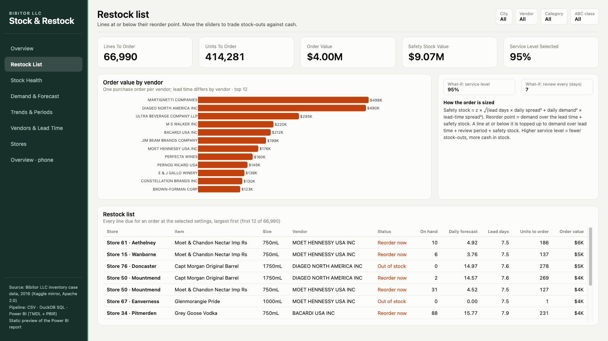
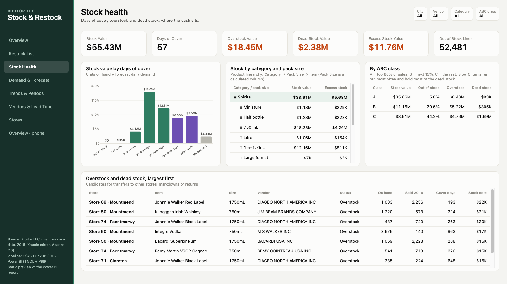
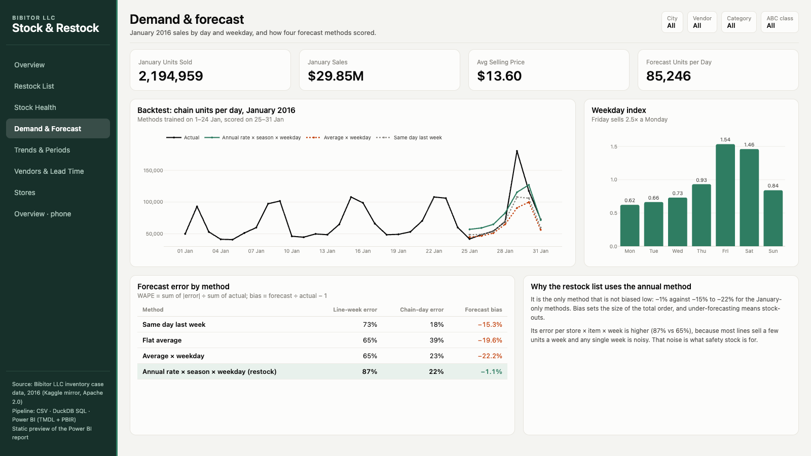
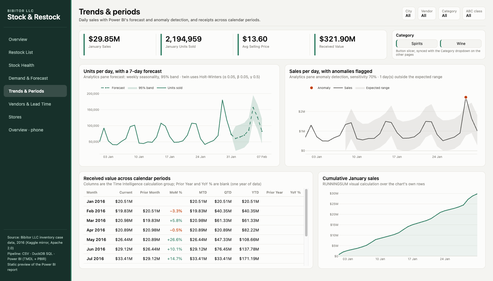
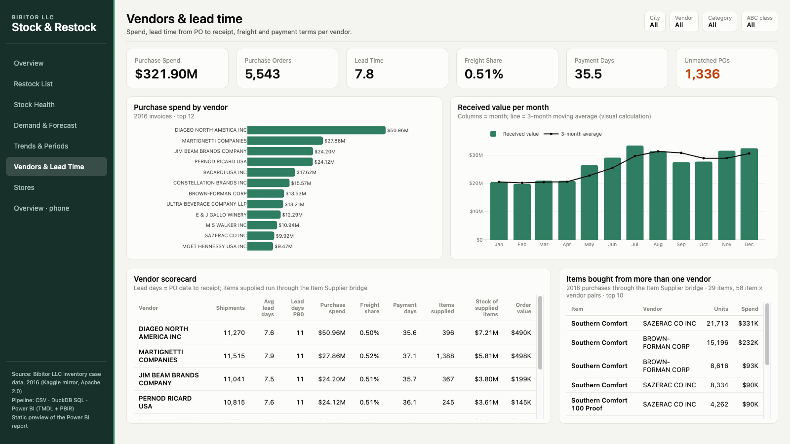
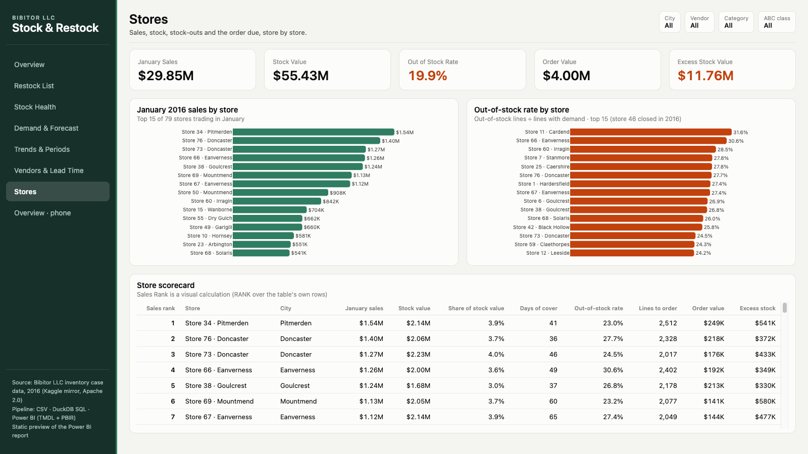
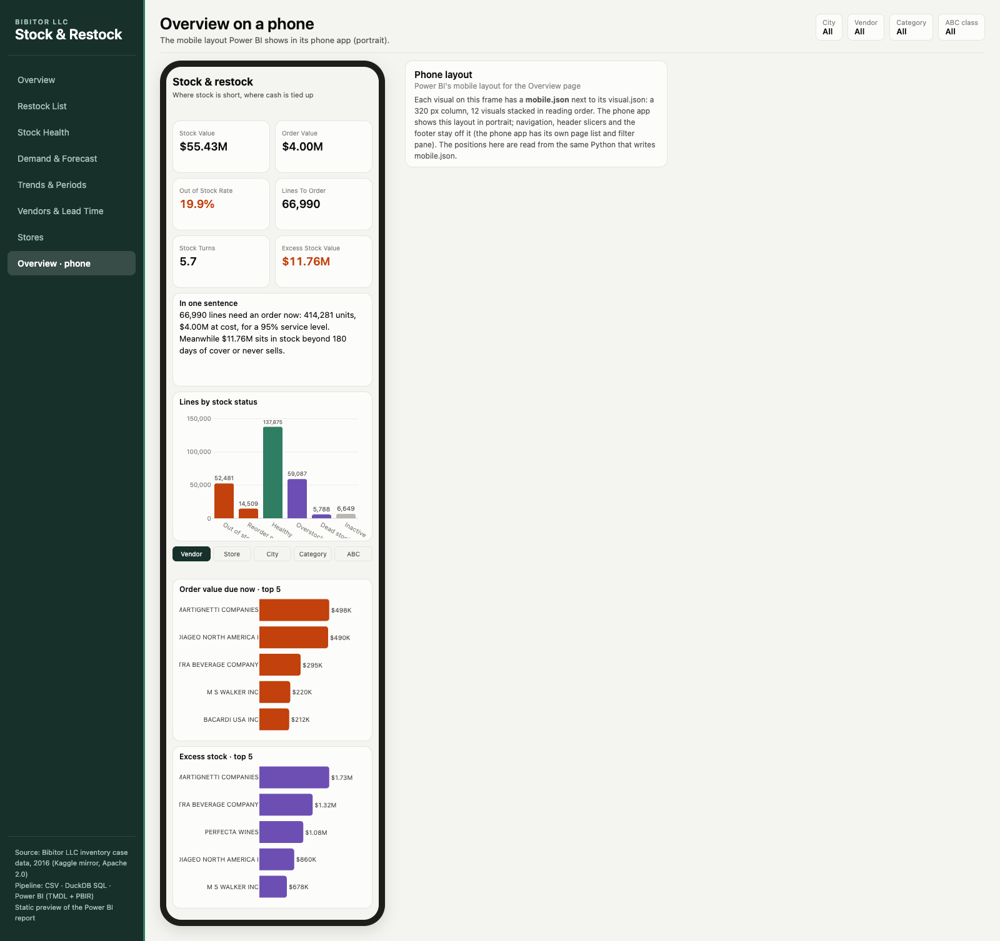
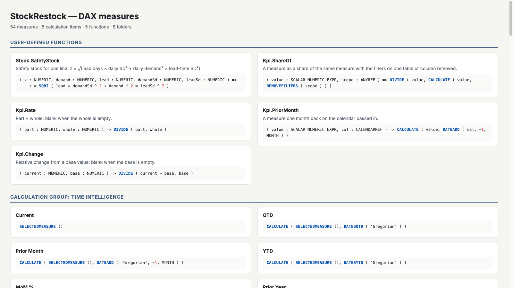

# Stock & Restock: Inventory to Power BI

An inventory and purchasing report for a 79-store wine & spirits chain. A year of stock counts, receiving lines, vendor invoices and daily sales goes through a DuckDB warehouse. Out comes a restock engine (safety stock, reorder point, order quantity per store × item) and a Power BI model that recalculates the order when the service level or review period changes. The report answers four questions:

1. **What has to be ordered now,** how much, and from which vendor?
2. **Where is the cash stuck?** How much stock is beyond any reasonable cover, or never sells?
3. **How good is the forecast** behind the order, and why that method?
4. **How do vendors perform** on lead time, freight and payment terms?


## What the data shows (as of 31 Dec 2016)

| | |
|---|---:|
| Stock on hand at cost | **$55.43M** across 272,623 store × item lines (store 46, closed in 2016, filtered out) |
| Stock turns (2016 cost of goods ÷ year-end stock) | 5.6 |
| Lines out of stock with demand | **52,481 (19.9%)** |
| Order due now at a 95% service level | **66,990 lines, 414,281 units, $4.00M** |
| Stock beyond 180 days of cover, plus dead stock | **$11.76M** |

- **One line in five is empty.** 52,481 lines that sell are out of stock at the year-end count, and they account for $2.60M of the $4.00M order. Another 14,509 lines are at or below their reorder point ($1.39M).
- **At the same time, $11.76M is tied up in stock that is not moving.** $9.38M is the part beyond 180 days of cover; $2.38M sits on lines that sold nothing in 2016. The chain has both problems at once: too little of what sells, too much of what doesn't.
- **The stock-outs are in the tail.** A items (top 80% of sales) are out of stock on 5% of lines; C items (last 5%) on 44%. C items also hold $1.99M of the $2.38M dead stock. That points at range decisions for slow items rather than at the replenishment of best-sellers.
- **Friday sells 2.5× a Monday** (weekday index 1.54 vs 0.62), which matters for when deliveries land.
- **Vendors are uniform.** Average lead time is 7.8 days, the 90th percentile is 10–11 days for nearly every vendor, freight is 0.51% of spend and invoices are paid in about 35 days. Lead time is not where the problem is.
- **New lines don't run out; old ones do.** Lines first listed in 2016 (48,229) are out of stock on 3.3% of selling lines; lines carried over from the opening count on 15.5%. New lines do hold most of the dead stock ($1.71M of $2.38M). 26,850 lines ($5.74M) are going dormant: stock on the shelf, no January sales, no receipt in the last 120 days of 2016.
- **The sales are concentrated.** 1,200 of 10,182 items make 80% of 2016 sales. Re-ranking ABC inside one city (Hardersfield) moves 1,358 of 4,415 brands to another class.
- **1,336 invoices don't match receiving at PO level,** although units and dollars reconcile exactly per vendor. A three-way-match check would flag them.

## Report pages

| Page | What it shows |
|---|---|
| **Overview** | KPIs; lines by stock status; a one-sentence summary that follows the slicers; order due and excess stock by a dimension the user picks (store / city / vendor / category / ABC class). |
| **Restock List** | The order, line by line, with what-if sliders for **service level** (80–99%) and **review period** (1–28 days), grouped as *What-if* in the selection pane. Moving them recomputes safety stock, reorder point and order quantity in DAX. Urgent order value (lines already out of stock); each line's % of the order shown; status shown as icon + label; order value with a background gradient. Hovering a vendor opens the *Line Tip* tooltip page. A bookmark navigator swaps the list between *Order now* and *Excess*. Page filter: dead and inactive lines are left out. Phone layout. |
| **Stock Health** | Stock value by days of cover; a bookmark navigator switching between a matrix on the Product hierarchy (Category → Pack Size → Item) and an ABC class table with lines over their (synthetic) cover target; a waterfall *stock bridge* (opening + received − sold = closing, at cost); closing counted units (semi-additive); overstock and dead stock lines, largest first, with data bars on days of cover. |
| **Demand & Forecast** | January daily sales with a one-week backtest of four forecast methods; weekday index with January units per weekday (TREATAS) in the tooltip; error and bias per method. |
| **Trends & Periods** | The new card visual (four tiles) and a Category button slicer; units per day with Power BI's 7-day forecast and 95% band; sales per day with anomaly detection; received value across the Time Intelligence periods; cumulative January sales (RUNNINGSUM). |
| **Vendors & Lead Time** | Spend by vendor (hover: the *Vendor Tip* page with lead-time P90, freight and payment days); received vs paid per month (paid on the inactive Pay Date relationship) with two 3-month averages, a WINDOW measure and a visual calculation, drillable Year → Quarter → Month; a vendor scorecard built only from fields the *Store Staff* role can see; items bought from more than one vendor. Clicking a vendor filters the scorecard and highlights the monthly chart; the KPI cards ignore it. |
| **Stores** | A bar chart whose measure is picked in a slicer (measure field parameter); stock-out rate per store with a Store Size slicer (a group); a scatter of days of cover vs order due per store; store scorecard with a RANK visual calculation, each store's share of stock value and arrow icons on the out-of-stock rate (▲ under 15%, ► 15–20%, ▼ over 20%). |
| **Assortment** | Pareto of 2016 sales by item (top 40 drawn by a Top N filter; the cumulative-share line still counts every item in the slicers) with an 80% line; ABC class re-ranked inside the slicers next to the stored chain-wide class; out-of-stock rate and dead stock for new vs carried-over lines; lines going dormant. |
| **Movement & Outliers** | Waterfall of the stock value change by category with each category's share; a matrix of year-end status × opening state (stocked or empty on 1 Jan); a procurement funnel (PO raised → invoiced → matches receipts → approved → paid); cover bands counted from a table of Min / Max Days edges; lines whose cover is above their category's 95th percentile (PERCENTILEX.INC). |
| **Diagnose** | Key influencers (what makes a line out of stock: ABC class, category, pack size, city); decomposition tree of the order (vendor → category → store); a Q&A visual that uses the model's synonyms; a *Diagnosis* paragraph written by a DAX measure (out-of-stock rate → class C vs A gap → short vs long lead-time gap → where to drill). |
| **Item Detail** / **Vendor Detail** | Drillthrough pages (hidden; right-click an item or vendor › Drill through), each with a Back button. Item: on hand vs reorder point vs order-up-to per store in a Deneb bullet chart, its vendor and every store stocking it. Vendor: lead-time histogram, invoices without a matching receipt, items shared with other vendors, items to order. |
| *Vendor Tip* / *Line Tip* | 320 × 240 report-page tooltips (hidden). |

Header slicers on every page: **City**, **Vendor**, **Category** and **ABC Class**, synced across pages. On Trends the Category dropdown is replaced by a button slicer in the same sync group. Every page header also has **↺** (a bookmark that puts the slicers back to their defaults) and **?** (a bookmark that shows a help panel with the page's rules; ✕ hides it). Overview and Restock List have a **phone layout**; the twin shows them at `#mobile` and `#restock_mobile`.

Twin anchors: `#overview`, `#restock`, `#health`, `#demand`, `#trends`, `#vendors`, `#stores`, `#assortment`, `#movement`, `#diagnose`, `#item_detail`, `#vendor_detail`, `#mobile`, `#restock_mobile`.

| | |
|---|---|
|  |  |
|  |  |
|  |  |
|  | |

### Report UX: interactions, drill, tooltips, bookmarks

- **Filters pane.** Report level: `Store[Closed 2016] = FALSE`, so store 46 (closed in July 2016, zero at year end) is out of every visual. Page level on Restock List: `Status` is not *Dead stock* or *Inactive*. The plan said `Status IN {Out of stock, Reorder now}`; that would freeze the list at the default 95% / 7 days, because a higher service level moves *Healthy* lines over their reorder point too. Visual level: `Units To Order > 0` on the restock table.
- **Edit interactions** (`visualInteractions` in `page.json`): Overview's two bottom charts filter the status chart and leave the headline sentence alone; on Vendors, a vendor click highlights the monthly chart, filters the scorecard and leaves the KPI cards; on Stores, the metric chart filters the other two.
- **Drill:** Overview's excess chart drills Category → Pack Size → Item (opens on pack size); Vendors' monthly chart drills up to quarter and year.
- **Bookmarks:** 34 files. *Order now* / *Excess* (Restock) and *By pack size* / *By ABC class* (Health) sit in bookmark groups behind bookmark navigators; one reset bookmark per page (data only, slicers to default); a help / hide-help pair per page (display only, toggles the hidden *help_group*).

### Custom visual: Deneb

The Item Detail bullet chart is a [Deneb](https://deneb-viz.github.io/) visual (AppSource, listed under `publicCustomVisuals` in `report.json`); its Vega-Lite spec is versioned in `powerbi/deneb/rop_bullet.json` and inlined by `build_report.py`. Why not a built-in visual: a bullet needs three measures on one row per store (a wide grey bar for order-up-to, a narrow bar for on hand, a tick for the reorder point). The built-in bar chart lays bars side by side or stacks them, and has no per-category target marker. Deneb draws the three layers from a 29-line spec. Deneb has to be allowed by the tenant's custom-visual policy.

### Export and Analyze in Excel

`report.json` sets `exportDataMode` to *AllowSummarized*: the restock table's header is on, so its **⋯ › Export data** gives the buyer a CSV / Excel of the order as filtered. For a live pivot, a buyer with Build permission on the published semantic model opens it in Excel (Power BI service › the semantic model › **Analyze in Excel**, or in Excel **Data › Get Data › From Power Platform › From Power BI semantic models**), puts *Vendor* and *Item* on rows and *Units To Order* / *Order Value* in values. The what-if sliders don't exist in Excel, so it shows the default 95% / 7 days. A paginated purchase-order layout is a later step (14-s16).

### Accessibility

Every data visual and slicer carries alt text (the business question it answers); tab order follows the layout (top to bottom, left to right). Status is never colour alone: icon + label (✖ Out of stock, ! Reorder now, ⚑ Overstock / Dead stock). `build_report.py` checks the theme's text contrast against WCAG AA (4.5 : 1) and stops the build if a pair fails:

| Text | On | Ratio |
|---|---|---:|
| Ink #0b0b0b | surface #FCFCFB | 19.17 |
| Ink 2 #52514e | surface | 7.73 |
| Muted #6F6D68 | surface / plane #F4F4F1 | 5.03 / 4.69 |
| Order now #C2410C | surface | 5.04 |
| Reorder #B45309 | surface | 4.89 |
| Excess #6d4fb3 | surface | 5.98 |
| Accent #2f7d62 | surface | 4.84 |
| Sidebar text #a9c2b8 / white | sidebar #17302a | 7.43 / 14.07 |
| Ink | gradient top #F3B48F / data bar #CFC3EE | 11.00 / 11.90 |

### Object-level security in the visuals

The *Store Staff* role hides the Invoices table and four Vendor columns (Invoiced Spend, Invoiced Freight, Freight Pct, Avg Days To Pay). A visual that uses a hidden field shows an error for that role, so `build_report.py` lists them:

| Page | Visuals that error for Store Staff |
|---|---|
| Vendors & Lead Time | KPI cards Purchase Spend, Freight Share, Payment Days, Unmatched POs; spend-by-vendor bar; received-vs-paid chart (Paid Dollars) |
| Vendor Detail | the same four KPI cards; unmatched invoices table |
| Vendor Tip | the tooltip card (freight, payment days) |
| Movement & Outliers | the procurement funnel (Funnel POs reads Invoices) |

The Vendors scorecard was rebuilt from safe fields only (listed items, lead time, received value, items supplied, order value), and the build asserts it stays that way. A second page per role or field-level fallback measures would hide the errors; that is left for the service step, where the role can be tested with **View as**.

## How it works

```
Six CSV exports (stock counts 1 Jan + 31 Dec, receiving lines, invoices, daily sales, price list)
  → DuckDB SQL: staging → star schema → demand, forecast, restock engine, backtest
  → Power Query mirror of the CSV tables (sql/30_power_query.sql)
  → 26 data tests (all must pass, or nothing is exported)
  → Parquet marts
  → Power BI semantic model (TMDL) + report (PBIR)
```

### The restock engine (`sql/20_marts.sql`, mirrored in DAX)

Per store × item line, as of the 31 Dec count:

- **Demand.** 2016 units sold = begin stock + received − end stock. Divided by the days the line was active, then scaled to January by a per-category seasonal factor (the next order covers January).
- **Safety stock** = z × √(lead days × daily spread² + daily demand² × lead-time spread²). Daily spread comes from the line's January sales; lead time and its spread from the vendor's 2016 shipments.
- **Reorder point** = demand over the lead time + safety stock.
- **Order** = when on hand ≤ reorder point, top up to demand over (lead time + review period) + safety stock, rounded up.
- **Status**: out of stock, reorder now, healthy, overstock (> 180 days of cover), dead stock (stock, no sales), inactive.

The SQL computes the defaults (95%, 7 days) so the tests can check them. The DAX measures recompute the same formulas row by row for whatever the sliders say. The HTML twin and the model agree at the default settings.

### Why the forecast uses the annual rate

Four methods were trained on 1–24 January and scored on 25–31 January:

| Method | Error per line-week | Error per chain-day | Bias |
|---|---:|---:|---:|
| Same day last week | 73% | 18% | −15.3% |
| Flat January average | 65% | 39% | −19.6% |
| January average × weekday | 65% | 23% | −22.2% |
| **Annual rate × season × weekday** (used) | 87% | 22% | **−1.1%** |

The January-only methods have a lower error per line but all under-forecast by 15–22%, because the last week of January sold 24% more per day than the first three. Bias sets the size of the whole order, and a forecast that is 20% low means stock-outs everywhere. The annual method is almost unbiased. Its higher per-line error is noise on lines that sell a few units a week, and covering that noise is what safety stock is for.

### Semantic model

**29 tables, 25 relationships, 102 measures, 8 DAX functions, 1 calendar, 3 roles, 3 perspectives**, compatibility level 1702. Measures sit in display folders (Stock, Restock, Demand, Purchasing, Sourcing, Assortment, Movement, Narrative) and every one has a description. A second model, **Restock Komposit** (7 tables, 8 relationships, 7 measures), shows DirectQuery / Dual / Import on PostgreSQL; see *Storage mode*.

### Relationships

Most relationships are one-to-many, single direction, from a fact to a dimension key. The exceptions:

| From → to | Cardinality | Direction | Active | Why |
|---|---|---|---|---|
| Invoices[PO Date] → Date | many-to-one | single | yes | the default date of an invoice |
| Invoices[Invoice Date] → Date | many-to-one | single | **no** | role-playing date; *Invoiced by Invoice Date* turns it on with USERELATIONSHIP |
| Invoices[Pay Date] → Date | many-to-one | single | **no** | role-playing date; *Paid Dollars* (cash out by payment month) uses USERELATIONSHIP |
| Category Target[Category] → Item[Category] | **many-to-many** | **both** | yes | targets are per category × ABC class, so Category repeats on both sides; both directions so the Category slicer filters the targets too |
| Item Supplier → Item, Vendor | many-to-one | single | yes | bridge table; *Stock of Supplied Items* switches the direction with CROSSFILTER inside the measure, not on the relationship |

The Date table runs from 1 Dec 2015 to 28 Feb 2017 so every PO, invoice and payment date has a row to land on (a test checks it).

**Limited relationships.** A many-to-many relationship is a *limited* relationship, even in Import: the engine joins at query time instead of through the column index, so there is no blank row for unmatched values and RELATED can't cross it. That is why *Lines Over Target Cover* iterates the target table and filters Stock by context transition instead of looking the target up with RELATED. The other kind of limited relationship, across source groups (DirectQuery ↔ Import), is in the composite variant below.

### Storage mode

The main model (**StockRestock**) is all **Import**. Next to it, the same generator writes a second, smaller model, **Restock Komposit** (`powerbi/Restock Komposit.SemanticModel` + a one-page report `Restock Komposit.pbip`), that uses three storage modes against a real PostgreSQL 17 database: db `portfolio`, schema `inventory`, on the Mac Mini, reached from Desktop at `<db-server>` over Tailscale. The database holds the raw till file (`daily_sales_detail`, 1,048,575 rows: all of January 2016 plus 110,979 February rows; the main model's Daily Sales mart keeps January only) and copies of the Date, Store and Item marts. Every partition in both models states its `mode:` in TMDL.

| Table | StockRestock (main) | Restock Komposit (variant) | Source in the variant |
|---|---|---|---|
| Daily Sales Detail | — | **DirectQuery** | `inventory.daily_sales_detail` (raw till rows) |
| Daily Sales | Import | **Import**, hidden aggregation | `GROUP BY sales_date, store, brand` folded to PostgreSQL |
| Date | Import | **Dual** | `inventory.dim_date` |
| Store | Import | **Dual** | `inventory.dim_store` |
| Item | Import | **Import** (on purpose, see below) | `inventory.dim_item` |
| Stock | Import | **Import** | `fact_stock.parquet` |
| every other table | Import | not in the variant | Parquet / CSV |
| (Direct Lake) | — | not built here | Fabric variant: the same marts as Delta tables in a lakehouse, read straight from OneLake (plan rows 11-s15/11-s16, phase G) |

How the variant works:

* **Daily Sales Detail is DirectQuery**: every visual on it becomes a SQL query on PostgreSQL at view time; nothing is copied into the file. The M selects only the columns it needs first, so the query folds.
* **Daily Sales is the aggregation table** (Import, hidden). Its columns carry `alternateOf` mappings to the detail: Sales Date / Sales Store / Sales Brand = group by, Units Sold and Sales Dollars = sum, Sales Rows = count of detail rows. A query that fits day × store × brand (or anything coarser through the related Date, Store and Item) is answered from memory; anything finer (e.g. Price) goes to PostgreSQL. Honest note: the till export is already one row per day × store × brand, so this aggregation has as many rows as the detail (1,048,575; checked in `evidence/komposit-sql-check.txt`, totals match to the cent). Its gain is memory instead of a SQL round trip, not fewer rows; a coarser grain (day × store) would shrink it too.
* **Date and Store are Dual**: the same table is both cached and queryable live, so a slicer on City is fast (from memory) and still joins inside the SQL when it filters the DirectQuery table. Relationships from Dual to DirectQuery and to Import are both regular.
* **Item stays Import on purpose.** The plan row (15-s6) listed Item as Dual; it is kept Import so that **Daily Sales Detail → Item is a limited relationship** (DirectQuery and Import are different source groups). Setting Item to Dual would turn that relationship regular and remove the example.

**Effects of the limited relationship (Daily Sales Detail → Item)**, with a measure for each in the *Limited Relationship* folder:

| Effect | What it means here | Measure |
|---|---|---|
| RELATED / RELATEDTABLE can't cross it | `SUMX ( 'Daily Sales Detail', 'Daily Sales Detail'[Units] * RELATED ( Item[Item Unit Cost] ) )` is an error | *Units At Item Cost* iterates Item instead and lets context transition filter the till rows: `SUMX ( Item, Item[Item Unit Cost] * [Detail Units] )` |
| filters still flow from Item to the till rows | slicing by Category works; the join happens at query time | *Detail Units Via TREATAS* moves the filter with TREATAS (a virtual relationship) and gives the same numbers, the usual workaround when a relationship can't be used |
| no blank row for unmatched keys | till rows whose brand has no Item row would vanish from any visual grouped by Item instead of showing under "(Blank)" | *Units Without Item* = total minus the sum over Item; it is 0 because the database check found 0 orphan brands (also 0 orphan stores and dates) |

A row-by-row LOOKUPVALUE over the till rows is not used: iterating 1,048,575 DirectQuery rows would hit the 1-million-row limit on intermediate results.

**Connecting (Power BI Desktop on Windows):**

1. Tailscale must be up on the laptop (the server address `<db-server>` is the database server address).
2. Open `powerbi/Restock Komposit.pbip`. The PostgreSQL connector is built into Desktop; no driver install.
3. When Desktop asks for credentials for `<db-server>;portfolio`, choose **Database** and enter the read-only login `pbi_reader` (the password is not in this repo). Server and database are the M parameters `PgServer` / `PgDatabase` (Transform data → Edit parameters).
4. Stock still reads the Parquet marts through `DataFolder`; set it to your local copy of `data/marts`.

What was checked on the Mac (no Desktop here): both models pass the TOM validator, both reports pass `pbir validate`, BPA has 0 errors on both models, and the SQL the aggregation folds to was run as `pbi_reader` over Tailscale against the real database. The live DirectQuery run, the aggregation hit and the limited-relationship behaviour are proven in Desktop (checklist in `_plan`, phase F).

Why the main model stays Import, table by table:

1. Does the source support live queries (a SQL database, a warehouse, a Fabric lakehouse)? The main model reads Parquet and CSV files, which don't, so DirectQuery, Dual and Direct Lake are out before size matters. The till rows exist in PostgreSQL only for the variant.
2. Does it fit in memory? The biggest table is *Stock* (276K rows, 15.8 MB Parquet); *Daily Sales* is 938K rows in 3.9 MB. The whole model is a few tens of MB compressed, far below the 1 GB shared-capacity limit.
3. Does it need to be fresher than a scheduled refresh? No: the data is a closed 2016 year.

### Visual calculations vs window functions

The same 3-month average is computed two ways on the Vendors chart. The **WINDOW** measure (*Received Value 3M (WINDOW)*) lives in the model: any visual or query can use it, and it walks the months of the Date table. The **visual calculation** (`MOVINGAVERAGE ( [Paid Dollars], 3 )`) lives in the visual and walks only the rows the chart shows; it is simpler to write but can't be reused. *Received Value Prev (OFFSET)* and *Received Value 3M Avg* (DATESINPERIOD) sit next to the calendar-based *Received Value Prior Month*; `DAXQueries/03 OFFSET WINDOW DATESINPERIOD.dax` puts all of them side by side.

### DAX query view

`powerbi/StockRestock.SemanticModel/DAXQueries/` holds four queries for Desktop's DAX query view: KEEPFILTERS vs a plain filter, vendors to call (SUMMARIZECOLUMNS + FILTER), the window functions vs time intelligence, and the expanded table. The build checks their references like the measures', but they have not been run.

### Power Query tables (straight from the raw CSV)

Most tables read the pipeline's Parquet marts. Four are built in Power Query from the raw exports instead, so the M does the cleaning:

| Table / query | Connector | Steps |
|---|---|---|
| *Price List Raw* (staging, not loaded) | `Csv.Document` on `RawFolder` | promote headers; drop blank brand lines |
| *Price List 2017* (staging, not loaded) | reference to *Price List Raw* | key types with `"en-US"` culture, `RemoveRowsWithErrors`, `try … otherwise null` on prices, drop the row without a size, fix "ml" / double spaces, split "750mL 4 Pk" by delimiter into size mL + pack units, `Text.Proper(Text.Trim())` vendor names, one row per brand |
| *Item* | Parquet + **merge** | left outer `Table.NestedJoin` to *Price List 2017* on the brand, expands *List Price 2017* and *Pack Units* |
| *Stock Counts* | `Csv.Document` × 2 + **append** | one function reads both counts; `Table.Combine`, types, blank city → null, sort, **fill down** the city, proper case, remove duplicates |
| *Vendor Catalog* | reference to *Price List Raw* | **Group By** vendor: item count and average list price |
| *Forecast Metric* | Parquet | **unpivot** the four score columns into Metric / Metric Value (drives the small multiples on Demand) |

`RawFolder` and `DataFolder` are text **parameters**, so the model can be pointed at another folder without editing M. Power Query does not run on the Mac this was built on, so `sql/30_power_query.sql` repeats every step in DuckDB. The tests check that mirror and the twin reads it.

What the steps actually remove in this data: the price list loses exactly one row (brand 4202: no size, no description, price 0). The blank-brand filter, the key-error removal and the price `try` remove nothing here; they are guards for a broken export. Four sizes are "Unknown" and become a null size. The 31 Dec count has 1,284 lines with no city, all store 46, filled down to Tywardreath.

### Power BI methods used, beginner to expert

Each one is in the model or report files, not only described here. Where it lives is in brackets.

**Beginner**
- Star schema: fact tables for stock, daily sales, receipts and invoices around Date, Store, Item and Vendor dimensions (`build_model.py`).
- Card KPIs, clustered bar / column charts, line charts and tables (every page).
- Dropdown slicers for City, Vendor, Category and ABC class (header of every page).
- Sort-by columns: month by month number, weekday by weekday number, pack size by pack order, and so on.
- Display folders, descriptions and format strings on every measure.
- Page navigation buttons in the sidebar.

**Intermediate**
- A date table marked as such, with a Calendar hierarchy (Year → Quarter → Month).
- A **calculated column**, *Pack Size*. DAX bands each item's bottle volume into Miniature, Half bottle, 750 mL, Litre, 1.5–1.75 L or Large format. A hidden *Pack Size Order* column sorts it.
- A **Product hierarchy** (Category → Pack Size → Item), used by the Stock Health matrix and opened at the Pack Size level.
- **Synced slicers.** Each header slicer has a `syncGroup` (City, Vendor, Category, ABC), so a selection follows the user from page to page.
- **Button slicer** (`advancedSlicerVisual`) for Category on Trends, in the same Category sync group as the dropdowns on the other six pages.
- **New card visual** (`cardVisual`): four measures in one visual with an accent bar and dividers (Trends).
- Static and dynamic **row-level security**: *Hornsey District* is static; *Store Manager* maps a login to a store or a whole city through an access table.
- **What-if parameters** *Service Level* (80–99%) and *Review Period* (1–28 days). The restock measures iterate over lines, so the order follows the sliders and the slicers together.
- **Perspectives** Restock, Purchasing and Demand, and **synonyms** for Q&A (for example "supplier" for Vendor, "inventory value" for Stock Value).

**Advanced**
- **Field parameters**: *Analyze By* (store / city / vendor / category / ABC class) on the Overview bars, and a measure parameter *Metric* (January sales, order value, excess stock, stock value, out-of-stock lines) on the Stores bars.
- **Groups and bins**: *Store Size* (Large / Medium / Small: stores in thirds by stock value, a list group) and *Retail Price Tier* ($10 bins on the retail price), both with Desktop's grouping metadata.
- **Inactive relationships and USERELATIONSHIP** (role-playing Date on invoice and pay dates); a **many-to-many** relationship with both-direction filtering (*Category Target*).
- **Semi-additive measures**: *Units On Hand (Closing)* and *Opening Units* take the last / first count date (LASTNONBLANK / FIRSTNONBLANK).
- **Filter-context patterns**: KEEPFILTERS (*Out of Stock Lines A*, *Urgent Order Value*), ALLEXCEPT (*Category Stock Value*), ALLSELECTED (*Share of Selected Order*, *% of Visible Order*, *% of Visible Spend*), FILTER over a table vs a column predicate (*Lines Below Safety*), context transition (*Stores Above 25% OOS*), the expanded table (*Stock Value of Jan Sellers*), RELATED / RELATEDTABLE (*Lines Under P90 Lead*, Vendor[*Lines Stocked*]), TREATAS on a disconnected table (*January Units by Weekday*), virtual tables with ADDCOLUMNS (*Vendors To Call*).
- **Window functions**: OFFSET, WINDOW, RANK with PARTITIONBY (*Vendor Rank in Category*) and INDEX (*Top Order Store in City*); DATESINPERIOD rolling averages.
- **Many-to-many with a bridge table.** *Item Supplier* holds one row per item × vendor that traded in 2016. *Stock of Supplied Items* follows Vendor → bridge → Item → Stock using CROSSFILTER, so a vendor sees the stock of everything it supplied, even when another vendor got the latest order. *Multi-Sourced Items / Spend / Units* use the same bridge.
- **Calculation group** *Time Intelligence*: Current, Prior Month, MoM %, MTD, QTD, YTD, Prior Year and YoY %. The two percentage items have their own format strings. The Trends matrix puts the items on its columns.
- **Dynamic format strings** on money measures: $940, $94K or $3.52M depending on the size of the value. Visuals showing them use display units "None", so the format string decides.
- **Visual calculations:** RUNNINGSUM (cumulative January sales, Trends), MOVINGAVERAGE (3-month line on received value, Vendors) and RANK (Sales Rank column, Stores).
- **Analytics pane forecast:** a 7-day forecast with a 95% confidence band and weekly seasonality on units per day (Trends).
- **Analytics pane anomaly detection** on sales per day (Trends).
- **Mobile layout** for the Overview page: a `mobile.json` beside each of its 12 visuals, stacked in a 320 px phone column.

**Expert**
- **DAX user-defined functions** (`functions.tmdl`):
  - `Stock.SafetyStock`, `Stock.ReorderPoint`, `Stock.OrderQty` and `Stock.CoverDays`, the restock formulas, used inside the row-by-row restock measures and *Days of Cover* (each has a description with a worked example);
  - `Kpi.Rate`, `Kpi.Change` and `Kpi.ShareOf`, with an `ANYREF` scope parameter;
  - `Kpi.PriorMonth`, which takes a `CALENDARREF`.
- **Calendar-based time intelligence.** The *Gregorian* calendar on the Date table maps year, quarter, month, month of year and date columns. The calculation group and `Kpi.PriorMonth` use it instead of the classic date-column functions.
- **Object-level security.** Role *Store Staff* hides the Invoices table and the vendor finance columns (invoiced spend and freight, freight %, days to pay).
- **Best-practice checks.** The full Tabular Editor rule set runs from `tools/pbi-kit` in CI (see *Dev lifecycle* below). `build_model.py` keeps a fast pre-flight and refuses to write when one fails:
  - every column, measure, table, calendar and function reference resolves;
  - parentheses balance;
  - every measure has a description ending in a full stop, and every numeric measure has a format;
  - relationships end on key columns, and foreign keys are hidden;
  - sort-by targets, hierarchy levels, role tables, perspective members and synonym targets exist.
- **Validation against Microsoft's object model.** `tools/tmdl-validate` (TOM 19.117) deserialises the TMDL, runs `Model.Validate()` and round-trips it. **CI** (`.github/workflows/ci.yml`) runs BPA, TOM, the DAX tests and `pbir validate` on every push. The warehouse, the model rebuild and the twin run in the opt-in `data` job, then deploys through Test to Prod (see *Dev lifecycle*).
- **Analytics patterns** (Assortment, Movement & Outliers, Diagnose):
  - *Cumulative Sales Share*: a Pareto over a virtual table of items; REMOVEFILTERS on Item[Item] ignores the axis Top N filter but keeps the other slicers;
  - *ABC Dynamic*: the ABC class recomputed on the brands inside the slicers, shown beside *ABC Static*;
  - *Lines in Band (Dynamic)*: cover bands counted from Min Days / Max Days columns on the Cover Band table instead of the stored band text (a test checks the two agree);
  - *New Line 2016* / *Line Origin* and *Opening State* columns from SQL staging; *Lines Going Dormant* from a *Last Receipt* date;
  - *Stock Value Change* with a contribution % (ALLSELECTED) on a waterfall by category;
  - *Funnel POs* on a disconnected *Funnel Step* table, drawn as a funnel;
  - *Cover P95 by Category* (PERCENTILEX.INC) and *Outlier Lines* / *Outlier Stock Value* against the category's P95;
  - *Diagnosis*: a text measure that writes the page's conclusion and changes with the slicers.
- **The report is written as code (PBIR)**, including the analytics-pane query transforms, the visual calculations, the hierarchy expansion state and the mobile layout.

### Data tests (`sql/90_tests.sql`)

- One row per line; the stock identity is never negative; stock reconciles to the raw counts and receipts.
- January sales cover all 79 stores; the truncated February is excluded.
- Every line maps to an item, store and vendor with a lead time; ABC classes split 80 / 15 / 5.
- Restock maths is internally consistent (an order only at or below the reorder point, never above the target).
- Stores closed during 2016 get no demand and no order.
- Invoices reconcile to receiving lines per vendor, units exact and dollars to the cent.
- The backtest covers a full week and four methods; RLS seeds reference real stores and cities.
- Power Query mirror: the price list drops exactly one row and keeps one row per brand; the stock counts keep every counted line and fill every city; the closing count equals the shelf units in the fact table; the vendor catalog counts every price-list row once; the unpivot is 4 × 4.
- The Date table covers every PO, invoice and payment date; the category targets cover every category × ABC class once.
- A new 2016 line has no opening count and no receipt falls after the year-end count; the Cover Band edges reproduce every line's stored band; every PO on a receiving line has exactly one invoice.

### Every DAX measure

`reports/dax.html` lists every measure, calculation item and DAX function with its description and format string. It is generated from the TMDL by `../tools/dax_gallery.py` (run `python3 ../tools/dax_gallery.py .` from this folder).

[](reports/screenshots/dax.png)

## Honest notes

- **Sales cover January only.** The sales export has exactly 1,048,575 rows, Excel's row limit, and stops on 1 February. The full-year demand is therefore implied from the stock identity, and January sales are used for the weekday profile, the daily spread and the backtest.
- **Implied demand includes shrinkage.** Begin + received − end counts breakage, theft and count errors as sales. The data cannot separate them, so the forecast is slightly high on lines with losses.
- **Store 46 closed during 2016.** Its receipts stop on 27 July and every line counts zero at year end. The first version of the model read that as 100% out of stock and wanted to restock it for $97K. The store is now flagged as closed and gets no demand; a test guards it. The report also filters it out at report level, so its 3,766 inactive lines and its January sales ($115K) are not in any number above; that is why stock turns read 5.6, not 5.7.
- **No on-order data.** The source has no open purchase orders, so the order assumes nothing is in transit. In real use the open-PO quantity would be added to on-hand before comparing with the reorder point.
- **Unit cost** is the latest 2016 receiving cost. Items never bought in 2016 fall back to the December 2017 price list. The 2017 purchase price equals that cost on every stocked line, so a "2017 cost" order value would just repeat *Order Value*. The merge therefore brings the 2017 **shelf** price instead: *Order Shelf Value 2017* ($5.87M) is what the restocked units sell for at the new list prices.
- **Import in the main model; DirectQuery and Dual only in the variant.** Every StockRestock table is Import (Parquet and CSV can't be queried live). DirectQuery, Dual and the aggregation table live in *Restock Komposit* on PostgreSQL; that model was validated on the Mac (TOM, pbir, BPA, the folded SQL run as `pbi_reader`) but its live DirectQuery run is not proven until it is opened in Desktop. Item is kept Import there on purpose (limited relationship), not Dual as the plan listed. Hybrid tables and Direct Lake are not built.
- **Category Target is synthetic.** `seeds/category_target.csv` holds made-up target days of cover (A 60, B 90, C 120 for spirits and 150 for wine). It exists to show a many-to-many relationship and a measure across it; it is not Bibitor data.
- **Urgent Order Value counts out-of-stock lines only.** At the default settings every "reorder now" line is also due, so a filter on both due statuses would just repeat *Order Value*.
- **Invoices vs receiving:** per vendor they reconcile exactly, but 1,336 invoices don't match the receiving lines of their own PO number. This is reported, not fixed.
- **One year of history** means the seasonal factor compares January with the 2016 average; there is no previous January to check it against. For the same reason **Prior Year and YoY % are blank** in the Time Intelligence matrix, in Power BI and in the twin.
- **Phase D analytics, what to know:**
  - The Pareto line only reaches 27% within the 40 items drawn (10,182 items sell); the subtitle in the twin says 1,200 items make 80%.
  - *Outlier Lines* recomputes the category P95 per category and the outlier table filters on it row by row; over 270K lines this may be slow in Power BI. Not measured, because Desktop has not run it.
  - The funnel's first two steps are equal by construction: every PO on a receiving line has an invoice (a test checks it). Only 374 of 5,543 invoices carry an approver, so the funnel drops sharply at *Approved*. That is the data, not a filter.
  - *Received, not counted* lines (bought in 2016 but in neither stock count) are empty at year-end by definition, which is why their out-of-stock rate is 100%.
  - The twin shows *ABC Dynamic* in the default state (no slicer: 225 brands differ from the stored class, because store 46 is filtered out). It quotes the Hardersfield count in the subtitle because it cannot click a slicer.
- **Never opened in Power BI Desktop.** Everything was built and checked on a Mac. The DAX was validated for structure only: references resolve, TOM accepts the model, and it round-trips. No query has run against the data in a Power BI engine, so a measure could still return a wrong number or hit a runtime error that only the engine would show.
- **The forecast and anomaly-detection parameters were hand-written to the schema.** PBIR keeps the analytics-pane settings as a query transform inside the visual's `forecast` / `anomalyDetection` object: forecast length 7, 95% confidence, seasonality 7; anomaly sensitivity 70%. They follow the semanticQuery `QueryTransform` schema and pass `pbir validate`, but they were not produced by Desktop. Desktop may rewrite them, or ignore them, on first open.
- **Report UX that only Power BI can prove:** key influencers, the decomposition tree and Q&A are configured (fields, synonyms) but the AI runs in the product; the Deneb spec has not been rendered inside Deneb (the twin redraws it in plotly); the drillthrough bindings, tooltip pages and bookmark groups pass the schema but have not been clicked. The twin approximates them: key influencers = out-of-stock share with a trait vs without it; the tree follows its largest branch; one Q&A example; tooltips folded into the hover text; bookmarks shown in their default state; one example item / vendor for each drillthrough page.
- **The twin's forecast is a Python approximation of Power BI's.** Power BI's forecast (exponential smoothing) and anomaly detection run inside the product. The twin fits an additive Holt-Winters model with weekly seasonality in Python and draws:
  - a dashed forecast line with a shaded 95% band;
  - anomalies wherever the actual falls outside ±2.5σ of the one-step expectation (only 29 January).

  The shapes should be close to Power BI's, but the exact values will differ.
- **`pbir validate` passes with warnings, no errors** (198):
  - layout advice: VISUAL_UNDERSIZED ×114 (small cards, slicers, header buttons), HIDDEN_VISUAL ×38 (the help panels and bookmark-toggled tables start hidden), TOO_MANY_VISUALS ×12 (the sidebar navigation counts as visuals), TOO_MANY_FIELDS ×19 (scorecard and detail tables), VISUAL_OVERLAP ×3 (the what-if group frame overlaps its own slicers), TOO_MANY_PAGES ×1 (14 pages counting drillthrough and tooltip pages; the advice is 12);
  - VISUAL_LEVEL_FILTERS ×8 (status, due-line, dormant, outlier and Top N filters);
  - HIDDEN_FIELDS ×1 (the hidden *January Sales* that RUNNINGSUM reads);
  - AMBIGUOUS_MATCH ×1 and INVALID_FORMAT ×1: the validator can't look up visual-calculation names (*Paid 3M avg (visual calc)*, *Sales Rank*), because they don't exist in the model.
  - The Metric field parameter is written the way PBIR stores it (`fieldParameters` on the Y well, with the default measure projected); the validator accepts it, but Desktop has not opened it.

  `pbir validate` does not check bookmark snapshots or `visualInteractions`; those were written to the schema by hand and are untested until Desktop opens them. `pbir validate` does not read `mobile.json`. `build_report.py` checks each one against the visualContainerMobileState 2.4.0 rules itself, and all 12 were also checked once with `jsonschema` against Microsoft's schema file.

## Run it

```bash
uv sync
uv run python src/pipeline.py        # download → warehouse → tests → parquet
uv run python src/build_model.py     # powerbi/StockRestock.SemanticModel + Restock Komposit.SemanticModel (TMDL)
uv run python src/build_report.py    # powerbi/StockRestock.Report + Restock Komposit.Report (PBIR) + pbir validate
uv run python src/build_preview.py   # reports/dashboard.html (offline HTML twin)
dotnet run --project tools/tmdl-validate -- powerbi/StockRestock.SemanticModel/definition   # Microsoft TOM check
python3 ../tools/dax_gallery.py .    # reports/dax.html
```

Open `powerbi/StockRestock.pbip` in Power BI Desktop. The semantic model reads `data/marts/*.parquet`. `powerbi/Restock Komposit.pbip` needs the PostgreSQL database over Tailscale (see *Storage mode*).

**Built on a Mac, without Power BI Desktop.** The model is checked with Microsoft's Tabular Object Model: `tools/tmdl-validate` deserialises it, runs `Model.Validate()` and round-trips the TMDL. The report passes `pbir validate` for schema and field references (warnings listed in the honest notes). It has **not been opened in Power BI Desktop**, so visual details may need a touch-up on first open.

The screenshots come from `reports/dashboard.html`. It is an HTML twin of the report's default state (all cities, vendors, categories and ABC classes; Analyze By = Vendor; 95% service level; 7-day review), computed in DuckDB with the same rules as the DAX.

## Dev lifecycle: Git, BPA, DAX tests, deploy (pbi-kit)

The shared toolkit lives in `tools/pbi-kit/`, copied from the portfolio's `tools/pbi-kit`. The project-specific parts are `bpa/project-rules.json`, `dax/10 Headline numbers.dax` with its `.assert.json`, `powerbi/parameter.yml`, `.github/workflows/ci.yml` and `azure-pipelines.yml`. **Nothing here has been pushed, published or run on a Windows machine yet.** Everything that runs on a Mac was run (results below). Steps that need the Service, GitHub or Desktop are listed at the end for you to do.

### Who does what

| Role | Who | Owns | Where |
|---|---|---|---|
| Data engineer | Data team | `src/pipeline.py`, `sql/*.sql`, the 35 data checks, the Parquet marts | This repo, `sql/` and `data/marts/` (on the Service: the gateway share in `parameter.yml`) |
| Modeler | BI developer | `src/build_model.py`: measures, the `Stock.*` UDFs, RLS/OLS, `bpa/project-rules.json`, `dax/*.assert.json` | This repo, `powerbi/StockRestock.SemanticModel` |
| Report author | BI developer with the purchasing lead | `src/build_report.py`: pages, bookmarks, mobile layouts | This repo, `powerbi/StockRestock.Report` |
| Reviewer | A second BI developer | Pull request review and the TMDL/PBIR diff | GitHub PR |
| Approver | Purchasing manager | The go-ahead for Prod | GitHub environment `Prod` (required reviewer) |
| Buyer | Purchasing team, store managers | Nothing in the repo: they use the app (RLS by store / district) | Power BI app from the Prod workspace |

**Ownership pattern.**

| Layer | Owner | Change goes through |
|---|---|---|
| Warehouse and marts (DuckDB SQL, Parquet) | Data team | `sql/90_tests.sql` + `pipeline.py` checks in CI |
| Semantic model `StockRestock` | BI | BPA (kit + project rule), TOM, DAX asserts, PR review |
| Report *Restock* and the other pages | Purchasing (with BI building it) | `pbir validate`, PR review, Prod approval by purchasing |

The team is small, so the buyers don't edit the model. They ask for a change; BI makes it in the generator and purchasing approves the Prod deploy.

### Daily git flow

```bash
git switch -c fix/pct-format                     # 1 branch per change
# edit src/build_model.py (never the generated TMDL)
uv run python src/build_model.py                 # regenerates powerbi/StockRestock.SemanticModel
git diff -- powerbi/StockRestock.SemanticModel   # read the TMDL diff before committing
tools/pbi-kit/bpa/bpa.sh powerbi/StockRestock.SemanticModel/definition --rules bpa/project-rules.json
python3 tools/pbi-kit/dax-tests/daxtest.py powerbi/StockRestock.SemanticModel/DAXQueries --offline
git commit -am "Percentages use the BPA format"  # small commit; push + PR once a remote exists
```

Here is the real diff for one measure from this phase: `Out of Stock Rate` moved from `0.0%` to the BPA percentage format.

```diff
 	/// Out-of-stock lines ÷ lines with demand.
 	measure 'Out of Stock Rate' = Kpi.Rate ( [Out of Stock Lines], [Selling Lines] )
-		formatString: 0.0%
+		formatString: #,0.0%;-#,0.0%;#,0.0%
 		displayFolder: Stock
 		lineageTag: 192fdafe-ce1b-5239-8c55-c24df75020d8
```

`lineageTag`s are already derived from each object's path (uuid5), so a rebuild with no source change produces no diff. CI relies on that: it regenerates everything and fails if the committed PBIP is stale.

### CI gates (`.github/workflows/ci.yml`, mirrored in `azure-pipelines.yml`)

Two jobs. `ci` runs on every push and PR on a clean runner, with no source data (the data is gitignored). `data` is opt-in because it downloads the public source data.

**`ci`** (the required check):

1. **Report:** `build_report.py` regenerates the report from source (it needs no data), and the job fails if it differs from the committed one.
2. **BPA, every semantic model:** 71 Microsoft rules, 3 kit rules and 1 project rule, on TOM. Fails on severity ≥ 3.
3. **TOM validate:** every model.
4. **DAX tests (offline).**
5. **PBIR validate.**

**`data`** (Run workflow with `data` ticked, or set the repo variable `RUN_DATA=true`; in Azure DevOps the pipeline variable `RUN_DATA=true`):

6. **Data tests:** `src/pipeline.py` (download → DuckDB → 35 checks → Parquet), then rebuild the models from the warehouse and the HTML twin and fail if the committed TMDL is stale.

7. **On `main` only** (`deploy-test` needs `ci` and `data`; a skipped `data` job does not block it, a failed one does): publish to Test (fabric-cicd + `parameter.yml`) → refresh → DAX asserts against Test → approval on `Prod` → publish to Prod.

An optional `bpa-te2` job runs the same rules in Tabular Editor 2 on a Windows runner. The short Python checks in `build_model.py` stay as a fast pre-flight (references, keys, descriptions); the full BPA now runs from the kit.

**BPA, before → after** (`evidence/bpa-before.txt` → `evidence/bpa-after.txt`, JSON in `evidence/bpa.json`): **5 errors / 181 warnings / 199 info → 0 / 165 / 199.**
- **Percentages:** `PCT1` is now `#,0.0%;-#,0.0%;#,0.0%` (16 warnings gone).
- **Ignored on purpose** (annotation `BestPracticeAnalyzer_IgnoreRules`, which Tabular Editor also reads): the 5 text measures *Headline*, *Diagnosis*, *Top Order Store in City*, *ABC Dynamic*, *ABC Static* ignore `PROVIDE_FORMAT_STRING_FOR_MEASURES` and `INTEGER_FORMATTING`. They return sentences or class letters, so a number format means nothing. These were the 5 errors.
- **165 warnings left on purpose:**
  - **Dollar measures** use the dynamic `$…K / $…M` format string, which `INTEGER_FORMATTING` doesn't recognise.
  - **6 other % formats:** whole percent (`0%`) on service level, WAPE and the Pareto line, where a decimal adds noise; two decimals on *Freight Share* (freight is under 1%); the signed `+0.0%` on *Received Value MoM*.
  - **Double columns** (forecast, SD, lead days, costs): the maths needs fractions.
  - **Visible date and category columns** that the report slices on (`Item[Category]`, the Invoices dates).
  - **Calculated tables:** field parameters, what-if tables and the calc group.

**Project rule `PROJ_RESTOCK_USES_UDF`** (severity 3, in `bpa/project-rules.json`): a measure in the *Restock* folder that does safety-stock or order maths (`SQRT`, `ROUNDUP`, `NORM.S`) must call a `Stock.*` UDF, so the formula lives in `functions.tmdl` once. It passes on the model today. Tested against a copy where `Safety Stock Units` inlined the formula: the rule fires as an error.

**DAX test** (`dax/10 Headline numbers`, copied into `DAXQueries/` by the generator). At the default slicers (95% service, 7-day review), checked against DuckDB over `mart.fact_stock`, the same numbers as the headline table:

| Measure | Assert |
|---|---|
| Stock Value | $55,429,569.00 (±1) |
| Out of Stock Lines | 52,481 |
| Order Value | $3,996,717.32 (±1) |
| Lines To Order | 66,990 |
| Units To Order | 414,281 |

Offline all 5 query files pass (syntax, references, assert file). The asserts haven't been executed: that needs a published model.

**Deploy:** `deploy.py --dry-run` passes for Test and Prod (`evidence/deploy-dry-run.txt`): 2 items, the model and the report. `powerbi/parameter.yml` swaps `DataFolder` (Parquet marts) and `RawFolder` (CSV exports) per environment to a gateway share. The `\\fileserver` values are placeholders.

### Why Git + fabric-cicd

| Option | Fit for a small purchasing team |
|---|---|
| Fabric Git integration only | Syncs a workspace with a branch, but runs no checks before the model lands. |
| Deployment pipelines only | Easy Dev → Test → Prod with rules, but nothing stops a model that breaks BPA or changes the order total. |
| **fabric-cicd from GitHub Actions** | **Chosen.** The repo is already the source of truth (TMDL and PBIR are generated), so CI can block a bad model before any workspace sees it, and the purchasing manager approves Prod on a GitHub environment. |
| Own REST scripts | Same control as fabric-cicd, but more code to maintain. |

The full comparison is in `tools/pbi-kit/docs/cicd-options.md`. A deployment pipeline alone would be simpler, but the restock numbers drive real orders, and a DAX assert on the $4.00M order is the check that matters.

### Your steps (Service / GitHub / Desktop)

1. **12-s8, repo and PR:** create a GitHub repo, `git push -u origin main`, then open a PR from a branch. Screenshot → `evidence/12-s8.png`.
2. **12-s15, branch protection:** follow `tools/pbi-kit/ci/branch-protection.md`. Require a PR and the `ci` check on `main`. Screenshot → `evidence/12-s15.png`.
3. **14-s5, service principal:** follow `tools/pbi-kit/docs/service-principal.md`.
   1. Create the Entra app with a federated credential for this repo.
   2. Add it as Member of `StockRestock-Test` and `-Prod`.
   3. Turn on the tenant settings for service principals and the Fabric APIs.
   4. Set the `AZURE_CLIENT_ID`/`AZURE_TENANT_ID` secrets, plus `vars.FABRIC_WS_TEST`/`FABRIC_WS_PROD`/`PBI_DATASET_NAME` (`StockRestock`).
   5. `PBI_ACCESS_TOKEN` must be a **user** token: the model has RLS roles, and executeQueries refuses service principals on RLS models.

   Screenshot → `evidence/14-s5.png`.
4. **14-s7, parameter.yml:** replace the `\\fileserver` placeholders in `powerbi/parameter.yml` with the gateway share (or SharePoint folder) holding the marts and raw CSVs. Rerun `deploy.py --dry-run`. Save the output → `evidence/14-s7.txt`.
5. **14-s6 / 14-s8 / 14-s9, pipeline:** push to `main`. Watch `ci` → `deploy-test` (publish, refresh, DAX asserts online) → approve `deploy-prod`.
   - Run log → `evidence/14-s6.txt`.
   - Pipeline graph → `evidence/14-s8.png`.
   - DAX assert output (Order Value $4.00M, 52,481 OOS lines, Stock Value $55.43M) → `evidence/14-s9.txt`.
6. **12-s14, Azure DevOps mirror:** import `azure-pipelines.yml`, using the service connection `pbi-kit-fabric` and the variable `PBI_USER_TOKEN`. Set `RUN_TE2_BPA=true` to run the Windows TE2 job. Screenshot → `evidence/12-s14.png`.
7. **14-s4, CI/CD options:** after step 5, screenshot the Actions run as the proof for the chosen option → `evidence/14-s4.png`.
8. **12-s12 / 12-s13 / 8-s14, Tabular Editor 2 on Windows:**
   1. Run `pwsh tools/pbi-kit/bpa/te2-bpa.ps1 -Model powerbi/StockRestock.SemanticModel/definition -ProjectRules bpa/project-rules.json`. Save the output → `evidence/12-s12.txt`.
   2. In TE's BPA window, confirm that the 5 text measures show as ignored and that `PROJ_RESTOCK_USES_UDF` loads. Save → `evidence/12-s13.txt`.
   3. Open the model in Tabular Editor via Desktop (External Tools) and run BPA there once. Screenshot → `evidence/8-s14.png`.

## Source & licence

The data is the Bibitor LLC inventory case study, from a [Kaggle mirror](https://www.kaggle.com/datasets/bhanupratapbiswas/inventory-analysis-case-study) under Apache 2.0. The download is pinned by SHA-256 so the numbers never drift. Bibitor LLC is a fictitious company.
