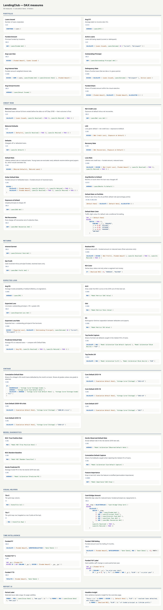
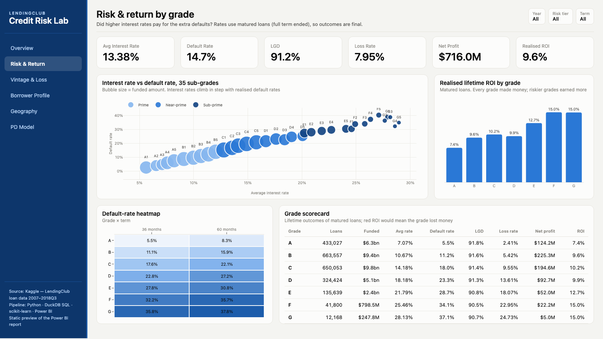
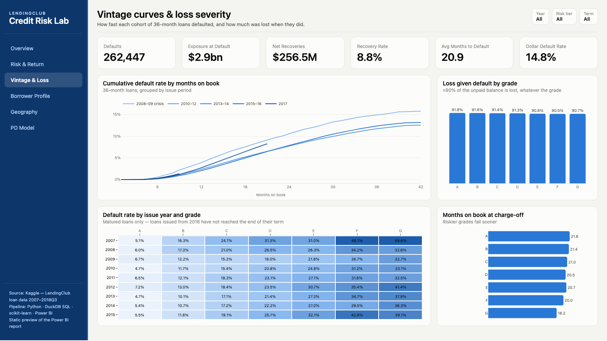
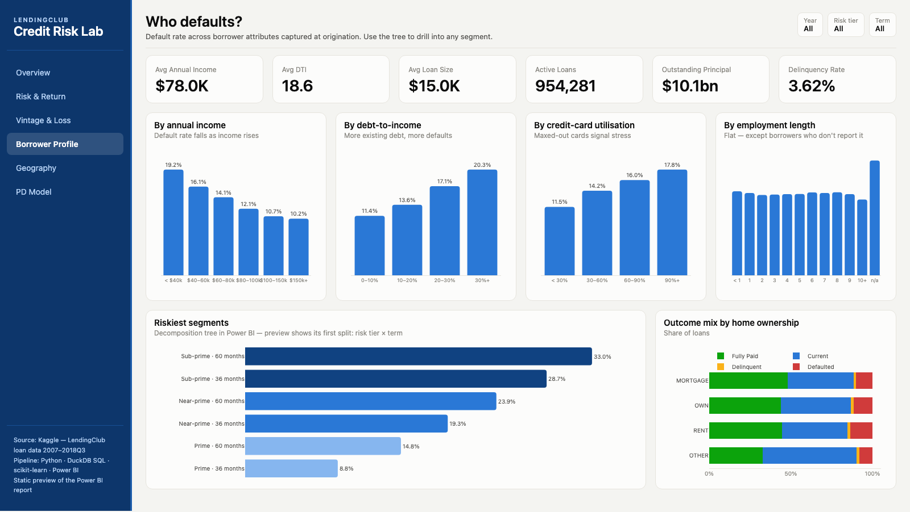
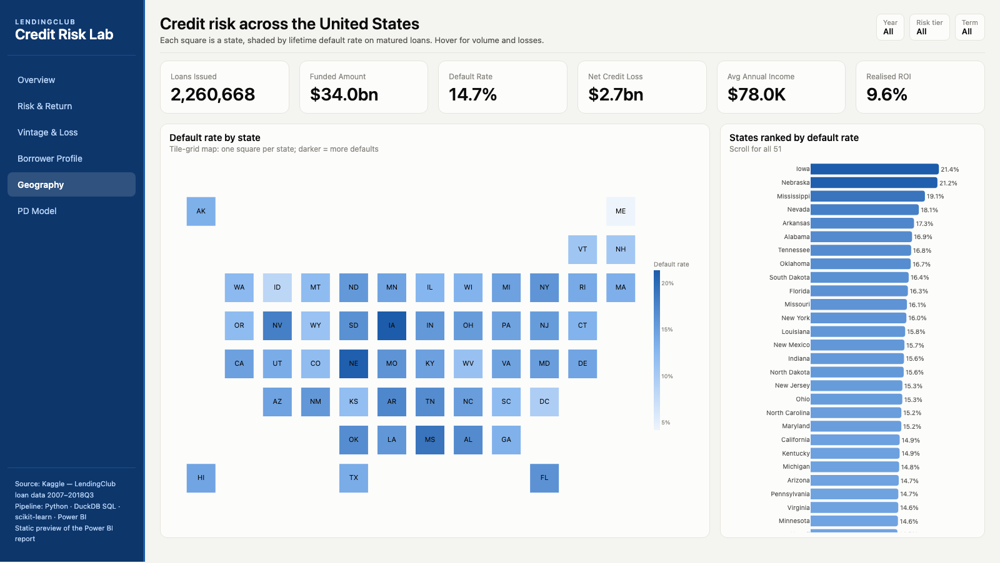
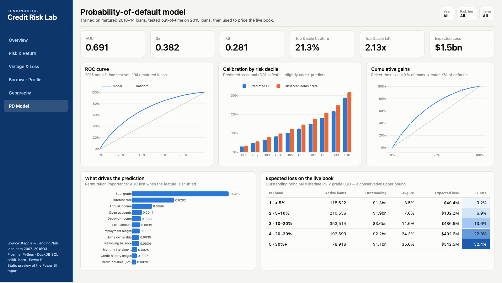

# Credit Risk Lab — LendingClub, 2007–2018

End-to-end credit-risk analytics on **2.26 million LendingClub consumer loans** (Kaggle):
Python ingestion → DuckDB SQL star schema → gradient-boosted probability-of-default model →
a 6-page Power BI report, plus an HTML twin of the report for review on any machine.


## What it answers

| Page | Question |
|---|---|
| Overview | What was lent, what came back, what was lost? |
| Risk & Return | Did higher interest rates pay for the extra defaults? |
| Vintage & Loss | How fast did each cohort default, and how much was lost? |
| Borrower Profile | Which borrower attributes predict default? |
| Geography | Where in the US is credit risk concentrated? |
| PD Model | How good is the default model, and what is the live book's expected loss? |

## Key findings

- **$34.0bn** funded across 2.26M loans. On matured loans (full term ended) the lifetime default rate is **14.7%** and lenders kept **9.6%** of principal as profit.
- **Every grade made money.** Riskier grades earned *more* (F/G ≈ 15% lifetime ROI vs 7.4% for A): pricing more than covered the extra defaults.
- **Loss given default is ≈91% for every grade.** Recoveries are tiny, so grade drives *how often* loans fail, not how badly.
- 60-month loans default far more than 36-month ones within every risk tier (Sub-prime: 33% vs 29%).
- Default rate rises steadily with debt-to-income (11% → 20%) and card utilisation, falls with income (19% → 10%), and is flat across employment length. The exception is borrowers who don't report employment (21%).
- The PD model scores **AUC 0.691 / KS 0.281** out-of-time. Its riskiest 10% of loans hold 21% of all defaults (2.1× lift).

## A methodology trap this project avoids

The naive "defaults ÷ resolved loans" metric says grades D–G **lost money**. That's wrong.
Young loans that default are resolved within months, but young loans that pay on time are still
open, so recent vintages look far riskier than they are. Every default-rate, loss-rate and ROI metric
here uses **matured loans only** (`issue_date + term ≤ Sep 2018`), and the PD model trains and tests on matured loans.
Fixing this flipped the grade-level conclusion.

## Pipeline

```
Kaggle CSV (1.2 GB, 145 cols)
  └─ sql/10_staging.sql      type & clean                     ─┐
  └─ src/pd_model.py         HistGradientBoosting PD model     │  src/pipeline.py
  └─ sql/20_marts.sql        star schema (fact + 5 dims)       │  (~45 s)
  └─ sql/30_analytics.sql    vintage curves, LGD by grade      │
  └─ sql/90_tests.sql        16 data-quality tests (gate)     ─┘
  └─ data/marts/*.parquet    ─► Power BI (import mode)
```

- **Model:** origination-time features only (no leakage), trained on matured 2010–14 loans, tested out-of-time on 2015 36-month loans. Outputs ROC, calibration by decile, gains and permutation importance as tables.
- **Expected loss** on the live book = outstanding principal × lifetime PD × empirical grade LGD. This is a conservative upper bound, because lifetime PD ignores the months already survived.
- **Tests** cover key uniqueness, referential integrity, reconciliation to the raw tape, monotone vintage curves, and a cash bridge that adds up to net profit.

## Power BI

`powerbi/LendingClub.pbip` is a PBIP project (TMDL semantic model + PBIR report), fully generated by code:

- `src/build_model.py` generates 22 tables (13 loaded from Parquet, 3 shaped in Power Query, 4 calculated tables, the `Time Calc` calculation group and the measure table), 9 relationships, 93 DAX measures in display folders and 3 user-defined functions. It also writes the composite variant `LendingClub.Fabric.SemanticModel` (see below). Column types come from DuckDB, and a pre-check makes sure every DAX column/measure reference resolves.
- `src/build_report.py` generates 6 pages. Each page has a navy navigation sidebar, synced Year/Tier/Term slicers, KPI cards, and conditional formatting: default-rate heatmaps, a tile-grid US map and measure-driven colours. The theme is `CreditRiskLab.json`.
- Palette: one blue ordinal ramp (risk tier, vintage), the status palette for loan outcomes, and a sequential blue for heatmaps. All were checked with a colour-blind-safety validator.

### Power Query (M) layer

Most shaping happens upstream in DuckDB SQL, but some steps belong in Power Query because they work on a
source that SQL doesn't own (LendingClub's own Excel data dictionary) or are classic report-side reshapes.
All M is generated by `src/build_model.py`; `src/glossary.py` mirrors the same steps in Python so the pipeline
can test them (4 glossary tests) and the HTML twin can show the result.

- **`Dictionary Raw`** (staging expression, load disabled): `Excel.Workbook` over `LCDataDictionary.xlsx` →
  keep the `LoanStats` + `browseNotes` sheets → `Table.Combine` (append) → keep two columns →
  `Table.Skip` with a condition (drops blank leading rows; it skips 0 rows on today's file) → promote headers.
  Other queries **reference** it instead of duplicating the load.
- **`Field Glossary`** (199 fields): marks the second sheet's header row → `Table.FillDown` the sheet name →
  `Table.ReplaceValue` for sheet names → removes header/footnote rows → cleans text inside
  `try … otherwise null` (codes carry trailing spaces and non-breaking spaces) → fixes the two
  secondary-applicant FICO descriptions that LendingClub swapped → `Table.Distinct` → `Text.Proper` label → index column.
- **`Purpose`**: the display label is rebuilt from the code with `Table.ReplaceValue` (`credit_card` → `Credit card`).
- **`Model Importance`**: left-outer `Table.NestedJoin` to the glossary (a mapping record translates renamed
  features such as `annual_income` → `annual_inc`); all 22 features get a definition, shown as a tooltip on the bar chart.
- **`Loans`**: report columns are kept first, then `[funded_amount] > 0`, then types; the term text
  (`"36 months"`) is split into a numeric `Term Months` column with `Splitter.SplitTextByDelimiter`.
- **`Model Metrics Long`**: `Table.UnpivotOtherColumns` turns AUC/Gini/KS into rows, so one card visual with
  small multiples shows all three. **`Vintage Summary`**: `Table.Group` per vintage × grade (lifetime cumulative
  default, months observed).

**Query folding:** Parquet and Excel sources don't fold, so filter and column-removal steps come first to cut
rows before the expensive steps. On a SQL/Lakehouse source the same order folds; check with
*View Native Query* there. The model sets `dataAccessOptions.returnErrorValuesAsNull`, so a cell that fails type conversion
loads as blank instead of failing the refresh; text cleaning additionally uses `try … otherwise null`.

### Semantic model & DAX

**Storage modes.** Two models come from the same generator:

| Table | `LendingClub.SemanticModel` (main) | `LendingClub.Fabric.SemanticModel` (composite) | Why |
|---|---|---|---|
| Loans (2.26M rows) | Import | DirectQuery to the Lakehouse SQL endpoint | the only big table; DQ keeps it in the Lakehouse |
| Loans Agg | — | Import, `alternateOf` Loans (sum Funded Amt, count rows by issue date × sub-grade × state × purpose) | totals and trends hit the cache, not the endpoint |
| Date, State, Purpose | Import | Dual | join to both the DQ fact and the Import agg without a limited relationship |
| Grade | Import | Import | carries calculated columns, so it can't be Dual |
| Everything else | Import | Import | small marts and model outputs |

The composite variant has no calculated columns and no `Field Glossary` (the Excel file is local); the one
measure that needs a calculated column (`Rate Premium`) is left out of it, and `build_model.py` prints which.
**Regular vs limited:** in the composite model Loans (DirectQuery) → Grade (Import) crosses source groups, so it is a
*limited* relationship: no blank row for unmatched keys, the join runs as a query-time intersection, and `RELATED`
across it is not allowed in calculated columns. The generator prints every relationship with its kind.
Neither model has been loaded in Power BI Desktop or deployed to Fabric; both pass the TOM validator.

**Which design when** (11-s17):

1. **Import** — today: 2.26M rows fit comfortably in memory, refresh is a monthly tape. Stay here until the model stops fitting the capacity or refresh time hurts.
2. **Composite + aggregations** — when the fact table outgrows memory but most visuals ask for totals by month/grade/state: keep the fact in DirectQuery, cache an Import agg (`Loans Agg`) and make the dims Dual.
3. **Direct Lake** — when the data already lives as Delta tables in a Fabric Lakehouse: no import copy and no DQ round-trip; fall back to DirectQuery only for features Direct Lake doesn't support (calculated columns on the fact, for one).

**Relationships.** Loans[Issue Date] → Date is active; Loans[Last Payment Date] → Date is a second, *inactive*
relationship: Date plays two roles, and `Loans Closed` switches to it with `USERELATIONSHIP` (Vintage page: loans issued vs closed per month).
Grade → 'Grade LGD' snowflakes the LGD rate onto the grade letter. 'Vintage Curve' ↔ Grade is many-to-many on the
grade letter (single direction, Grade filters the curve), so the Risk Tier slicer narrows the vintage curves;
`Vintage Cum Default (Tier)` does the same with `TREATAS` and the relationship switched off (`CROSSFILTER … NONE`).
`powerbi/LendingClub.SemanticModel/DAXQueries/m2m-vs-treatas.dax` compares both; its expected values come from DuckDB.
Hierarchies: `Calendar` (Year → Year Quarter → Month Year), `Credit Grade` (Risk Tier → Grade → Sub Grade), `Geo` (Region → Division → State Name).

**Calculated column vs measure** (3-s1, 3-s11):

| Use a calculated column when… | Use a measure when… |
|---|---|
| the value is a property of one row and goes on an axis, slicer or relationship — `Loans[Interest Rate Band]` (5-point bands, sorted by a hidden helper) | the value is an aggregate that must react to filters — `Default Rate` |
| it needs context transition once per row of a small table — `Grade[Sub Grade Avg Rate]`, `Grade[Sub Grade Loans]` (`RELATEDTABLE`) | it would cost memory on 2.26M rows for a number only shown in totals |

`Purpose[Purpose Group]` is a data group (calculated column with `GroupingMetadata`, e.g. *Refinancing* = debt consolidation + credit card).
Calculated tables: `MOB` (`GENERATESERIES(0, 60)`, a disconnected axis for cohort DAX) and the what-if parameters `PD Multiplier` (0.5–2.0) and `LGD Shock` (−0.2 to +0.1).

**Time intelligence.** Classic functions on 'Date'[Date] (`Funded QTD/MTD/PM/PQ`, `Funded 3M Avg` over `DATESINPERIOD`)
plus a **calendar-based** definition `Gregorian` on Date (TMDL `calendar`, compatibility level 1702; preview feature):
the quarter and month groups use the unique sort keys (`Year Quarter Sort`, `Month Year Sort`) as primary columns and the
labels as associated columns, so a filter on Month Year is read as a month filter and `DATEADD('Gregorian', -1, YEAR)`
in `Funded PY (Cal)` shifts it a year back instead of clearing it. The `Time Calc` calculation group (Current, PY, YoY %, YTD,
12M Rolling) applies those to any measure through `SELECTEDMEASURE()`; YTD skips ratio measures with `ISSELECTEDMEASURE`
(a year-to-date default rate is not a sum), and the YoY % item carries its own percent format string.
`Funded Amount` and `Net Profit` use a dynamic format string ($bn / $m / $k by size).

**Semi-additive stock.** `Book Balance` (sql/30_analytics.sql) is an **estimate** of each loan's outstanding principal at every
month end, from the standard amortisation schedule up to the last payment date. The tape has only today's balance, not monthly
snapshots, so prepayments and missed payments are not in the path. Feb 2019 comes out at $9.80bn against $10.05bn on the tape
(a test keeps the gap under 10%). `Book Outstanding` takes `LASTDATE` in the filter context, so a year shows its December balance
and is never a sum of twelve month-ends. The table has no term column, so the Term slicer does not filter it.

**Window functions** (9-s6):

| Function | Measure | Reads as |
|---|---|---|
| `OFFSET(-1, …)` | Default Rate Prev Vintage | value of the previous Vintage Year in the ordered list |
| `WINDOW(1, ABS, 0, REL, …)` | Funded Running Total | from the first selected month up to this one |
| `RANK(DENSE, …)` | State Default Rank | 1 = highest default rate among the selected states |
| `INDEX(1, …)` | Worst Sub Grade | first row of the sub-grades ordered by default rate, descending |

All of them take an explicit `ORDERBY` on a sort key (`Month Year Sort`, `Vintage Year`, the measure itself) so the order never depends on labels.

**User-defined functions** (`functions.tmdl`, prefix `LC.`, a `///` description on each, listed in `reports/dax.html`):
`LC.MaturedOnly(m : EXPR)` wraps the methodology rule (matured, resolved loans only) and is used by Matured Loans,
Matured Defaults, Loss Rate, Realised ROI and Predicted Default Rate. It takes **EXPR** because the measure must be
evaluated *inside* its `CALCULATE`, after the matured filter is applied. `LC.SafeRate(num : VAL, den : VAL)` takes **VAL**:
both numbers are computed once in the caller's context and only divided. `LC.VsPortfolio(m : MEASUREREF)` subtracts the
all-selected value of any measure (`Default Rate vs Portfolio`, `ROI vs Portfolio`).

**Problem → DAX tool** (9-s15):

| Problem in this project | Tool |
|---|---|
| young loans make default rates look too good | `LC.MaturedOnly` (UDF, EXPR parameter) |
| tier slicer must narrow the vintage curves | many-to-many relationship, or `TREATAS` |
| closed loans by month of last payment | inactive relationship + `USERELATIONSHIP` |
| 60-month rate next to the row's own term | `KEEPFILTERS` (blank where the row says 36 months) |
| share of all defaults | `REMOVEFILTERS(Loans)` |
| sub-grade vs its letter grade | `ALLEXCEPT(Grade, Grade[Grade])` |
| worst state, worst sub-grade | `TOPN` + `CONCATENATEX`, `INDEX` |
| balance at month end, not a sum | `LASTDATE` (semi-additive) |
| expected loss recomputed in the model | `SUMX` + `RELATED` over Loans → Grade → 'Grade LGD' (reconciles to the SQL column to the dollar, see `DAXQueries/expected-loss-reconcile.dax`) |

**Security.** `West Region` is a static role (`State[Region] = "West"`). `Regional Analyst` is dynamic: it looks up
`USERPRINCIPALNAME()` in `Region Access`. **`Region Access` is synthetic** — a hidden `DATATABLE` of example.com
addresses, there only to show the pattern; replace it with a real user → region table. `Business Viewer` uses
object-level security: the three model-risk tables are hidden and Loans[Annual Income] and Loans[DTI] are hidden
columns. Caveat: any measure that touches a hidden column (`Avg Annual Income`, `Avg DTI`) errors for that role, so
visuals with those measures break under it. `DAXQueries/ols-test.dax` has the queries to try with *View as*; it has not been run.

**Incremental refresh.** `RangeStart`/`RangeEnd` filter Loans[Issue Date] in the partition query, and a refresh policy
keeps 12 years and refreshes the last 3 months (monthly tapes arrive by issue date). Power BI Desktop loads the whole
range; the partitions only appear after publishing to the service.

**Performance.** `build_report.py` lists Loans columns that no visual, DAX expression, relationship or sort-by uses;
the ones it flagged (Loan Amount, Credit History Years, Revolving Utilisation) are removed in Power Query. Loan ID is kept
for the detail page with `encodingHint: Value`; the amount columns are `isAvailableInMdx: false` (no attribute hierarchies).
Perspectives `Credit Risk` and `Model Risk`, and Q&A synonyms (en-US culture), round off the model.

### Report layer (PBIR)

Seven navigation pages plus three hidden ones: **Loan Detail** (drillthrough on sub-grade, state or purpose; a
locked page filter keeps it to current and delinquent loans; a Back button returns) and two report-page tooltips,
**Grade Tip** (scatter, heatmap) and **State Tip** (tile map). Overview, Risk & Return, Vintage and Geography are tall
pages (1600 × 1232, vertical scroll).

- **Interactions.** The Time Calc slicer only drives its matrix (`NoFilter` to everything else on the page); the term
  slicer leaves the cash waterfall alone (the bridge has no term); a donut slice *highlights* three charts; the scatter
  *filters* the grade × term matrix (a matrix can't highlight) and highlights the rate-band columns.
- **Bookmarks.** Count / Dollar on Vintage flip two curve visuals (display-only, target visuals only); one reset
  bookmark clears the year, tier and term slicers on every page; each page has a help overlay shown and hidden by a pair
  of bookmarks. Header slicers are synced across pages by sync group.
- **Field parameters.** `Risk Metric` (default rate, loss rate, ROI, rate) feeds a table on Vintage; `Borrower
  Attribute` swaps the axis of the Borrower Profile column chart. The Risk Metric parameter sits in a table, not a
  matrix, because the PBIR visual catalog rejects a parameter column in a matrix's Values well.
- **Filters.** Report level: Application Type (Individual / Joint). Page level: the locked live-loan filter on Loan
  Detail. Visual level: Top N 15 states by default rate. Export is set to summarized data only, and Loan Detail shows
  an income band, not the raw income.
- **Analytics pane.** Linear trend on the monthly originations line (native `trend` object). The average line on the
  scatter and the 25th-percentile line on the ROI chart are y-axis reference lines whose value is a measure
  (`Sub Grade Avg Default Rate`, `Grade ROI P25`): the PBIR catalog has no average or percentile line object for these
  visuals, so they are built from measures.
- **Custom visual.** The interest-rate box plot is Deneb (Vega-Lite, spec in `powerbi/deneb/rate-boxplot.json`), fed by
  `Rate P05…P95`. It has never been rendered in Power BI; Deneb has to be allowed in the tenant's org visuals.

**Visual calculations** (preview feature): `Share of defaults` = `COLLAPSEALL` percent of grand total (its helper
`Matured Defaults` is hidden in the visual), `Cumulative funded` = `RUNNINGSUM` over the Calendar drill, `Versus previous`
= ROI minus `PREVIOUS` (blank on the first category). Limits: they live in the visual only (no reuse in other visuals or
DAX queries), they can't be the target of conditional formatting from another visual, they don't export as model
measures, and their result depends on the visual's axis order, so a re-sorted chart changes `PREVIOUS`.

**Accessibility.** Every visual has alt text (generated from its type, title and fields, overridden where a sentence is
clearer); tab order runs nav → header slicers → help/reset → visuals top-left to bottom-right; body text passes 4.5:1
on the light canvas (ink #0b0b0b, #52514e); the muted grey #898781 (about 3.5:1) is used for axis labels and card
captions and falls short of AA for small text, a known gap; no chart
relies on colour alone: every bar and tile has a data label or a tooltip with the value. A mobile layout is defined
for Overview and Risk & Return.

**Business-analysis layer.**

- **Pareto** of net credit loss by state (Geography): `Loss Share` bars, `Cum Loss Share` line (`WINDOW` over
  `ALLSELECTED(State)` ordered by loss), and a reference line at 80%. 19 of the 51 states stay under 80% cumulative; the 20th crosses it.
- **ABC classes** of loan purpose by funded amount: `Cum Funded Share` → `Purpose ABC` (A = first 80% of dollars,
  B = to 95%). Debt consolidation and credit card are A (83% of funded dollars). The class shows in the purpose
  tooltip on Overview and in a table on Borrower Profile.
- **Dynamic segmentation:** `DTI Segments` is a disconnected `DATATABLE` of bands (min/max). `Default Rate by DTI
  Segment` filters Loans to each band, so re-banding means editing the table rows. "40 and over" is blank: none of
  those 24,636 loans has reached term.
- **Cohort curves in DAX:** `Cohort 2010…2015` (one measure per issue year over `Cohort Default by MOB` and the MOB
  table) beside the pooled SQL curve; `DAXQueries/cohort-reconcile.dax` holds the expected MOB 12/24/36 values.
- **Funnel:** issued → term ended → resolved → defaulted → anything recovered (2,260,668 → 575,760 → 575,743 →
  84,432 → 69,272), driven by the `Funnel Stage` table.
- **Prepayment rate:** matured loans paid in full before the term ended (55.6% overall), by grade and term.
- **Pricing outliers:** loans priced outside their sub-grade's P5–P95 rate band (`PERCENTILEX.INC`). There are 88,246
  (3.9%), mostly from rate-card changes over the years.
- **Mix vs rate variance:** the default-rate change between the latest matured vintage year and the year before,
  split into grade mix and the rate within each grade (`Mix Effect`, `Rate Effect`, waterfall on `Variance Step`; the
  title is a measure).
- **Trend and forecast:** `Funded Trend` is least squares with `LINESTX` on a month index, shown in the tooltip. The
  originations line also has the native forecast object. PBIR exposes only show/line/band for forecast, so the
  length and confidence interval stay at Desktop defaults, and the HTML preview does not draw the forecast.
- **What-if stress:** the `PD Multiplier` and `LGD Shock` sliders feed `Stressed Expected Loss` and `Stress Uplift`.
  The chart sets that against `Expected Loss (DAX)` by grade.
- **Fabric variant:** the composite `LendingClub.Fabric` model leaves out the four measures that need calculated
  columns (Cum Funded Share, Prepayment Rate, Purpose ABC, Rate Premium).

**Why did the default rate rise? A three-step walkthrough.**

1. *Borrower Profile → Riskiest segments* (decomposition tree): sub-prime 60-month loans default at 33.0%, against
   8.8% for prime 36-month loans.
2. Right-click a sub-grade → *Drill through → Loan Detail* to list the live loans behind it.
3. *Borrower Profile → Why the default rate moved* (waterfall): from the 2014 to the 2015 vintage the default rate
   rose 1.19 points. The grade mix got slightly safer (−0.40), and the rate within each grade rose (+1.59). So the
   rise came from worse outcomes at the same grade, not from lending to riskier grades. From 2013 to 2014 the move
   was −0.96 (mix −1.36, rate +0.41).

The numbers are computed in DuckDB SQL (the HTML preview) with the same definitions as the DAX measures.
`DAXQueries/mix-rate-effect.dax` holds the query to check them in Power BI; it has not been run.

**Open it (Windows, Power BI Desktop):**

1. `uv run python src/pipeline.py` (downloads the data from Kaggle on first run, ~355 MB)
2. `uv run python src/build_model.py --data-dir "C:\path\to\lendingclub-risk\data\marts"`
3. `uv run python src/build_report.py`
4. Open `powerbi/LendingClub.pbip` → Refresh.

Or skip steps 2–3: open the `.pbip` and set **Transform data → Edit parameters → DataFolder** to your `data/marts` folder.

**Verification status:** the semantic model is parsed and round-tripped with Microsoft's TOM serializer
(`tools/tmdl-validate`, Microsoft.AnalysisServices 19.117.0), and the report passes `pbir validate --all` (schema, field references against the model, visual catalog).
It was built on macOS, so it has **not yet been opened in Power BI Desktop**. DAX measures are
reference-checked but were not executed. Expect minor visual tweaks on first open.

## Every DAX measure

`reports/dax.html` lists every measure with its description and format string, generated from the TMDL by `../tools/dax_gallery.py`.

[](reports/screenshots/dax.png)

## HTML preview

`uv run python src/build_preview.py` writes `reports/dashboard.html`: the same pages, layout, palette and
metric definitions (computed in DuckDB), self-contained (only the Geography filled map fetches its outline from the plotly CDN). Slicers, bookmarks, drill levels and field parameters are mirrored as buttons above the panel they drive; tooltip pages become hovers. Screenshots of every page are in
`reports/screenshots/`.

| | |
|---|---|
|  |  |
|  |  |



## Dev lifecycle (pbi-kit)

The PBIP folder is the source of truth, generated by `src/build_model.py` + `src/build_report.py`. The shared
toolkit is vendored at `tools/pbi-kit/` (BPA runner, DAX test runner, fabric-cicd wrapper, CI template).

### Who does what (12-s1)

| Who | Where | Does |
|---|---|---|
| Analyst (model owner) | this repo, branch `feat/*` | edits the generator, rebuilds, runs the local checks, opens a PR |
| Reviewer | GitHub PR | reads the TMDL/PBIR diff + CI result, approves |
| CI (GitHub Actions) | `.github/workflows/ci.yml` | job `ci` (repo files only: BPA → TOM validate → DAX tests → PBIR) + opt-in job `data` (Kaggle → SQL tests → regenerate + drift) → deploy Test → approval → Prod |
| Service principal (OIDC) | Fabric workspaces Test / Prod | the only identity that publishes; humans don't publish from Desktop |
| Report consumers | Prod workspace / app | read only; RLS roles `West Region`, `Regional Analyst`, `Business Viewer` |

### Repo (12-s6)

Git repo with one commit per coverage phase. `.gitignore` keeps raw data, the DuckDB warehouse, mart parquet,
`.pbi/localSettings.json`, `cache.abf`, `unappliedChanges.json` and dotnet `bin/ obj/` out of git — only
text definitions (TMDL, PBIR JSON, M, SQL, Python) are versioned.

### Daily flow: change → diff → commit (12-s7)

```bash
git switch -c feat/avg-loan-cents
# edit src/build_model.py, then regenerate
uv run python src/build_model.py
git diff --stat powerbi            # only what you meant to change
tools/pbi-kit/bpa/bpa.sh powerbi/LendingClub.SemanticModel/definition --rules bpa/project-rules.json
python3 tools/pbi-kit/dax-tests/daxtest.py powerbi/LendingClub.SemanticModel/DAXQueries --offline
git commit -am "Avg Loan Size: show cents"
```

Real diff of one measure change (`evidence/12-s7-diff.txt`) — 2 lines across the Import and Fabric models, nothing else:

```diff
 	/// Average funded amount per loan.
 	measure 'Avg Loan Size' = DIVIDE ( [Funded Amount], [Loans Issued] )
-		formatString: \$#,0
+		formatString: \$#,0.00
 		displayFolder: Portfolio
 		lineageTag: 5e126fe8-3134-5f7d-a077-aef4f35a6482
```

This only works because `lineage()` is deterministic: tags are `uuid5("lendingclub-risk/<kind>/<table>/<object>")`,
so a rebuild without changes produces a zero-byte diff (before this phase every rebuild rewrote all 333 `lineageTag`s).
CI enforces it: the drift step regenerates the model and fails on `git diff --exit-code -- powerbi`.

### Best Practice Analyzer (12-s12, 12-s13)

Central runner, kit rules + `bpa/project-rules.json`. Before → after (`evidence/bpa-before.txt` → `evidence/12-s12.txt`):

| | error | warning | info |
|---|---|---|---|
| before | 20 | 240 | 210 |
| after | **0** | 153 | 180 |

- Fixed in the generator: `summarizeBy: none` on all numeric columns (11 errors; the model sets
  `discourageImplicitMeasures`, so nothing used implicit sums), descriptions on 30 measures, `#,0.0%` percent formats.
- Ignored with `BestPracticeAnalyzer_IgnoreRules` (`PROVIDE_FORMAT_STRING_FOR_MEASURES`, `INTEGER_FORMATTING`) on 9 text
  measures (Default Rate Color, ROI Color, Funded YoY Label, Headline Insight, Period Label, Purpose ABC, Variance Title,
  Worst State, Worst Sub Grade) — reason: they return text/hex colours, a number format has no meaning.
- Left as warnings on purpose: 43 AVOID_FLOATING_POINT (rates/PD are decimals by nature), 35 HIDE_FACT_TABLE_COLUMNS
  (Loan Detail page shows raw columns), 17 ISAVAILABLEINMDX, 10 calculated tables (scenario/bridge tables), 25 percent
  formats with 2 decimals (spreads need bps precision), 12 integer formats (AUC 0.000).
- Custom rule `LC_RATE_MATURED_ONLY` (severity 3): any measure named `* default|loss|prepayment rate` must go through
  `LC.MaturedOnly` / matured filter — the methodology trap above, as a gate. 0 violations; proven to fire (exit 1) when
  `Default Rate` was rewritten as `DIVIDE([Defaults],[Loans Issued])` on a scratch copy.

### DAX tests (14-s9)

`DAXQueries/ci-*.dax` + `.assert.json`, generated by `kit_tests()` in the build with expected values computed from DuckDB:

| test | asserts |
|---|---|
| `ci-key-measures` | Loans Issued 2,260,668 · Funded Amount 34,004,208,600 · Default Rate 0.1466 · AUC 0.6912 · Gini 0.3824 |
| `ci-cash-bridge` | sum of Cash Bridge steps = matured Net Profit = 716,036,031 (tol 0.01% of matured funded, same as `sql/90_tests.sql`) |
| `ci-data-integrity` | 0 duplicate loan IDs, 0 loans without grade/state/purpose, 0 PD/rate/LGD out of range |

Offline (`--offline`) checks syntax + assert shape: 9/9 pass. The online run (XMLA `executeQueries`) needs a user token
because the model has RLS — the service principal can't run `executeQueries` on an RLS model.

### Environments (14-s7)

`deploy/parameter.yml` swaps per environment: the gateway `DataFolder` of the Import model
(`\\pbi-gw01\lendingclub\test\marts\` vs `...\prod\marts\`) and the Fabric SQL endpoint + lakehouse of the composite model.
`deploy.py --dry-run` for Test and Prod: 3 items in scope, every find value matched, fabric-cicd validation OK
(`evidence/deploy-dry-run.txt`). Nothing has been deployed.

### Ownership pattern

One central semantic model owned by the analyst (`LendingClub.SemanticModel`); the report binds to it `byPath` and
holds no model of its own, so report and model can be reviewed separately. `LendingClub.Fabric.SemanticModel` is the
Fabric variant (lakehouse SQL endpoint) generated from the same code, so the two never drift apart.

### Why Git + fabric-cicd + GitHub Actions (12-s18, 14-s4)

| option | verdict |
|---|---|
| Fabric deployment pipelines (UI) | fine for a team without git; no PR review, no BPA gate |
| Fabric Git integration (workspace ↔ repo) | good for the Dev workspace, but promotion still needs a pipeline |
| Azure DevOps + Tabular Editor CLI | equivalent gates, but a second platform to run |
| **Git + fabric-cicd + GitHub Actions** | chosen: the repo is already on GitHub, everything is Python, `parameter.yml` handles per-env values, approval = GitHub environment reviewer |

Solo analyst → one `main` + short feature branches; the same file works for a team by adding required reviewers.

### Steps left for you (Service / Desktop)

1. **12-s8** Create the GitHub repo, `git push -u origin main`; from then on every change goes through a PR.
2. **12-s14** Push → Actions runs `ci.yml`; check the BPA, TOM and DAX steps go green on the first PR.
   The `ci` job needs only committed files (checked on a local clean clone: BPA, TOM, offline DAX and PBIR pass;
   the generators fail there because `data/warehouse/` is gitignored). To also run the data job, set repo
   variable `RUN_DATA_TESTS=true` (downloads ~355 MB from Kaggle, cached in `data/raw`).
3. **12-s15** Settings → Branches → protect `main`: require PR + require status check `ci`.
4. **14-s5** Entra ID: register an app (service principal), add it as Member of both workspaces, allow
   "Service principals can use Fabric APIs" in the tenant settings; add a federated credential for this GitHub repo (OIDC,
   no secret) and save `AZURE_CLIENT_ID` / `AZURE_TENANT_ID` as secrets of the `Test` and `Prod` environments.
5. **14-s6** Create a Test and a Prod workspace; set the `FABRIC_WS_TEST` / `FABRIC_WS_PROD` (and `PBI_DATASET_NAME`) environment variables; merge to `main` to run the deploy jobs.
6. **14-s7** Replace the gateway paths / SQL endpoints in `deploy/parameter.yml` with your real ones.
7. **14-s8** Settings → Environments → `Prod`: add yourself as required reviewer — this is the approval step.
8. **14-s9** Add `PBI_ACCESS_TOKEN` (user token, RLS model) so the DAX tests run online against Test.
9. **12-s12 / 12-s13 (Desktop)** Open the model in Tabular Editor → Best Practice Analyzer; confirm 0 errors and that the
   9 text measures show as ignored; add `LC_RATE_MATURED_ONLY` from `bpa/project-rules.json`, break `Default Rate`, see it flag.

## Stack

Python 3.12 · uv · DuckDB · pandas · scikit-learn · Plotly · Power BI (TMDL/PBIR) · pbir-cli · .NET TOM

Data: [LendingClub loan data (Kaggle)](https://www.kaggle.com/datasets/adarshsng/lending-club-loan-data-csv). The loan IDs are blank in the public tape, so a surrogate key is minted from file order.
