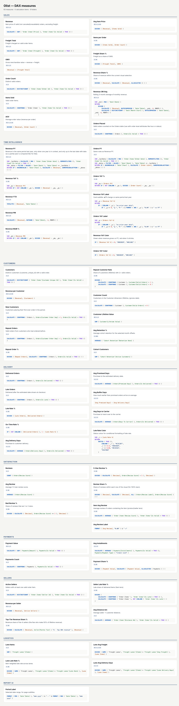

# Olist Marketplace Analytics

End-to-end analytics project on the [Olist Brazilian E-Commerce dataset](https://www.kaggle.com/datasets/olistbr/brazilian-ecommerce) (Kaggle): ~100k orders, 9 relational CSVs, 2016–2018.

**Raw CSV → DuckDB SQL star schema → Python statistics → Power BI semantic model + 5-page report.**

## Headline findings

| | |
|---|---|
| **Growth** | R$13.5M item revenue; Jan–Aug 2018 is **+138% YoY**. Black Friday (Nov 2017) is the biggest month. |
| **Delivery drives reviews** | Orders more than a week late average **1.7★**, vs **4.3★** for orders that arrive early. A logistic regression on 95.8k orders puts late delivery at **×9.0** the odds of a 1–2★ review (multi-seller orders ×3.8). |
| **Retention is the real problem** | **97%** of customers buy once; only **0.48%** of a monthly cohort orders again the next month. |
| **Seller concentration** | **129 sellers (4.2%)** generate half of all revenue; 17.7% generate 80%. |
| **Freight burden** | Freight takes a median **26%** of the basket past 2,000 km vs **15%** locally. North/Northeast states get the slowest deliveries despite 9–21-day buffers in the promise. |

## Architecture

```
Kaggle (9 CSV, 1.55M rows)
   │  src/pipeline.py  (auto-downloads, no API key)
   ▼
DuckDB  data/warehouse/olist.duckdb
   ├─ sql/10_staging.sql    typing, review de-dup, ZIP centroids from 1M geo points, state→region
   ├─ sql/20_marts.sql      star schema: dim_date, dim_customer (RFM), dim_seller (Pareto tier),
   │                        dim_product (category groups), fact_orders, fact_order_items (haversine km), fact_payments
   ├─ sql/30_analytics.sql  cohort_retention, seller_monthly, freight_lanes, fact_backlog_daily
   ├─ sql/90_tests.sql      15 data-quality tests — export is blocked if any fail
   └─ data/plan/*.csv       SYNTHETIC category plan (see below) + 4 plan tests
   │
   ├──► data/marts/*.parquet (+ .csv)   (src/predict.py adds the ETS forecast + BG/NBD × Gamma-Gamma CLV)
   │       │
   │       ├─ src/analysis.py      → reports/insights.html  (statsmodels logit, Plotly, 9 charts)
   │       │
   │       └─ src/build_model.py   → powerbi/Olist.SemanticModel  (TMDL: 24 tables, 17 relationships, 139 measures, 5 functions, 3 roles)
   │          + Olist.Scale / Olist.DirectLake.SemanticModel (design variants, not run)
   │          src/build_report.py  → powerbi/Olist.Report         (PBIR: 7 pages + drillthrough + tooltip page, bookmarks, mobile)
   │                               → powerbi/Olist.Ops.Report     (thin report on the same model)
   │                               → reports/Seller Scorecard.rdl (paginated, one page per seller)
   ▼
powerbi/Olist.pbip  ← open this in Power BI Desktop
```

### Every DAX measure

`reports/dax.html` lists every measure and calculation item with its description and format string, generated from the TMDL by `../tools/dax_gallery.py`.

[](reports/screenshots/dax.png)

## Run it

```bash
uv sync
uv run python src/pipeline.py      # download + build warehouse + tests + export marts
uv run python src/analysis.py      # reports/insights.html
uv run python src/build_model.py   # Power BI semantic model (TMDL)
uv tool install pbir-cli           # once, for the report builder
uv run python src/build_report.py  # Power BI report (PBIR), validated at the end
```

### Opening the Power BI report (Windows)

Power BI Desktop is Windows-only. The project is a **PBIP** (text-based Power BI Project), so everything is diffable in git.

1. Run the pipeline on the Windows machine (or copy `data/marts/`), then regenerate the model so it points at that folder:
   `uv run python src/build_model.py --data-dir "C:\path\to\olist-analytics\data\marts"`
   (or open the report and change the **DataFolder** parameter under *Transform data → Edit parameters*).
2. Open `powerbi/Olist.pbip` in Power BI Desktop (enable *Options → Preview features → Power BI Project (.pbip) save option* on older versions).
3. Click **Refresh** to load the Parquet marts.

## Report pages

| Page | Question it answers | Key visuals |
|---|---|---|
| **Executive Overview** | How big, how fast, from where? | KPI cards with YoY reference labels · trend of a chosen metric (Metric field parameter, Year → Quarter → Month drill) · revenue by a chosen breakdown (Breakdown field parameter) · region→state→city treemap · payment mix · weekday pattern |
| **Sales & Products** | Which categories earn and how they rate | Top 10 categories (Top N filter, report-page tooltip) · price-vs-review bubble scatter · weekday × hour heatmap matrix · category mix over time · Time Calc matrix · 2018 growth waterfall by category group · ETS revenue forecast Sep–Dec 2018 with 80% band |
| **Customers & Retention** | Who is worth keeping? | RFM segment counts & lifetime value · repeat-order share · cohort retention heatmap · customers by state · customers by spend band (dynamic) · churn card · predicted 12-month CLV by RFM segment |
| **Delivery & Satisfaction** | Where does the delivery promise break? | Review by delivery outcome (red→blue gradient) · late rate trend · late rate by state as bars or a filled map (bookmark toggle) · freight lanes table with status icons and an outlier flag (lane above its state's P90) · late-rate trend line + 8% target line · purchase vs promise month · orders in transit · order lifecycle funnel · what-if slider (cut the late rate → projected bad reviews) · bad reviews by 3-day delay bins |
| **Sellers & Logistics** | How concentrated is supply, what does distance cost? | Seller revenue-vs-rating scatter by Pareto tier · tier revenue split · seller leaderboard · freight share by distance band · Azure Map of sellers · Sankey of goods flow · P90 revenue line on the scatter · seller tier 2017 → 2018 transition matrix · lifetime vs dynamic ABC table |
| **Why Reviews Dropped** | Why did reviews fall in early 2018? | Guided path: KPIs → bad reviews vs late rate by promise month → decomposition tree → key influencers on Review Outcome |
| **About & Definitions** | What do the numbers mean? | Q&A visual · definitions · the synonyms Q&A understands |
| *Seller Detail* (hidden) | One seller in full | Drillthrough on `Seller[Seller Code]` from the scatter or the leaderboard: KPIs, monthly revenue/orders, categories, late rate vs review |
| *TT Category* (hidden) | Hover card | Report-page tooltip of the category bars: revenue, review, late rate, share of group, buyers, 12-month sparkline |

Every page shares a navy sidebar (a background SVG, `RegisteredResources/bg.svg`, instead of a shape per page) with
page-navigation buttons, **? Help** (→ About) and **↺ Reset** (bookmark: every slicer back to All), an ⓘ info button next
to the page title (hover = definitions; on Overview it opens a definitions overlay) and three slicers. Pages with extra rows are
taller (Sales, Delivery, Sellers 5 rows; Customers 4 rows) and fit to width.

`reports/dashboard.html` is a static HTML twin of these pages (`src/build_preview.py`, same numbers from DuckDB) for review
without Desktop. Field parameters and the bars/map toggle become chip buttons there; the map has no basemap.

## Report design

All of this is written by `src/build_report.py` and checked by `pbir validate`; none of it has been opened in Power BI
Desktop (Windows only), so rendering is unverified.

**Filters.** Report filter `Orders[Is Valid] = TRUE`, hidden and locked: cancelled/unavailable orders never reach a visual.
Page filter on Delivery: `Orders[Is Delivered] = TRUE`. Visual filters: Top N 10 by `[Revenue]` on the category bars,
`[Lane Items] ≥ 30` on the lanes table, `Date[Year] = 2018` on the Time Calc matrix.

**Interactions.** Overview: the payment donut *highlights* the trend instead of filtering it; weekday clicks leave the KPI
cards alone. Customers: an RFM click leaves the cohort matrix whole (None) and filters the state bars.

**Drill, drillthrough, tooltips.** `trend_revenue` sits on the `Date[Calendar]` hierarchy, `tree_region` on `Customer[Geo]`,
`bar_category` on `Product[Category Tree]`. The scatters carry extra tooltip fields (seller late rate, freight share,
category share in group). `TT Category` is the report-page tooltip of `bar_category`.

**Bookmarks.** `bm_reset_filters` (data only, every page's slicers), `bm_defs_show/hide` (definitions overlay group on
Overview), `bm_view_bars/map` (Delivery: late rate by state as bars or as a filled map).

**3-30-300 per page.** 3 seconds: the KPI row. 30 seconds: row 2, the trend and the main breakdown. 300 seconds: rows 3–4,
the matrix / table / map to dig into, then drillthrough to Seller Detail.

| Page | 3 s | 30 s | 300 s |
|---|---|---|---|
| Executive Overview | Revenue, orders, AOV, review, late | metric trend, revenue by breakdown | region treemap (drill to city), payment mix, weekday |
| Sales & Products | GMV, items, price, freight share, YTD | top 10 categories, price vs review | hour heatmap, category mix, Time Calc matrix |
| Customers & Retention | customers, new / returning (+ period), repeat | RFM counts and value, repeat share | cohort matrix, customers by state |
| Delivery & Satisfaction | on-time, days, promised, review, bad % | review by outcome, late trend | late by state (bars / map), lanes, promise month, backlog |
| Sellers & Logistics | sellers, revenue per seller, top tier, late, at risk, distance | seller scatter, tier split | leaderboard → Seller Detail, distance, map, Sankey |

**Accessibility.** Every data visual has alt text (`Kind: title`); the revenue card and the late-rate trend take theirs
from measures (`Alt Text Revenue`, `Alt Text Late Rate`) so a screen reader hears the current number. Tab order follows
reading order (sidebar first, then top-to-bottom, left-to-right). Late status is an icon and a word (▲ High / ● Watch /
✓ OK, `Late Status`, `Lane Late Status`), colour only repeats it. Sidebar text contrast on navy `#0D366B` is asserted ≥ 4.5:1
at build time (white 12.0:1, `#B7D3F6` 7.8:1, `#9EC5F4` 6.7:1; white on the active `#1C5CAB` 6.6:1). `pbir validate`
still flags the sidebar brand/footer titles as low contrast because it compares them with the theme's white background,
not with the navy SVG behind them.

**Mobile.** Phone layouts (`mobile.json`) for Executive Overview (year slicer, 4 KPI cards, trend) and Delivery (year
slicer, on-time and bad-review cards, late trend, late rate by state — all states, sorted, not a top 5).

**Maps and custom visual.** Azure Map bubbles at each seller's zip-prefix centroid (latitude/longitude through the
`Seller Lat`/`Seller Lng` measures, size = revenue, colour = Pareto tier); a filled Azure Map of `Customer[State Geo]`
coloured by `Late Rate Color`. Sankey (Microsoft, AppSource, listed in `publicCustomVisuals`): seller region → customer
region weighted by `Lane Items`; the two ends carry a "Seller · " / "Customer · " prefix so the flow has no self-loops.
Azure Maps must be enabled by the tenant admin; the Sankey must be allowed as an AppSource visual.

**Export and print.** `report.json` allows export of summarized data only (no underlying rows).
`reports/Seller Scorecard.rdl` is a paginated report on the published model (PBIDATASET): multi-value parameter
`Seller Code` (valid values = sellers with revenue, default = top 10), one A4 page per seller with month, revenue,
orders, review and late rate. The build checks only that the XML is well-formed. It has not been rendered or exported
to PDF: Report Builder and the Service are not available on this Mac, and the dataset id is filled in at publish.

**Security in visuals.** No visual uses `Customer Unique Id`, `Seller Id` or any name: sellers appear only as
`Seller Code`. Lanes with fewer than 30 items are removed by a visual-level filter, not just sorted to the bottom.
Export is summarized only. (Row/object-level rules are in [Security](#security).)

**Olist Ops dashboard (Service, spec).** Built from the thin report `Olist.Ops.Report` (one page, bound to the shared
model): pin 6 tiles — Revenue, Revenue YoY %, Late Rate %, Avg Review, revenue per month, late rate by customer state.
Layout: four KPI tiles across the top, the trend (wide) and the state bars under them. No tile needs its own model; data
alerts go on the Late Rate % tile (> 8%). The dashboard itself can only be made in the Service and is not built here.

## Semantic model highlights

- Star schema with a marked **Date** table; auto date/time disabled.
- **139 measures** in display folders: Sales, Time Intelligence (PY, YoY, YTD, MoM, rolling 3M), Customers, Delivery, Satisfaction, Payments, Sellers, Logistics.
- Measure-driven formatting (`Late Rate Color`, `Revenue YoY Color`) instead of hard-coded colours.
- Sort-by columns for every ordered label (months, weekdays, delivery buckets, RFM segments, distance bands).

## Power Query: the category plan (synthetic)

> **The plan data is synthetic.** Olist publishes no budget, so `src/pipeline.py` writes
> `data/plan/category_plan_2017.csv` and `category_plan_2018.csv`: 2017 plan = 2017 actual × a per-group factor,
> 2018 plan = 2017 actual × a per-group growth assumption, split 90% Base / 10% Promo. Nothing here is Olist's real target.

The files are deliberately spreadsheet-shaped (two title rows, the group name only on the first line of each group like a
merged cell, a TOTAL row, `Notes`/`Owner` columns, a typo `Casa & Living`, stray spaces, `n/a` and `-` in Promo cells) so the
Power Query side has real cleaning to do. This is the second connector next to the Parquet marts.

| Query | Load | What it is |
|---|---|---|
| `DataFolder`, `PlanFolder` | parameter | Folder paths (set by `build_model.py --data-dir/--plan-dir`) |
| `fxReadPlan` | off | Function: reads one plan CSV and returns clean long rows |
| `Plan 2017`, `Plan 2018` | off | `fxReadPlan(PlanFolder & "category_plan_YYYY.csv")` — the same steps referenced twice, not duplicated |
| `Plan Raw` | off (staging) | `Table.Combine` of both years (append) |
| `Plan Groups` | off | Distinct `Category Group` from `dim_product.parquet` + `Group Code` |
| `Plan Unknown Groups` | off | Left-anti `Table.NestedJoin` of `Plan Raw` to `Plan Groups` — must be 0 rows |
| `Category Plan` | **on** | Monthly plan: merge to `Plan Groups` (left outer, VLOOKUP-style), `Month Start`, `Is Peak Month` (Nov), index |
| `Category Plan Quarterly` | **on** | `Table.Group` of the monthly plan by group × quarter |

Applied Steps of `fxReadPlan`, in order: Source → Skip title rows → Promoted headers → Blank group to null →
Filled down group → Removed TOTAL row → Replaced Casa typo → Trimmed and proper case → Kept plan columns (drops
`Notes`/`Owner`) → Unpivoted months → Split month (`2018-01` → `Year`, `Month No`) → Amounts as numbers →
Removed text amount → Changed type → Removed errors.

**Import errors.** 52 Promo cells hold `n/a` or `-`. `Amounts as numbers` uses `try Number.From(...) otherwise null`, so they
become 52 nulls rather than errors; the final `Table.RemoveRowsWithErrors` therefore removes 0 rows. Both counts come from the
SQL mirror of these steps (`plan_mirror()` in `src/pipeline.py`), not from running the Power Query engine — the Mac has no
Power BI Desktop. The mirror is checked by 4 tests: no unknown groups, 8 groups × 2 lines × 24 months = 384 rows,
quarterly total = monthly total, and the file TOTAL rows = the sum of the lines.

Every query is also exported as plain M to `powerquery/*.pq` and parsed by Microsoft's Power Query parser
(`node tools/m-check/check.mjs powerquery`). That checks syntax only, not results.

## Shared vs local model

`Olist.SemanticModel` is the one shared model: every measure lives there. A thin report (`Olist.Ops.Report`, one page,
generated by `build_report.py`) binds to it `byPath` locally; after publishing, it would be repointed `byConnection` to the Service dataset,
so it carries no model of its own. Dataflows and Dataverse are not used: the source is already cleaned and tested in
DuckDB, so a dataflow would only repeat the SQL layer.

## Storage mode per table

| Table | Main model (`Olist.SemanticModel`) | Scale variant (`Olist.Scale.SemanticModel`, design only) | Why |
|---|---|---|---|
| Order Items | Import | DirectQuery | 113k items fit in memory easily; DirectQuery only pays off if the fact table grew to many millions of rows |
| Orders | Import | Import + incremental refresh | Order-level facts stay in memory; only the last month is reloaded |
| Payments, Seller Monthly, Backlog | Import | (left out) | Not needed to show the pattern |
| Date, Customer, Product, Seller | Import | Dual | Dual dims answer slicers from memory and still join to a DirectQuery fact in the source |
| Order Items Agg (day × category × seller × customer state) | — | Import, hidden, `alternateOf` the fact | Most visuals hit the small aggregate; detail drills fall through to DirectQuery |
| Category Plan (+ Quarterly) | Import | Import | Small CSVs; there is no source that DirectQuery could push to |
| Live connection | — | — | Only the thin report connects live, to the shared model |

The Scale variant has not been run against a real source; it exists to show the design (see *Scale and Fabric variants*).

## Model design

### Skeleton

```
Date ──1:*──► Order Items ◄──*:1── Product, Seller, Customer
Date ──1:*──► Orders  (purchase date active; delivered date, promised date inactive)
Customer ─1:*─► Orders ──1:*──► Payments
Seller ──1:*──► Order Seller (bridge) ◄──*:1 both──► Orders
Seller, Date ──1:*──► Seller Monthly          Date ──1:*──► Backlog Daily
Date[Month Start], Product[Category Group] ──*:*──► Category Plan
```

Facts: `Order Items` (grain: one item), `Orders` (one order), `Payments` (one payment line), `Seller Monthly`
(seller × month), `Backlog Daily` (one day, a snapshot), `Category Plan` (group × month × line, synthetic).
Dimensions: `Date`, `Customer`, `Product`, `Seller`. Helpers: `Order Seller` (bridge, hidden), `Spend Bands` and
`Region Access` (calculated tables), `Time Calc` (calculation group), `Metric` / `Breakdown` (field parameters).

### Relationships

| From → To | Cardinality · direction | Active | Why |
|---|---|---|---|
| Orders[Order Date] → Date | many-to-one · single | yes | Purchase date drives every trend |
| Orders[Delivered Date] → Date | many-to-one · single | **no** | `USERELATIONSHIP` in *Delivered Orders (by Delivery Date)* |
| Orders[Estimated Date] → Date | many-to-one · single | **no** | `USERELATIONSHIP` in *Late Rate % (by Promise Month)* |
| Order Items → Date, Customer, Product, Seller | many-to-one · single | yes | The item fact; every dimension filters it |
| Orders → Customer | many-to-one · single | yes | Customer filters reach orders without the item table |
| Payments[Order Id] → Orders | many-to-one · single | yes | Date and customer filters reach payments through the order |
| Seller Monthly → Seller, Date | many-to-one · single | yes | Pre-aggregated seller × month |
| Category Plan[Category Group] → Product[Category Group] | **many-to-many** · single | yes | Plan grain is the group, not the product |
| Category Plan[Month Start] → Date[Month Start] | **many-to-many** · single | yes | Plan grain is the month, not the day |
| Order Seller[Seller Id] → Seller | many-to-one · single | yes | Bridge side 1 |
| Order Seller[Order Id] → Orders | many-to-one · **both** | yes | Bridge side 2: only here is the filter two-way, so a seller filter reaches order-level facts (reviews, lateness) |
| Backlog Daily[Date] → Date | many-to-one · single | yes | Daily snapshot |

**Regular vs limited.** Every one-to-many above is a *regular* relationship: the engine can expand the many side and a
missing key lands in a blank row. The two many-to-many plan relationships are *limited*: no blank row, and an
`'Category Plan'` row only reaches a product when its group string matches exactly (the `Plan Unknown Groups` query
must stay at 0 rows for that reason). In the Scale variant every relationship from the DirectQuery fact to a Dual
dimension is regular; a limited relationship there would only appear if a dimension were Import-only while the fact
is DirectQuery (cross source group), which is why the dimensions are Dual.

### Calculated column, calculated table or measure?

| Use | When | Here |
|---|---|---|
| Calculated column | Value belongs to one row, needed as a slicer/axis/group, and fixed after refresh | `Customer[Is Repeat]`, `Seller[Distinct Products]`, `Product[Category Group (Big 5)]` (group), `Orders[Delay Days (bins)]` (bin) |
| Calculated table | A small lookup that does not exist in the source, or a role table | `Spend Bands` (band edges for a dynamic segmentation), `Region Access` (RLS mapping) |
| Measure | Anything that must react to filters | the other 101 |

`Customer[Is Repeat]` is a column, not a measure, because it is a *property of the customer over the whole history*
(more than one valid order ever), and it is used as a slicer. A measure would re-ask the question inside the current
filter (repeat *in 2018*), which is the separate measure `Repeat Customers`. The Big-5 group and the 3-day delay bins
are written the way Power BI Desktop's *New group* / *New bins* dialogs write them (`GroupingMetadata` extended property);
they have not been opened in Desktop.

### Filter context: KEEPFILTERS and window functions

- `Revenue SP Sellers` writes `Seller[State] = "SP"` as a plain filter: on a seller-state axis it *replaces* the row's
  state, so every row shows SP. `Revenue SP Sellers (KEEPFILTERS)` intersects: SP on the SP row, blank elsewhere. The same
  pair exists for tier A (`Revenue Top Tier` vs `Revenue Top Tier (overwrite)`). The DAX query
  `DAXQueries/KEEPFILTERS vs overwrite.dax` shows both side by side.
- `Revenue PM (OFFSET)`, `Revenue Running Total`, `Revenue 3M MA (WINDOW)` and `Category Rank` use OFFSET / WINDOW / RANK
  over `ALLSELECTED` month or category tables with `ORDERBY`; `DAXQueries/Window functions.dax` adds `PARTITIONBY`
  customer region. Window functions read neighbouring rows of a table; classic time intelligence instead shifts a set of dates.

### Calendar-based time intelligence

`Date` carries a `Gregorian` calendar (year, quarter, month, month-of-year, date column groups). `Revenue PY (cal)`,
`Revenue YTD (cal)`, `Revenue PQ (cal)` and the `Time Calc` items use `DATEADD('Gregorian', …)` / `DATESYTD('Gregorian')`.
`Weekday Name` is deliberately *not* tagged in the calendar. Per Microsoft's documentation of calendar-based time
intelligence, filters on untagged columns are kept, so with a Monday filter `Revenue PY (cal)` is last year's Mondays;
classic `DATEADD('Date'[Date], -1, YEAR)` shifts the selected dates, so it returns the same calendar dates a year back
(mostly other weekdays). That difference is from the documentation; it has not been run in Desktop.

### Functions (DAX UDFs)

`functions.tmdl` defines `Olist.SafePct`, `Olist.Growth` (VAL parameters), `Olist.AtPY` (EXPR parameter),
`Olist.AtPYVal` (the same body with a VAL parameter, for teaching) and `Olist.YoY` (a `MEASUREREF` parameter).
**VAL vs EXPR**: a VAL argument is evaluated once, by the caller, before the function runs, so
`Olist.AtPYVal([Revenue])` in 2018 returns 2018 revenue: the `CALCULATE` inside cannot change a number. An EXPR argument
is passed as an expression and re-evaluated inside the function's filter context, so `Olist.AtPY([Revenue])` returns 2017.
`DAXQueries/Functions.dax` holds one TRUE/FALSE check per function; `VAL vs EXPR.dax` shows the difference.
These queries are saved in the DAX query view format but have **not been run** (no engine on the Mac).

### Field parameters, calculation group and dynamic format strings

- `Metric` (Revenue, Order Count, AOV, Late Rate %, Avg Review) and `Breakdown` (category group, customer region,
  seller tier, distance band). Distance band rather than payment type: `Payments` hangs off `Orders` and does not
  filter `Order Items`, so payment type on an item-level axis would repeat the total on every row.
- `Metric Value` follows the picked metric with a `formatStringDefinition` (R$, count, %, ★).
- `Time Calc` items: Current, PY, YoY %, YTD, MoM %, 3M Avg; the two % items carry their own format string.

### Security

| Role | Kind | Rule |
|---|---|---|
| Northeast Ops | static RLS | `Customer[Region] = "Northeast"` |
| Region Manager | dynamic RLS | `Customer[Region]` in the regions mapped to `USERPRINCIPALNAME()` in `Region Access` (placeholder `@example.com` users) |
| Logistics Partner | OLS + CLS | `Payments` and `Seller Monthly` hidden (`metadataPermission: none`); `Customer[Lifetime Value]` and `Seller[Lifetime Revenue]` hidden (`columnPermission: none`) |

Roles validate in TOM; *View as role* has not been tried (needs Desktop).

### Which tool for which question

| Question | Tool |
|---|---|
| Value of one row, used to slice | calculated column |
| Small lookup the source lacks | calculated table |
| Reacts to the user's filters | measure |
| Same logic on many measures (PY, YTD …) | calculation group |
| User picks the measure / the axis | field parameter |
| Repeated arithmetic in many measures | DAX function (UDF) |
| Second date on a fact | inactive relationship + `USERELATIONSHIP` |
| Plan at a coarser grain | many-to-many relationship (or `TREATAS` in the measure) |
| Many-to-many between real entities | bridge table, two-way only on the bridge |
| Previous / next / running row | window functions (OFFSET, WINDOW, INDEX, RANK) |
| Value at a point in time | snapshot table + `LASTDATE` (never a sum over days) |

## Scale and Fabric variants (design, not run)

Two more semantic models are generated next to the main one. Both pass TOM validation; **neither has been connected to
a real source** (no Fabric workspace, no SQL endpoint). Placeholders `<workspace>` and `<lakehouse-id>` stay in the M.

**Choosing a mode.** Sizes of today's marts:

| Table | Rows | Parquet |
|---|---:|---:|
| fact_order_items | 112,650 | 10.7 MB |
| fact_orders | 99,441 | 9.7 MB |
| fact_payments | 103,886 | 4.1 MB |
| dim_customer | 96,096 | 5.4 MB |
| order_seller | 100,010 | 3.4 MB |
| dim_product | 32,951 | 1.3 MB |
| dim_seller / seller_monthly | 3,095 / 16,308 | 0.2 / 0.3 MB |
| dim_date / fact_backlog_daily | 852 / 777 | < 0.01 MB |

```
Does the data fit in memory after compression, and is a daily refresh fresh enough?
 ├─ yes ─► Import                                  ← today: 35 MB of Parquet, Import everything
 └─ no
     ├─ data already sits as Delta in a Fabric lakehouse? ─► Direct Lake   (Olist.DirectLake.SemanticModel)
     └─ otherwise ─► DirectQuery fact + Dual dimensions + Import aggregation + incremental refresh
                     (Olist.Scale.SemanticModel)
```

**`Olist.Scale.SemanticModel`**: `Order Items` DirectQuery; `Date`, `Product`, `Seller`, `Customer` Dual; `Orders` Import
with an incremental-refresh policy (keep 3 years, refresh the last month, `pollingExpression` = latest `purchased_at` in the
partition, so an unchanged month is skipped); `Order Items Agg` Import, hidden, every column `alternateOf` the detail
(group by day, category, seller, customer state, validity; sum price and freight; count rows). A visual at month ×
category hits the aggregate; a drill to one order falls through to DirectQuery. Whether the engine actually picks the
aggregate needs DAX Studio or Performance Analyzer against a live source, so that is **not proven** here.

Query folding: every M step was written to fold, and each step carries the SQL it should become:
`Sql.Database` → navigation (`FROM dbo.x`) → `Table.SelectRows` on `RangeStart`/`RangeEnd` (`WHERE`, filter first) →
`Table.SelectColumns` (`SELECT` list) → `Table.TransformColumnTypes` (`CAST`); the aggregate adds
`Table.NestedJoin` (`LEFT JOIN`) and `Table.Group` (`GROUP BY`). No step that breaks folding (index columns, custom
functions, `Table.Buffer`) is used. "View native query" was not checked — no Desktop and no source.

**`Olist.DirectLake.SemanticModel`**: three tables with `entity` partitions in `directLake` mode over a shared
`DatabaseQuery` expression (the lakehouse SQL endpoint), compatibility 1702.

**Performance choices in the main model.** `purchased_at` (a timestamp, ~99k distinct values) is dropped from `Orders`
in Power Query; the date part is kept as `Order Date` and the hour as `Order Hour`, which compress far better.
Keys used only by relationships are hidden; the bridge table is hidden. A VertiPaq Analyzer (`.vpax`) export needs
Desktop or a live model and is not included.

## Validation

| Layer | Check |
|---|---|
| SQL | 18 tests in `sql/90_tests.sql` (keys, orphans, revenue reconciles to the cent, value ranges) + 4 plan tests in `src/pipeline.py` |
| M | `tools/m-check`: every `powerquery/*.pq` parses with `@microsoft/powerquery-parser` (syntax only) |
| DAX | `build_model.py` fails on any measure, calculated column, calc item, role filter, function or field parameter that references a missing column/measure/table/function, or a measure that collides with a table name. Syntax and results are not checked (no engine) |
| TMDL | `tools/tmdl-validate` parses the model with Microsoft's own TOM `TmdlSerializer` (19.117), runs `Model.Validate()` and round-trips it |
| PBIR | `pbir validate --all` on `Olist.Report` and `Olist.Ops.Report`: JSON schemas, every field binding resolved against the model, catalog properties |
| BPA | `tools/pbi-kit/bpa` (Tabular Editor rules on TOM) + `bpa/project-rules.json`: 0 errors (see *Dev lifecycle*) |
| DAX values | `dax/Headline numbers` asserts revenue, orders, late rate (offline: syntax/references; values need a published model) |
| RDL | `Seller Scorecard.rdl` parsed as XML (well-formed only; not rendered) |
| Twin | `tools/twin-review`: Playwright opens `reports/dashboard.html`, checks every page for overflowing/clipped/wrapped tables, empty chips and panels, screenshots to `evidence/` |

```bash
for m in Olist Olist.Scale Olist.DirectLake; do
  dotnet run --project tools/tmdl-validate -- powerbi/$m.SemanticModel/definition
done
```

## Predictive and diagnostic layer (phase D)

- **Revenue forecast** (`mart.revenue_forecast`): statsmodels ETS, additive error + damped additive trend, fitted on monthly revenue Jan 2017–Aug 2018, Sep–Dec 2018 with 80%/95% prediction intervals (≈ R$3.8M over 4 months). The line chart also has the built-in forecast switched on; it has not been seen rendering because there is no Desktop here.
- **Predicted CLV 12M** (`dim_customer.predicted_clv_12m`): BG/NBD (purchase days) × Gamma-Gamma, the models the `lifetimes` package implements, written out with scipy (lifetimes is unmaintained and doesn't run on pandas 3). Gamma-Gamma uses a small L2 penalty (1e-3) because the unpenalised fit runs off to p → ∞. Only 2,065 customers ever bought twice, so the prediction is close to zero for most people.
- **Churn**: 97% of customers buy once, so "churn" (no purchase for 180+ days at the end of the extract: 71%) is really a retention problem: most of these customers never came back after their first order. At risk = 90–179 days.
- **What-if**: `Late Reduction (pp)` is a numeric-range parameter (0–10). Projected bad reviews use the logit odds ratio of late delivery (8.97, `src/analysis.py`): orders moved from late to on-time take the on-time bad-review rate.
- **Decomposition tree / key influencers** on *Why Reviews Dropped* are configured in PBIR only; the twin shows the same splits as static bars and a "× likelihood" ranking, not the AI visuals themselves.
- None of the DAX added in this phase (WINDOW/RANK with MATCHBY, PERCENTILEX, funnel, what-if) has been run on a real engine.

## Dev lifecycle: Git, BPA, DAX tests, deploy (pbi-kit)

The shared toolkit lives in `tools/pbi-kit/`, copied from the portfolio's `tools/pbi-kit`. The project-specific parts are `bpa/project-rules.json`, `dax/Headline numbers.dax` with its `.assert.json`, `powerbi/parameter.yml`, `.github/workflows/ci.yml` and `azure-pipelines.yml`. **Nothing here has been pushed, published or run on a Windows machine yet.** Everything that runs on a Mac was run (results below). Steps that need the Service, GitHub or Desktop are listed at the end for you to do.

### How the project moves from data to readers

```
Kaggle CSV ──pipeline.py──► DuckDB (22 tests) ──► data/marts/*.parquet
                                                     │
            build_model.py / build_report.py ────────┤ (on the Mac)
                                                     ▼
          powerbi/*.pbip (TMDL + PBIR, in git) ──► Power BI Desktop (Windows: open, refresh, lab work)
                                                     │  git push → PR → ci
                                                     ▼
          Service workspace Olist-Test ──approval──► Olist-Prod ──► app "Olist" for regional ops
```

| Stage | Where this project is |
|---|---|
| Data → marts | Done on the Mac; 22 tests gate the export. |
| PBIP in git | Done: generated, validated (TOM, PBIR, BPA, DAX offline), one commit per phase. Not pushed. |
| Desktop | Not opened yet (Windows lab, section F of the plan). |
| Workspaces Test/Prod, app | Planned. CI publishes with fabric-cicd once they exist; the Service evidence (plan section G: workspaces, refresh, app) goes in `evidence/` when it is done. |

### Who does what, and where

| Role | Who | Owns | Where they work |
|---|---|---|---|
| Data team | Analytics engineer | `src/pipeline.py`, `sql/`, `predict.py`, the marts and their tests | Mac / CI: code and DuckDB |
| Model owner | Same data team (solo project) | `src/build_model.py`: measures, UDFs, RLS/OLS, `bpa/project-rules.json`, `dax/*.assert.json` | Mac: TMDL; Windows: Desktop lab, Tabular Editor, DAX Studio |
| Report analyst | BI analyst | `src/build_report.py`: `Olist.Report`, `Olist.Ops.Report` | Mac: PBIR; Windows: Desktop touch-up |
| Approver | Head of operations | The go-ahead for Prod | GitHub environment `Prod` |
| Regional ops | Ops managers (Northeast Ops, Region Manager roles) | Nothing in the repo: they read the app, filtered by RLS | Service app |
| Platform admin | BI / Fabric admin | Workspaces, service principal, gateway, tenant settings | Service admin portal, Entra ID |

**Ownership pattern (small RACI).** One shared model, thin reports on top (see *Shared vs local model*).

| Activity | Data team | Analyst | Ops | Admin |
|---|---|---|---|---|
| Marts and data tests | R/A | C | – | – |
| Measures, RLS, BPA rules | R/A | C | I | – |
| Report pages | C | R/A | C | – |
| Prod deploy | R | C | A | I |
| Workspaces, gateway, service principal | C | – | – | R/A |

### Daily git flow

```bash
git switch -c fix/text-measures                  # 1 branch per change
# edit src/build_model.py (never the generated TMDL)
uv run python src/build_model.py                 # regenerates powerbi/*.SemanticModel
git diff -- powerbi/Olist.SemanticModel          # read the TMDL diff before committing
tools/pbi-kit/bpa/bpa.sh powerbi/Olist.SemanticModel/definition --rules bpa/project-rules.json
python3 tools/pbi-kit/dax-tests/daxtest.py powerbi/Olist.SemanticModel/DAXQueries --offline
git commit -am "Text measures: tell BPA on purpose"   # small commit; push + PR once a remote exists
```

Here is the real diff for one measure from this phase: `Late Status` returns a word, so it now carries a BPA ignore instead of a format string.

```diff
 	measure 'Late Status' =
 			VAR _r = [Late Rate %]
 			...
 		displayFolder: Report UI
 		lineageTag: ba9cade6-80d3-5b5c-a53b-110938d364fb
 
+		annotation BestPracticeAnalyzer_IgnoreRules = {"RuleIDs":["PROVIDE_FORMAT_STRING_FOR_MEASURES","INTEGER_FORMATTING"]}
+
```

`lineageTag`s are derived from each object's path (uuid5), so a model rebuild with no change produces no diff, and CI fails if the committed TMDL is stale. `build_report.py` assigns fresh page and visual ids on every run, so CI does not diff the reports; it validates the regenerated ones with `pbir validate --all`.

### CI gates (`.github/workflows/ci.yml`, mirrored in `azure-pipelines.yml`)

Two jobs. `ci` runs on every push and PR on a clean runner, with no source data (the data is gitignored). `data` is opt-in because it downloads the public source data.

**`ci`** (the required check):

1. **Report:** the committed reports are validated as they are. `build_report.py` assigns new page and visual ids on every run, so a diff would always fail.
2. **BPA, every semantic model:** 71 Microsoft rules, 3 kit rules and 1 project rule, on TOM. Fails on severity ≥ 3.
3. **TOM validate:** every model.
4. **DAX tests (offline).**
5. **PBIR validate.**

**`data`** (Run workflow with `data` ticked, or set the repo variable `RUN_DATA=true`; in Azure DevOps the pipeline variable `RUN_DATA=true`):

6. **Data tests:** `src/pipeline.py` (18 SQL + 4 plan tests), then rebuild the models from the warehouse and fail if the committed TMDL is stale.

7. **On `main` only** (`deploy-test` needs `ci` and `data`; a skipped `data` job does not block it, a failed one does): publish to Test (fabric-cicd + `parameter.yml`) → refresh → DAX asserts against Test → approval on `Prod` → publish to Prod.

An optional `bpa-te2` job runs the same rules in Tabular Editor 2 on a Windows runner.

**BPA, before → after** (`evidence/bpa-before.txt` → `evidence/bpa-after.txt`, JSON in `evidence/bpa.json`): **43 errors / 225 warnings / 246 info → 0 / 209 / 246.**
- **No implicit sums** (27 errors, `NUMERIC_COLUMN_SUMMARIZE_BY`): every numeric column is now `summarizeBy: none`. The reports already use measures for every total, so no visual changes; someone dragging `Price` into a new visual gets a list, not a silent SUM.
- **Ignored on purpose** (annotation `BestPracticeAnalyzer_IgnoreRules`, which Tabular Editor also reads): the **16 text measures** (alt text, status words, colours, labels, top seller, dynamic ABC class) ignore `PROVIDE_FORMAT_STRING_FOR_MEASURES` and `INTEGER_FORMATTING`. They return strings, so a number format means nothing. These were the other 16 errors.
- **209 warnings left on purpose:**
  - **`0.0%` formats** (32): kept; the kit wants `#,0.0%;-#,0.0%;#,0.0%`, which shows the same thing.
  - **27 measures without a description** (kit rule): mostly the method-demo measures (KEEPFILTERS, window, `(cal)` variants), whose explanation is in this README.
  - **Double columns** (money, distances, CLV) and **visible columns the report slices on**.
  - **Calculated tables:** field parameters, the calc group and what-if.

**Project rule `PROJ_BRL_MONEY_FORMAT`** (severity 3, in `bpa/project-rules.json`): every revenue, freight, price, payment, spend, AOV or CLV measure needs an `R$` format string, because every amount is in reais. Shares, %, counts, labels and colours don't count. It passes on the model today. Tested against a copy where `Revenue PY` lost its `R$`: the rule fires as an error.

**DAX test** (`dax/Headline numbers`, copied into `DAXQueries/` and the Desktop tab list by the generator). Values from DuckDB over the marts, the same numbers `sql/90_tests.sql` reconciles (revenue to the cent):

| Measure | Assert |
|---|---|
| Revenue | R$13,494,400.74 (±0.01), the README's "R$13.5M" |
| Orders Placed | 98,207 |
| Delivered Orders | 96,470 |
| Late Orders | 6,535 |
| Late Rate % | 6.7741% (±0.0001 pp) |

Offline all 7 query files pass (syntax, references, assert file). The asserts haven't been executed: that needs a published model.

**Deploy:** `deploy.py --dry-run` passes for Test and Prod (`evidence/deploy-dry-run.txt`). It covers 5 items: 3 models (`Olist`, `Olist Scale`, `Olist DirectLake`) and 2 reports. `powerbi/parameter.yml` swaps per environment:
- `DataFolder` / `PlanFolder` (import model) → a gateway share
- `SqlEndpoint` / `LakehouseDb` (Scale)
- The endpoint and lakehouse id inside the Direct Lake expression

The values are placeholders. Scale and Direct Lake are design variants: they publish, but only refresh once a Lakehouse with the marts exists. Delete their folders from the deploy branch if Test has none.

### Why this flow: solo PBIP + GitHub + fabric-cicd

There are four ways to ship: Fabric Git integration, deployment pipelines, fabric-cicd, and your own REST scripts (compared in `tools/pbi-kit/docs/cicd-options.md`). For one person who generates the PBIP from code, **GitHub + fabric-cicd** is the smallest setup that still tests before publishing: the repo is the source of truth, CI blocks a model that breaks BPA or changes the revenue, and the Prod step waits for one approval. Git integration would only mirror a workspace, and a deployment pipeline would promote whatever is in Dev without checks.

### AI in this project

An LLM (Claude Code) wrote most of the code: the SQL, the TMDL generator, the PBIR generator, the HTML twin. Nothing it wrote is trusted until a check outside the LLM passes:
- `build_model.py` `check()`: every measure, column, function and role reference resolves, no name collisions.
- Microsoft TOM: the TMDL deserialises, `Model.Validate()` passes, round-trip is clean.
- `pbir validate --all`: report schema and every field binding.
- BPA (kit + project rule) and the DAX value asserts above, plus the 22 data tests that reconcile revenue to the cent.

Visuals it could not see (no Desktop on the Mac) are marked as untested in this README rather than described as working.

### AI governance: what reaches the LLM

- **Schema and code, not customer rows.** The LLM reads the SQL, the generators, the TMDL/PBIR and test output (counts, totals, pass/fail). Expected values like the ones in the DAX test come from aggregate DuckDB queries. Olist's data is public and already anonymised (hashed customer/seller ids, no names), and no visual or prompt uses `Customer Unique Id` or `Seller Id`.
- **No credentials.** Secrets live in GitHub environments, never in the repo or a prompt; `parameter.yml` holds placeholders only.
- **MCP, if used.** A Power BI modeling MCP server would connect to the local Desktop model only, read-only (metadata and DAX queries for checks), never to the Prod workspace. None is configured in this project yet.

### Your steps (Service / GitHub / Desktop)

1. **12-s8, repo and PR:** create a GitHub repo, `git push -u origin main`, then open a PR from a branch. Screenshot → `evidence/12-s8.png`.
2. **12-s15, branch protection:** follow `tools/pbi-kit/ci/branch-protection.md`. Require a PR and the `ci` check on `main`. Screenshot → `evidence/12-s15.png`.
3. **14-s5, service principal:** follow `tools/pbi-kit/docs/service-principal.md`.
   1. Create the Entra app with a federated credential for this repo.
   2. Add it as Member of `Olist-Test` and `Olist-Prod`.
   3. Turn on the tenant settings for service principals and the Fabric APIs.
   4. Set the `AZURE_CLIENT_ID`/`AZURE_TENANT_ID` secrets, plus `vars.FABRIC_WS_TEST`/`FABRIC_WS_PROD`/`PBI_DATASET_NAME` (`Olist`).
   5. `PBI_ACCESS_TOKEN` must be a **user** token: the model has RLS roles, and executeQueries refuses service principals on RLS models.

   Screenshot → `evidence/14-s5.png`.
4. **14-s7, parameter.yml:** replace the `\\fileserver` and `<...>` placeholders in `powerbi/parameter.yml`. Rerun `deploy.py --dry-run`. Save the output → `evidence/14-s7.txt`.
5. **14-s6 / 14-s8 / 14-s9, pipeline:** push to `main`. Watch `ci` → `deploy-test` (publish, refresh, DAX asserts online) → approve `deploy-prod`.
   - Run log → `evidence/14-s6.txt`.
   - Pipeline graph → `evidence/14-s8.png`.
   - DAX assert output (Revenue R$13.49M, 98,207 orders, late rate 6.77%) → `evidence/14-s9.txt`.
6. **12-s14, Azure DevOps mirror:** import `azure-pipelines.yml`, using the service connection `pbi-kit-fabric` and the variable `PBI_USER_TOKEN`. Set `RUN_TE2_BPA=true` to run the Windows TE2 job. Screenshot → `evidence/12-s14.png`.
7. **14-s4, CI/CD options:** after step 5, screenshot the Actions run as the proof for the chosen option → `evidence/14-s4.png`.
8. **8-s7 / 12-s11 / 12-s12 / 12-s13, Windows tools:**
   1. Install DAX Studio and Tabular Editor 2 (checklist in `tools/pbi-kit/README.md`). Screenshot of both connected to the open model → `evidence/8-s7.png`.
   2. Run `tools/pbi-kit/te/format-check.csx` on the model in TE2. Screenshot → `evidence/12-s11.png`.
   3. Run `pwsh tools/pbi-kit/bpa/te2-bpa.ps1 -Model powerbi/Olist.SemanticModel/definition -ProjectRules bpa/project-rules.json`. Save the output → `evidence/12-s12.txt`.
   4. In TE's BPA window, confirm that the 16 text measures show as ignored and that `PROJ_BRL_MONEY_FORMAT` loads. Save → `evidence/12-s13.txt`.

## Definitions

- **Revenue** = item price (excluding freight) of orders not `canceled`/`unavailable`.
- **Late** = delivered after the estimated delivery date shown to the customer at checkout.
- **Customer** = `customer_unique_id` (Olist issues a new `customer_id` per order).
- **New / Returning Customers**: with no date filter every customer is "new" once, so the count would be meaningless. When the date filter covers the whole calendar, both measures count the last quarter with data (Q3 2018) and the `Period Counted` card says so.
- **RFM**: recency & monetary quintiles; frequency bucketed 1 / 2 / 3+ orders because 97% of customers order once.
- Sep–Dec 2016 and Sep–Oct 2018 are sparse in the source export; trend charts in the Python report exclude them.
