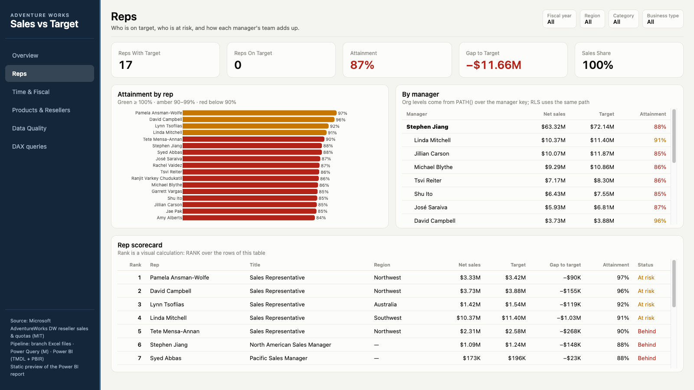
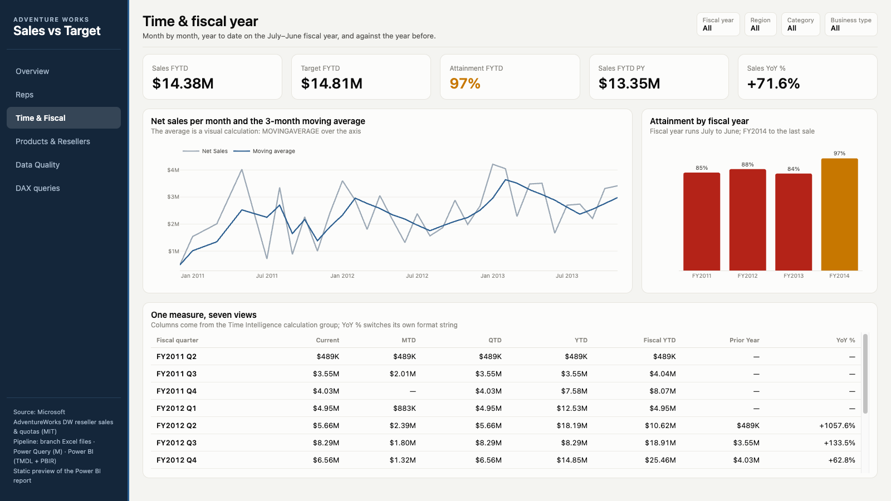
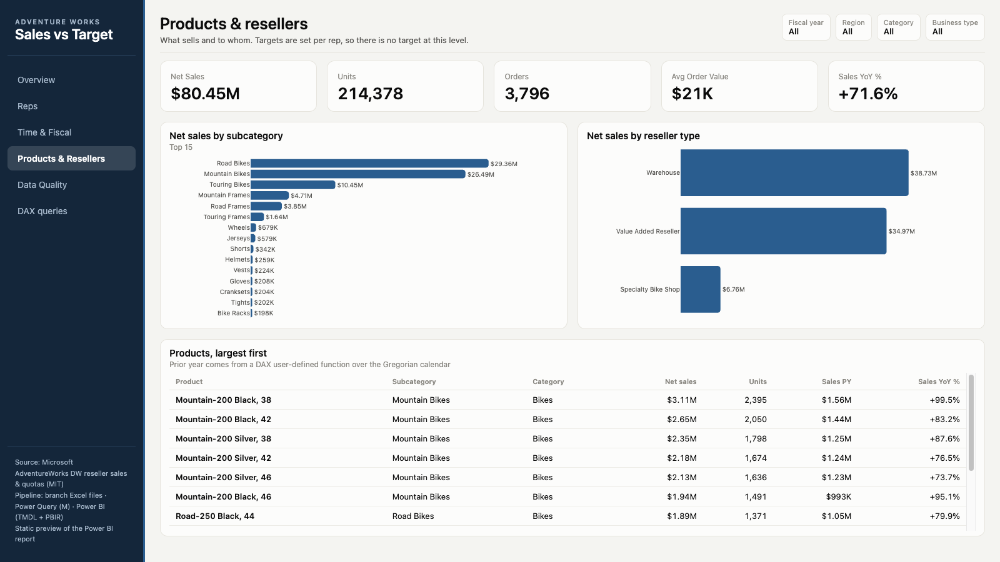
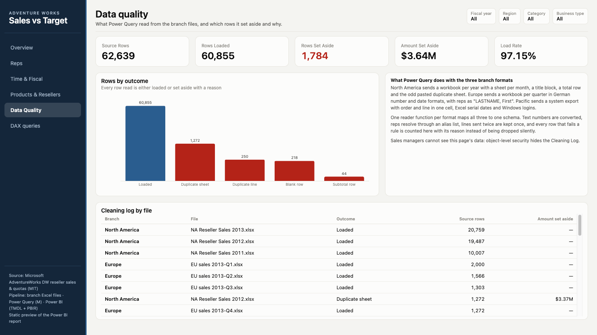
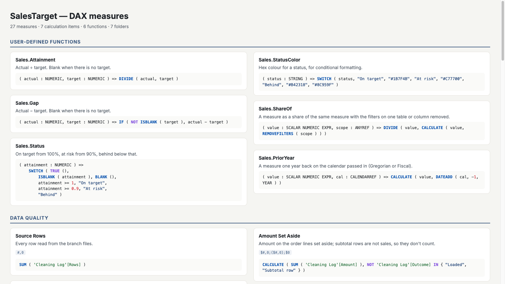
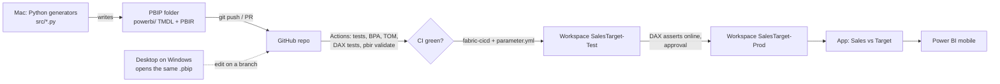

# Sales vs Target: Messy Excel to Power BI

A sales-against-quota report for a bike wholesaler with 17 reps in three branches. Each branch sends its sales in its own messy Excel format, and the quotas come as a wide quarterly sheet. Power Query turns all of it into one clean sales table, plus a log that says which rows were set aside and why. The report answers four questions:

1. **Are we on target?** Overall, per rep, per region, per fiscal year.
2. **Who is at risk** of missing quota, and how big is the gap?
3. **Where do the sales come from?** Products, resellers and business types.
4. **Can we trust the numbers?** Every source row is either loaded or set aside with a reason.


## What the data shows (Jan 2011 – Nov 2013)

| | |
|---|---:|
| Net sales | **$80.45M** |
| Target (quota up to the last sale, 29 Nov 2013) | $92.11M |
| Attainment | **87%** (behind), gap −$11.66M |
| Attainment this fiscal year (Jul–Nov 2013) | 97% |
| Reps on target | **0 of 17** |

- **No rep made quota over the three years.** The best is Pamela Ansman-Wolfe at 97% (at risk); the lowest is Amy Alberts at 84%. Four reps are at risk (90–99%), the rest are behind.
- **The current fiscal year is much closer.** FY2014 runs at 97% of target, against 84–88% in FY2011–FY2013.
- **Regions split hard.** Canada (130%) and Northwest (126%) beat their target; the UK (43%), Northeast (64%) and Central (67%) are far below it.
- **Road bikes carry the business.** They are the top subcategory at $29.36M. Warehouses are the biggest reseller type at $38.73M.
- **28% of the products make 80% of sales.** 139 resellers (A class) bring 70% of net sales; 381 (C class) share the last 10%.
- **Resellers slip away slowly but steadily.** 17.3% of FY2012's buyers did not order in FY2013 (expected lifetime 5.8 years); 169 resellers have not ordered in over 180 days and 18 more in 91–180 days. Lifetime value on sales is about $340K per reseller.
- **On the monthly trend, the current fiscal year ends the quota months (to Dec 2013) at 95% of target.**
- **The UK miss is an assignment problem, not a demand problem.** The UK has the largest negative gap (−$5.77M). Its quota follows Jae Pak (−$10.05M against it), but all 6,738 of his order lines ($8.5M) are booked to Canada (see the *Why* page).
- **The branch files were dirtier than they look.** 1,784 of 62,639 rows (2.85%) were set aside: a pasted duplicate month sheet (1,272), the Pacific resend overlapping by two months (250), blank spacer rows (218) and total rows (44). Without the log, the duplicates alone would have added $3.6M of sales that never happened.

## Report pages

| Page | What it shows |
|---|---|
| **Overview** | KPIs; cumulative sales vs cumulative target (running totals), with **Chart / Table** buttons that swap it for a monthly table; an **ⓘ Read status** button that opens a panel explaining the colours; a one-sentence summary (with the best rep) that follows the slicers; the Target Stretch slider; a metric the user picks (net sales / target / gap / gross margin / orders) and attainment, both by a dimension the user picks (rep / region / country / category / business type); a **waterfall** of the gap to target region by region. |
| **Reps** | Attainment per rep, coloured by status; sales from at-risk reps; a manager → rep table built from the org hierarchy; a scorecard ranked by attainment with last fiscal quarter's attainment, the rep's share of their manager's team and the leader of the rep's home region; constant lines at 100% and 90% on the attainment bars; a **Bullet Chart** (custom visual) of sales against quota per rep with 90/100% bands. |
| **Time & Fiscal** | Fiscal year-to-date vs target and vs last year; sales by ship date, average days to ship and reps with a quota at the end of the period; monthly sales with a 3-month average and rolling 12-month attainment; attainment per fiscal year; one measure in eleven time views from the calculation group. The monthly chart has an average line (driven by `[Avg Monthly Sales]`) and a trend line; a separate chart carries Power BI's **forecast**; the fiscal-year chart drills Fiscal Year → Quarter. The monthly chart also carries `[Sales Linear Trend]` (`LINESTX`), and a column chart splits **new vs returning resellers** per fiscal year. |
| **Products & Resellers** | Sales by category and subcategory, by business type; active resellers and gross margin; products with gross margin; the (synthetic) category plan against sales; the category chart drills Category → Subcategory → Product; an **Azure Map** of sales by reseller city; a **Pareto** combo chart (net sales per product + cumulative share, title from `[Pareto Text]`) and resellers by **size band** (disconnected band table). |
| **Resellers** | Active, new, at-risk and churned resellers, annual churn rate, expected lifetime and CLV; resellers by **ABC class** with an ABC slicer on a disconnected table, cumulative share, **RFM segment** and churn status; a **cohort retention** heatmap (first-order fiscal quarter × quarters since); **lifetime value** by reseller type; an **RFM transition** matrix (segment on 30 Jun 2012 → 30 Jun 2013); **market basket** pairs of subcategories with support, confidence and lift. |
| **Data Quality** | Rows loaded vs set aside, by reason and by file. A page filter on `Cleaning Log[Outcome]` is left open in the filters pane. Order P95 / P99 cards and a table of **unusual orders** (above P95, P99 flagged) with their z-score, to check against the branch files. |
| **Why** | "Why is it behind?": a **decomposition tree** of the gap to target (region → rep → category), **key influencers** on which resellers buy less than last year (`Resellers[Sales Trend]`, FY2013 vs FY2012, explained by business type and country), the four diagnosis steps, a UK monthly line with **anomaly detection** and the written finding (see *Diagnosing the UK* below). |
| *Rep detail* (hidden) | Drillthrough target: right-click a rep anywhere → **Drill through → Rep detail**. KPIs, sales vs target by month with the 3-month average and the fiscal-year running total, by category, and the rep's top resellers, with a Back button. An **account plan** (each reseller's RFM segment and the next action) and the rep's **lapsing resellers** (no order for over 90 days). |
| *Rep tooltip* (hidden) | Report-page tooltip (320×240) shown when hovering the "Attainment by rep" bars: sales, target, attainment, gap and attainment by fiscal year. |

Header slicers on every page: **Fiscal year**, **Region**, **Category** and **Business type**. A **Target Stretch** slider (0–25%) raises every quota to test "what if the target were higher".

| | |
|---|---|
|  |  |
|  |  |

### Interaction, accessibility and mobile

- **Status is never colour alone.** `[Status Label]` adds a shape (▲ on target, ● at risk, ▼ behind) and is used in the scorecard. Status colours were darkened to clear WCAG AA (4.5:1) on the card background: on target `#1B7F4B` 4.9:1, at risk `#A35F00` 4.9:1, behind `#B42318` 6.4:1, no status `#6B7280` 4.7:1; the dashed target line `#7D8A97` is a graphic and clears 3:1 (3.4:1). The theme's 12 series colours all clear 3:1 and there is no second amber that could read as "at risk". `tests/test_report.py` checks all of this.
- **Alt text** on every data visual (`visualContainerObjects.general.altText`, e.g. "Bar chart: Attainment by rep"); the **tab order** follows reading order (sidebar, then top to bottom, left to right).
- **Bookmarks** (`bookmarks/`): *Reset filters* (a sidebar button on every page, returns the four slicers to All), *View: chart / table* and *Help: show / hide*. The Chart/Table buttons and the help panel sit in visual groups so they can be shown and hidden from the selection pane.
- **Edit interactions** (`visualInteractions` in `page.json`): on Overview, clicking a bar in *Attainment by the same dimension* highlights the metric chart and filters the cumulative line (line charts can't highlight). On Reps, the manager matrix filters *Attainment by rep* but not the scorecard, so ranks stay intact. The Target Stretch slicer doesn't reach Data Quality: it isn't synced there and its table has no relationships.
- **Filters pane:** a report filter `Reps[Title]` is not blank (hidden and locked; today no title is blank, so it is a guard), plus the Data Quality page filter above.
- **Phone layout** (`mobile.json`) for Overview and Reps: cards, then charts, then tables, with the Fiscal year slicer only.

| 3-30-300 check (Overview) | What answers it |
|---|---|
| 3 seconds: are we on target? | KPI row: Attainment and Gap in status colour, Reps On Target |
| 30 seconds: where and since when? | Cumulative line vs target, the one-sentence headline, attainment by the picked dimension |
| 300 seconds: why? | The gap waterfall, the rep tooltip, drillthrough to *Rep detail*, the *Why* page |
| Accessibility | Alt text on every data visual, tab order = reading order, status shown by shape + text |
| Mobile | Phone layout for Overview and Reps |

**Custom visual:** Microsoft *Bullet Chart* (AppSource, `BulletChart1443347686880`, version 2.6.1.0 when written), listed in `publicCustomVisuals` in `report.json`. Power BI downloads it from AppSource when the report opens. If your tenant blocks AppSource visuals, the chart shows as an empty frame.

**Paginated report:** `reports/RepStatement.rdl` is generated by `build_report.py`: one page per rep with sales and target per quarter and the rep's top five resellers, on A4 with page numbers, for printing or monthly PDF. It reads the published semantic model through a DAX query. The `DATASET_ID` placeholder has to be replaced with the dataset's id after publishing.

## How it works

```
AdventureWorks DW reseller sales + quotas (clean)
  → src/make_inbox.py: the messy Excel files a client would actually send (data/inbox/)
  → Power Query (powerquery/*.pq): one reader per branch format → Sales Staging → Sales + Cleaning Log
  → Power BI semantic model (TMDL) + report (PBIR)
```

### The inbox (`data/inbox/`)

- **North America:** a workbook per year, a sheet per month, a title block, a "Month total" row, the order date typed only on the first line of each order, a pasted duplicate sheet ("Mar 2012 (2)"), a Notes sheet, rep names in stray case and spacing, the odd quantity typed as text.
- **Europe:** a workbook per quarter, German numbers and dates as text ("1.234,56", "31.12.2012"), reps as "LASTNAME, First", a blank row every 40 lines, a Total row, and an extra Comment column in one quarter.
- **Pacific:** a system export with "order/line" in one cell, Excel serial dates, Windows logins as rep names, and a resend that overlaps the first export by two months.
- **Targets:** quota per rep per quarter in thousands, wide (one column per quarter plus yearly totals), some numbers typed as text, reps by nickname ("Mike Blythe").
- **Reference:** reps, aliases, territories, products (with standard cost from `DimProduct.StandardCost`), resellers (with city and country from `DimGeography`).
- Every branch file also carries the **ship date** (`FactResellerSales.ShipDate`): a date in North America, German text in Europe's last column ("Shipped"), an Excel serial in Pacific.

### Power Query

- One reader function per format (`fnReadNorthAmerica`, `fnReadEurope`, `fnReadPacific`) maps all three to the same columns. `fnReadNorthAmerica` fills the order date down (`Table.FillDown`) inside each sheet before typing it.
- One query per branch (`NA Rows`, `EU Rows`, `Pacific Rows`) reads every file in that branch's folder, so a new month is picked up without editing anything. `Sales Staging` appends them with an explicit `Table.Combine`; a branch that changes its layout breaks only its own query.
- `Sales Staging` gives every row either no issue or one reason: duplicate sheet, subtotal row, blank row, bad value, unknown rep, unknown product, duplicate line.
- Rep names go through `fnKey` (trim, collapse spaces, upper-case) and an alias table, so "MICHAEL  BLYTHE ", "BLYTHE, Michael", "adventure-works\michael9" and "Mike Blythe" are the same person.
- `Targets` unpivots the quota sheet and spreads each quarter evenly over its days, so the target can be cut by any date range.
- `Cleaning Log` counts the rows per file and outcome.

### Refresh and parameters

| Parameter | Default | Used by |
|---|---|---|
| `InboxFolder` | `C:\SalesInbox` | every file query (`NA Rows`, `EU Rows`, `Pacific Rows`, `Targets`, `fnReference`) |
| `FiscalYearStart` | `7` (July) | `Date`: Fiscal Year, Fiscal Quarter and Fiscal Month columns. Set 4 for an April year, 1 for a calendar year. |

Change both in Power BI under *Transform data → Edit parameters*, then refresh. The Python mirror (`src/clean.py`, preview) assumes July.

### Folding

Nothing here folds, and that is expected: every source is an Excel workbook (`Folder.Files` + `Excel.Workbook`), which has no engine to push steps to. The queries are ordered for the mashup engine instead (comments in `Sales Staging.pq` and the branch queries):

- filter the folder listing before opening any workbook;
- `Table.Buffer` the small lookups (Aliases, Products) and the sorted staging copy used for the duplicate check, so each is read once;
- if the branches moved to a SQL source, the type conversions and joins would fold and the buffers would have to go, because a buffer stops folding.

### Semantic model: the advanced parts

- **DAX user-defined functions:** `Sales.Attainment`, `Sales.Gap`, `Sales.Status`, `Sales.StatusColor`, `Sales.ShareOf` and `Sales.PriorYear`. Status and colour rules live in one place, and every measure calls them.
- **Calendar-based time intelligence:** a Gregorian and a Fiscal (Jul–Jun) calendar on the Date table, so `DATESYTD` and `SAMEPERIODLASTYEAR` follow the fiscal year without date tricks.
- **Calculation group** *Time Intelligence* (11 items: Current, MTD, QTD, YTD, Fiscal YTD, Prior Year, YoY %, Prior Month, MoM %, Prior Quarter, QoQ %). The % items switch their format string dynamically.
- **Field parameters:** *Analyze By* (rep, region, country, category or business type) switches the axis; *Metric* (Net Sales, Target, Gap to Target, Gross Margin, Orders) switches the measure on the same Overview bars.
- **What-if parameter** *Target Stretch* (0–25%).
- **Visual calculations:** `RUNNINGSUM` and `RANK` computed on the visual rather than in the model. The 3-month average moved into the model (`Sales 3M Avg`, `WINDOW`) so Time & Fiscal and Rep detail share it.
- **Window functions:** `Sales 3M Avg` (`WINDOW -2 REL … 0 REL`), `Sales Running FY` (`WINDOW 1 ABS … 0 REL`, `PARTITIONBY` fiscal year), `Attainment Prev FQ` (`OFFSET -1` over fiscal quarters), `Top Rep` and `Top Rep in Region` (`INDEX 1`, the second with `PARTITIONBY Reps[Home Region]`).
- **Other DAX patterns:** `Gross Margin` (`SUMX` + `RELATED` standard cost), `Rep Share of Team` (`ALLEXCEPT`), `Share of Visible Total` (`ALLSELECTED`, tooltip on the Overview bars), `Sales from At-Risk Reps` (`FILTER` inside `CALCULATE`), `Net Sales by Ship Date` (`USERELATIONSHIP`), `Sales R12M`/`Attainment R12M` (`DATESINPERIOD`), `Active Reps (End of Period)` (semi-additive, `LASTDATE`), `Active Resellers` (`CALCULATE(COUNTROWS(Resellers), Sales)`: the Sales table as a filter keeps only resellers with a sale through the expanded table, where `DISTINCTCOUNT(Sales[Reseller Code])` would count codes, not reseller rows).
- **Security:**
  - Row-level: a *Sales Manager* sees their own team through `PATH()` over the manager key.
  - Static branch roles *Branch Europe*, *Branch North America*, *Branch Pacific* for the branch admins who send the files: `Territories[Branch] = "EU"` (etc.) on sales, and the rep's home branch on Reps.
  - Object-level: the *Sales Manager* role cannot see the Cleaning Log or `Products[Standard Cost]` (no product cost for managers). `Gross Margin` uses that column, so it returns an error in that role, which is the intended effect of OLS.
- **Perspectives** (Sales Review, Data Quality) and synonyms for Q&A.
- **Target measure:** quota counts only up to the last sale date, so the current quarter isn't compared with a full quarter's target. By region, quota follows the rep's home territory.

### Relationships

Every relationship states its direction and whether it is active in `relationships.tmdl`, so nothing depends on defaults.

| From (many) | To (one) | Cardinality | Direction | Active | Why |
|---|---|---|---|---|---|
| Sales[Order Date] | Date[Date] | many → one | single | yes | sales are dated by order |
| Sales[Ship Date] | Date[Date] | many → one | single | **no** | second role of Date; `Net Sales by Ship Date` turns it on with `USERELATIONSHIP` |
| Sales[Rep Key] | Reps[Rep Key] | many → one | single | yes | |
| Sales[Territory Key] | Territories[Territory Key] | many → one | single | yes | order's territory (targets use the rep's home territory via `TREATAS`) |
| Sales[Product Code] | Products[Product Code] | many → one | single | yes | |
| Sales[Reseller Code] | Resellers[Reseller Code] | many → one | single | yes | |
| Targets[Date] | Date[Date] | many → one | single | yes | daily quota |
| Targets[Rep Key] | Reps[Rep Key] | many → one | single | yes | |
| Category Plan[Category] | Products[Category] | **many ↔ many** | single (Products → plan) | yes | plan is per category, Products is per product |
| Category Plan[Fiscal Quarter] | Date[Fiscal Quarter] | **many ↔ many** | single (Date → plan) | yes | plan is per fiscal quarter, Date is per day |

**Regular vs limited.** The two Category Plan relationships are many-to-many, which Power BI treats as *limited* relationships: they filter like the others, but the engine adds no blank row for plan categories missing from Products (and vice versa), and `RELATED` cannot cross them. The `Limited relationship` DAX query puts sales, the plan and attainment side by side per category.

### Category Plan (synthetic)

`Targets` are per rep, so with a category filter the target used to be blank. `Category Plan` fills that gap: **it is synthetic**. AdventureWorks has no category targets, so each fiscal quarter's quota (up to the last sale) is split by the prior fiscal year's category mix (the first fiscal year uses its own mix), in `powerquery/Category Plan.pq` and mirrored in `src/clean.py`. That gives 48 rows (4 categories × 12 fiscal quarters, FY2011 Q3 – FY2014 Q2), and the plan adds up to the quota exactly (a data test checks it). `Category Target` reads it and returns blank under a rep, region or reseller filter, because the plan has no such grain. `Category Attainment` compares it with sales in the planned quarters.

### Model size tidy-up

| Column | Before | After | Why |
|---|---|---|---|
| `Sales[File]` | text column on 60,855 sales rows (14 distinct file names) | removed | only the Cleaning Log needs the file name, and it already has it |
| `Sales[Unit Price]` | visible | hidden | 375 distinct values; amounts and margin use `Amount` and `Quantity` |
| `Sales[Order Line]` | hidden | hidden | 72 distinct values, used only to keep line keys readable |
| Key columns | `summarizeBy: none` | `summarizeBy: none` | already the case |
| `Sales[Quantity]`, `Sales[Amount]`, Cleaning Log counts | `summarizeBy: sum` | `summarizeBy: none` | measures do the adding (BPA `NUMERIC_COLUMN_SUMMARIZE_BY`, phase E) |

These are the column counts and cardinalities. The size in MB before and after needs VertiPaq Analyzer in Power BI Desktop, which has not been run on this model.

### Which tool for which problem

| Problem in this model | Tool | Where |
|---|---|---|
| Target is blank when a category is picked | many-to-many `Category Plan` + `Category Target` | Products & Resellers |
| Sales by when they shipped, not when ordered | inactive relationship + `USERELATIONSHIP` | `Net Sales by Ship Date` |
| Last fiscal quarter's attainment on each rep row | `OFFSET -1` over fiscal quarters | `Attainment Prev FQ` |
| Moving average used on two pages | `WINDOW -2 … 0` measure instead of a visual calculation | `Sales 3M Avg` |
| Running total that restarts each fiscal year | `WINDOW 1 ABS … 0 REL` + `PARTITIONBY` | `Sales Running FY` |
| Best rep per region | `INDEX 1` + `PARTITIONBY` | `Top Rep in Region` |
| A rep's share of the team, whatever else is filtered | `ALLEXCEPT` | `Rep Share of Team` |
| Share of what the visual shows, not of everything | `ALLSELECTED` | `Share of Visible Total` |
| Head count that must not add up across months | semi-additive `LASTDATE` | `Active Reps (End of Period)` |
| Prior month / quarter for any measure | calculation group items | `Time Intelligence` |
| Let the user switch the measure | field parameter | `Metric` |
| Margin per line from a cost on another table | `SUMX` + `RELATED` | `Gross Margin` |

All measures with their DAX: [`reports/dax.html`](reports/dax.html).

### Why Import

| Question | Answer here | So |
|---|---|---|
| Can the source be queried live? | No: Excel files in a folder | DirectQuery is not possible |
| How much data? | ~61k sales lines, ~1.1k reference rows | fits in memory many times over |
| How fresh must it be? | branches send files monthly; a daily refresh is plenty | no need for real time |
| Is there a Fabric lakehouse / OneLake copy? | No | Direct Lake does not apply |
| Mixed sizes that need aggregations? | No large fact | aggregations / Dual storage add nothing |

Result: **Import** for every table. DirectQuery, Dual, aggregation tables and Direct Lake were each rejected for the reason in the table above.

### Checks (`.github/workflows/ci.yml`)

- **Palette tests** (`tests/test_report.py`, 4 tests): status and text colours clear 4.5:1, lines and theme series colours clear 3:1, the theme's good/neutral/bad match the status colours.
- **Data tests** (`tests/test_clean.py`, 6 tests): the synthetic category plan adds up to the quota per fiscal quarter; every source line is loaded exactly once; rep, territory, order date (after the North America fill-down), ship date, quantity and amount match the source line by line; branch totals reconcile; the cleaning log accounts for every row read; quotas add up to the source and map to known reps.
- **Power Query parses** with Microsoft's parser (`tools/m-check`): 20 queries, 0 errors.
- **The model loads** in Microsoft's Tabular Object Model (`tools/tmdl-validate`): `Model.Validate()` passes, and the TMDL round-trips.
- **The report validates** with `pbir validate` against the schema and the model.

### Every DAX measure

`reports/dax.html` lists all 85 measures, 11 calculation items and 6 functions, with their descriptions and format strings. It is generated from the TMDL by `../tools/dax_gallery.py`.

[](reports/screenshots/dax.png)

### Saved DAX queries (`SalesTarget.SemanticModel/DAXQueries/`)

Six tabs that open in Power BI's DAX query view, written by `src/dax_queries.py` (also shown with their expected results on the *DAX queries* page of `reports/dashboard.html`):

- **Sales by region:** `SUMMARIZECOLUMNS` report query (net sales, target, attainment per region).
- **Test key measures:** `DEFINE MEASURE … EVALUATE` test. Net sales, orders, target, attainment and reps on target against totals computed from `data/marts` with DuckDB at build time; every row should say PASS.
- **Model measures / Model tables:** documentation from `INFO.VIEW.MEASURES()` and `INFO.VIEW.TABLES()`.
- **Test security:** the three branch filters must add up to total net sales (nothing lost or counted twice), and `INFO.COLUMNPERMISSIONS()` lists the hidden columns per role (Sales Manager → Standard Cost). A query cannot run *as* a role; that needs *Modeling → View as* in Desktop.
- **Limited relationship:** sales, the synthetic category target and attainment per category across the many-to-many relationship.

### Customer analytics

- **Pareto & ABC** (follow the slicers): `Product Cum Share`, `Product Share for 80% of Sales`, `Pareto Text` (dynamic visual title), `Reseller Cum Share`, `Reseller ABC Class`. Classes come from a disconnected `ABC Class` table (A < 70% of sales before the reseller, B < 90%, C the rest), so a slicer on it filters through `Sales in Class` / `Resellers in Class`.
- **Size bands:** a disconnected `Reseller Size Bands` table (under $50K, $50K–250K, $250K–1M, over $1M) and `Resellers in Band` / `Sales in Band`, which band each reseller's sales in the current selection.
- **RFM:** calculated columns on Resellers (`Recency Days`, `Frequency`, hidden `Monetary`, quintile `R/F/M Score`, `RFM Segment` and `RFM Action`). The rules are evaluated top-down: Champions, Loyal, Promising, At risk, Lost, Needs attention; resellers with no order are "No orders". Today: Champions 162, Promising 155, Loyal 102, Lost 97, Needs attention 71, No orders 66, At risk 48.
- **New, returning and churn:** `New Resellers` (first order ever in the period, `ALLEXCEPT` on the reseller), `Resellers in Period`, `Returning Resellers`. With every date in context each reseller would count as new, so when no date is picked these three fall back to the latest fiscal quarter with sales (FY2014 Q2), and the `Period Counted` text card says which period the cards count (same pattern as team-kpi). Churn side: `Days Since Last Order`, `Churned Resellers` (> 180 days), `At-Risk Resellers` (91–180), `Churn Status`, `Annual Churn Rate` (FY2012 buyers missing in FY2013, `EXCEPT`), `Avg Reseller Lifetime` (1 ÷ churn) and `Reseller CLV` / `Reseller CLV on Sales` (FY2013 value per reseller × lifetime).
- **Static calculated tables:** `Reseller Cohort` (first-order fiscal quarter × quarters since, for the retention heatmap), `RFM Transition` (segment snapshots on 30 Jun 2012 and 30 Jun 2013 with the same quintile rules) and `Subcategory Pairs` (market basket on subcategories in one order, at least 30 orders: support, confidence both ways, lift). Heatmap fills come from `Retention Color` / `Transition Color`.
- **Outliers:** `Order Amount Z` (`STDEVX.P` over every order in the selection), `Order P95` / `Order P99` (`PERCENTILEX.INC`) and `Order Outlier`.
- **Forecast:** `Sales Linear Trend` (`LINESTX` on monthly net sales up to the last sale) and `Projected FY Attainment` (fiscal year so far + the trend to the last quota month, ÷ the quota for the same months; quota by home territory when a region is picked). The Overview sentence ends with it.

### Diagnosing the UK

1. **Decomposition tree** (*Why*): split the gap by region. The UK is the largest negative bar (−$5.77M).
2. **Split by rep:** Jae Pak −$10.05M (his whole UK quota), José Saraiva +$3.84M, Amy Alberts +$0.44M.
3. **Key influencers / anomaly line:** UK resellers are not declining more than average (20% declining vs 44–46% in the US and Canada), and the UK monthly line has no collapse to explain the miss.
4. **Rep detail** (drill through on Jae Pak): his home territory is the UK, but all 6,738 of his order lines ($8.5M) are booked to Canada.

So the UK quota follows a rep whose sales land in Canada: a territory-assignment artefact in the source data. Fix the assignment before coaching anyone.

### Methods by level

- **Beginner:** cards, bar/column/line charts, slicers, tables, star schema with one Date table.
- **Intermediate:** drillthrough page with a Back button, report-page tooltip, conditional formatting by status, running totals, field parameter, what-if parameter, Power Query folder ingest and custom functions.
- **Advanced:** calculation group with dynamic format strings, calendar-based (fiscal) time intelligence, visual calculations, RLS over a `PATH()` hierarchy plus object-level security, perspectives and synonyms, saved DAX queries (report query, `DEFINE MEASURE` test, `INFO.VIEW` documentation).
- **Customer analytics:** Pareto, ABC and size bands on disconnected tables, RFM segments with next actions, cohort retention, churn and lifetime value, RFM transition, market basket, order outliers, linear-trend projection, anomaly detection.
- **Expert:** DAX user-defined functions, `TREATAS` target allocation by home territory, the whole model and report generated as code (TMDL + PBIR) and validated in CI with Microsoft's parser and TOM.

## Dev lifecycle (pbi-kit)

The shared CI/CD kit is vendored at `tools/pbi-kit` (BPA rules + runner, DAX tests, fabric-cicd deploy, CI template, docs). Project-specific parts: `bpa/project-rules.json`, `powerbi/parameter.yml`, the `.assert.json` files next to two saved DAX queries (`src/dax_queries.py` → `ASSERTS`), and `.github/workflows/ci.yml`.

### Ecosystem and dev flow

Where each piece lives, from the laptop to the phone:



- **Desktop** opens `powerbi/SalesTarget.pbip` (PBIP: TMDL model + PBIR report as text files). Here the files are generated by `src/build_model.py` / `src/build_report.py` instead of saved by Desktop, but it is the same format.
- **Service:** a workspace per stage (Dev / Test / Prod), an app for the sales managers, and the mobile app on top of it. The screenshots of that part belong to the Service phase (G) and are not taken yet.

### Shared semantic model, not one dataset per report

`SalesTarget` is meant to be the **shared semantic model**: one set of measures (Net Sales, Target, Attainment …), one RLS/OLS setup, one refresh. A second report (planned in 5-s14) live-connects to it instead of importing the same files again, so two reports cannot disagree on attainment. The reference workbook (`data/inbox/reference/`: reps, aliases, territories, products) is the part other models would want too; in the Service it is meant to move into a Dataflow Gen2 `Sales Reference` that the model reads. Neither the thin report nor the dataflow exists yet (Service phase); today the model reads the inbox folder directly.

### Who owns what

| Owner | Owns | Where it lives |
|---|---|---|
| Branch admins (NA / EU / Pacific) | their branch's monthly sales file, in their own format | `data/inbox/sales/<branch>/`; they see only their branch through the *Branch …* roles |
| Data Steward | the Cleaning Log (rows set aside and why) and the rep alias list | `Cleaning Log` table, `data/inbox/reference/`; role *Data Steward* |
| BI developer | the model, the report, the generators, the BPA rules and DAX tests | `src/`, `powerquery/`, `bpa/`, `powerbi/` |
| Sales Ops | the quota sheet | `data/inbox/targets/` |
| Sales managers (viewers) | nothing; they read the app | RLS: own team through `PATH()`, no `Standard Cost` (OLS) |

### Who does what (in the release flow)

| Role | Changes | Gate before it reaches Prod |
|---|---|---|
| BI developer | `src/build_model.py`, `src/dax_queries.py`, `src/build_report.py`, `powerquery/` | data tests, BPA (no error), TOM, M parser, DAX tests offline, `pbir validate`; DAX asserts online in Test |
| Data Steward / Sales Ops | alias list, quota sheet (data, not code) | the data tests (every source line loaded once, quotas add up) on the next refresh |
| Workspace admin / approver | workspaces, service principal, GitHub environments `Test`/`Prod` | approves the Prod deployment (required reviewer) |

### Daily git flow

```bash
git switch -c feat/ship-days-format              # 1 branch per change
# edit src/build_model.py (never the generated TMDL)
uv run python src/build_model.py                 # regenerate model + DAXQueries
git diff powerbi/                                # the TMDL is plain text: review it like code
tools/pbi-kit/bpa/bpa.sh powerbi/SalesTarget.SemanticModel/definition --rules bpa/project-rules.json
python3 tools/pbi-kit/dax-tests/daxtest.py powerbi/SalesTarget.SemanticModel/DAXQueries --offline
git commit -am "Avg Days to Ship: thousands format" && git push -u origin HEAD   # → PR, CI must pass
```

Every phase of this project is one commit (`git log`: baseline, A, B, C, D + one D fix, E). Lineage tags are uuid5 of the object's path (`tag()` in `src/build_model.py`), so a rebuild without a change leaves `git diff` empty and a one-measure edit shows as a one-measure diff. A real one, from this phase (BPA `INTEGER_FORMATTING` fix):

```diff
--- a/powerbi/SalesTarget.SemanticModel/definition/tables/_Measures.tmdl
+++ b/powerbi/SalesTarget.SemanticModel/definition/tables/_Measures.tmdl
 	/// Average days from order to shipment, per order line.
 	measure 'Avg Days to Ship' = AVERAGEX ( Sales, DATEDIFF ( Sales[Order Date], Sales[Ship Date], DAY ) )
-		formatString: 0.0
+		formatString: #,0.0
 		displayFolder: Sales
 		lineageTag: e85eb134-a6a0-5b1e-9ac1-dc4c1762601b
```

### CI/CD: what runs and why this option

`.github/workflows/ci.yml`, job `build`: messy inbox → **data tests** → generate the model → **BPA** (fails on any error) → **TOM** validate → M parser → **DAX tests offline** → PBIR build + validate → `parameter.yml` check (Test and Prod) → *(main only)* **deploy Test** (fabric-cicd) → refresh → **DAX tests online** (fails on a FAIL row or a wrong number) → **approval** (GitHub environment `Prod`, required reviewers) → **deploy Prod**.

The four Fabric CI/CD options (`tools/pbi-kit/docs/cicd-options.md`):

| Option | Fits this project? |
|---|---|
| 1. Fabric Git integration (workspace ↔ branch) | Useful for someone who edits in the Service; it syncs but tests nothing. Demo only (12-s9/12-s10). |
| 2. Deployment pipelines (Dev → Test → Prod in the Service) | Easy promotion and deployment rules, but no gate: nothing runs the data tests or BPA before Prod. Demo only (12-s16/12-s17). |
| 3. **Git + fabric-cicd from CI** | **Chosen.** |
| 4. REST / PowerShell / Fabric CLI scripts | Everything hand-written; fabric-cicd already wraps these APIs. |

Why option 3 for a solo developer: the model and report are generated from Python, so the repo is already the source of truth; the same job that builds them can stop a release on a failed data test, BPA error or DAX assert; GitHub Actions costs nothing extra (no Azure DevOps to run); and `InboxFolder` changes per stage through `powerbi/parameter.yml` instead of a deployment rule clicked per stage.

### BPA

`tools/pbi-kit/bpa/bpa.sh` runs the 71 Microsoft rules + 3 kit rules + `bpa/project-rules.json` on TOM (no Tabular Editor needed). Project rule `PROJ_SALESTARGET_MEASURE_DESCRIPTION` (error): every visible measure needs a description, because report authors on the shared model only see the name and the description. Checked by deleting the description of `Net Sales` on a scratch copy: the rule fired.

| | error | warning | info |
|---|---:|---:|---:|
| before | 18 | 137 | 121 |
| after | 0 | 93 | 121 |

Fixed in `src/build_model.py`:
- `Sales[Amount]`, `Sales[Quantity]`, `Cleaning Log[Amount]` and `Cleaning Log[Rows]` now summarize by none (measures do the adding; no visual uses the raw columns).
- 1-decimal percentages use `#,0.0%;-#,0.0%;#,0.0%`, and `Avg Days to Ship` uses `#,0.0`.
- `Projected FY Attainment` sums the trend over the remaining months with the arithmetic-series formula instead of `SUMX ( GENERATESERIES ( … ), … [Value] )`. The unqualified `[Value]` also matched the hidden `_Measures[Value]` column (`DAX_COLUMNS_FULLY_QUALIFIED`). Same result, no row iteration.

Ignored on purpose (annotation `BestPracticeAnalyzer_IgnoreRules`, reasons next to `BPA_IGNORE`):
- The 13 text measures (`Status`, `Status Label`, `Status Color`, `Top Rep`, `Top Rep in Region`, `Pareto Text`, `Reseller ABC Class`, `Period Counted`, `Churn Status`, `Retention Color`, `Transition Color`, `Order Outlier`, `Headline`): they return labels or hex colours, so a format string means nothing.
- The 21 `$K/$M` money measures: they use a dynamic format string, which `INTEGER_FORMATTING` can't read.
- `Last Sale Date` (a date), `Avg Reseller Lifetime` (`0.0 "yrs"`) and `Order Amount Z` (a z-score with 2 decimals).

Left as warnings: whole-number percentages (`0%`, on purpose), hidden-FK and floating-point hints, `ISAVAILABLEINMDX`, the calculated tables, and the 3 `/` divisions on month arithmetic (`Year Month / 100` can't divide by zero). Results: `evidence/bpa.json`, `evidence/bpa-after.txt` (before: `evidence/bpa-before.json`).

### DAX tests (14-s9)

`DAXQueries/Test key measures` and `Sales by region` have `.assert.json` files. The expected values are the DuckDB totals `src/dax_queries.py` computes from `data/marts` at build time (the same numbers `tests/test_clean.py` reconciles against the source files):
- `Test key measures`: net sales $80,450,596.52, 3,796 orders, target $92,110,869.57, attainment 87.34%, 0 reps on target, and every row must say PASS.
- `Sales by region`: Southwest first, with $18,466,458.79.

Offline they pass syntax, structure and model-reference checks; **the asserts have not been executed** (that needs the published model). `SalesTarget` has RLS roles, so the online step needs a user token (`PBI_ACCESS_TOKEN`): Microsoft rejects service principals on `executeQueries` for RLS models.

### Generative AI in this project

- **Who wrote what:**
  - The local AI builder (an Ollama model on the Mac) got the mechanical files first. It failed three attempts each on `src/make_inbox.py` and on the M checker (`tools/m-check/check.mjs`), so both were written by hand.
  - Claude (an LLM) wrote the rest of the code: the TMDL generator (`src/build_model.py`), the PBIR report generator and the HTML twin.
- **How it was checked:** nothing it wrote counts until a machine gate passes:
  - the Python data tests (every source line loaded exactly once, branch totals and quotas reconcile);
  - Microsoft's M parser;
  - Microsoft's TOM (`Model.Validate()` + round-trip);
  - `pbir validate`;
  - BPA;
  - the DAX queries' expected values, computed independently in DuckDB.
- **What no machine checked:** the DAX results inside the Power BI engine (the model has not been opened in Desktop) and the business reading of *What the data shows*. Those need a person with Desktop / the Service (see *Honest notes*).

### AI governance (MCP / agents)

If the published model is opened through the Power BI MCP server or a Copilot/agent, whatever the connecting identity can query can leave for the LLM. In this model that includes:
- **quotas**: confidential to Sales Ops and managers;
- **`Products[Standard Cost]`**: product cost, hidden from managers by OLS;
- the **Cleaning Log**: file names and the rows that were set aside.

So an agent should connect as a member of the **Sales Manager** role: RLS limits it to one team and OLS removes Standard Cost and the Cleaning Log. It should never connect as a workspace admin, because admins bypass RLS/OLS. During development only metadata (names, DAX, M, code) and the public AdventureWorks data went to the LLM. No credentials are in the repo.

### Steps left for you (Service / Desktop)

1. **12-s8 repo + PR:** create the GitHub repo, push, open one PR per change, let `build` pass, merge.
2. **12-s15 branch protection:** `main` requires a PR and the status check `build` (`tools/pbi-kit/ci/branch-protection.md`).
3. **14-s5 service principal:** app registration + federated credential for GitHub OIDC (no secret stored; `AZURE_CLIENT_ID`/`AZURE_TENANT_ID` as GitHub secrets), tenant setting "Service principals can use Fabric APIs", Member of the Test/Prod workspaces (`tools/pbi-kit/docs/service-principal.md`).
4. **Workspaces:** `SalesTarget-Dev`, `-Test`, `-Prod`. GitHub environments:
   - `Test`: vars `FABRIC_WS_TEST`, `PBI_DATASET_NAME=SalesTarget`; secrets `AZURE_CLIENT_ID`, `AZURE_TENANT_ID`, `PBI_ACCESS_TOKEN`.
   - `Prod`: var `FABRIC_WS_PROD`, required reviewers.
5. **14-s7 parameter.yml:** put the real gateway share paths for `InboxFolder` in `powerbi/parameter.yml`; `deploy.py --dry-run` shows which file it hits (`evidence/deploy-dry-run.txt`).
6. **12-s14 / 14-s6 / 14-s8 / 14-s9:** merge to `main`. The workflow runs BPA, deploys Test, refreshes, runs the DAX asserts (14-s9: fails on any FAIL row), waits for approval, then deploys Prod.
7. **12-s9 / 12-s10 Fabric Git:** connect `SalesTarget-Dev` to branch `main`, folder `powerbi/`. Change one measure description in the Service → Commit; pull it back with Update.
8. **12-s16 / 12-s17 deployment pipeline:** Dev → Test → Prod on the three workspaces, Compare, and a deployment rule for `InboxFolder` per stage.
9. **19-s10 lineage:** in the workspace lineage view, take a screenshot of Sales Staging → SalesTarget → report, and use impact analysis on the model.
10. **12-s12 / 12-s13 Tabular Editor (Windows):**
    - Run `tools/pbi-kit/bpa/te2-bpa.ps1 -Model powerbi/SalesTarget.SemanticModel/definition -ProjectRules bpa/project-rules.json > evidence/12-s12.txt` and compare it with `evidence/bpa-after.txt`.
    - Look at the ignore annotations in the BPA window.
11. **14-s4:** the comparison and the choice are above.

Not run here: the workflow itself (only YAML-parsed), any publish, refresh or online DAX query, and Tabular Editor.

## Honest notes

- **The messy files are made, not received.** AdventureWorks only ships clean tables, so `make_inbox.py` writes the Excel files with realistic problems. It is deterministic, and the tests prove that cleaning them gives back the original source line for line.
- **The M has not run in Power BI.** On a Mac it is parsed with Microsoft's parser, and `src/clean.py` mirrors the same rules in Python for the tests and the screenshots. Treat it as checked logic that hasn't been refreshed in Power BI Desktop yet.
- **DAX, UDFs and visual calculations are validated for structure only.** The TOM confirms that every reference resolves. Results are cross-checked against the Python twin at the default state, not inside Power BI. `pbir validate` raises warnings on the visual calculations because its schema doesn't fully know them yet.
- **The report has not been opened in Power BI Desktop.** The screenshots come from `reports/dashboard.html`, an HTML twin of the default state (all slicers on All, 0% stretch) computed with the same rules.
- **Drillthrough, tooltip and DAX queries have not run in Power BI.** The page bindings, tooltip wiring and `.dax` files are written to Microsoft's schemas and pass `pbir validate`/TOM, but were never rendered in Desktop (Windows-only). In the HTML twin the tooltip is an HTML card and drillthrough is a click on a rep bar (`#rep_detail:<rep>`).
- **The INFO.VIEW expected results are derived from the TMDL**, not from a live engine. Column values such as DataCategory and IsHidden are what the TMDL declares; Power BI may show them in a different form (e.g. empty vs "Regular").
- **The category plan is synthetic.** See *Category Plan* above: it is derived from the real quota and the real sales mix, but no such plan exists in AdventureWorks.
- **Gross margin is negative (−2.9%).** Cost is the latest `DimProduct.StandardCost` per product, applied to every year; AdventureWorks reseller prices sit close to cost and costs rose over the years, so older sales look loss-making. Treat margin as "at today's cost".
- **The new security, window functions and many-to-many relationships have not run in Power BI.** The branch roles, the OLS on Standard Cost, `OFFSET`/`WINDOW`/`INDEX` and the limited relationships pass TOM validation and match the Python twin at the default state, but no role was tested with *View as*. `Top Rep in Region` relies on `INDEX` filling a missing partition column from the context (apply semantics); check it on a rep table in Desktop.
- **Phase C report features have not been rendered in Power BI.** Bookmarks, visual groups, edit interactions, the phone layout, the waterfall, the Bullet Chart, the Azure Map, the forecast, the decomposition tree and key influencers are written to Microsoft's schemas and pass `pbir validate`, but none of them has been opened in Desktop. The HTML twin approximates them: there is no map (tiles need a network and a key), so the preview lists sales by country; there is no forecast, because Power BI computes it when the visual renders; the decomposition tree and key influencers are shown as static splits. The forecast length is not in the PBIR schema, so Power BI's default applies, not the planned six months.
- **The drill hierarchy is on the fiscal-year chart, not on the monthly line.** A hierarchical axis on `line_monthly` would break the continuous date axis that the forecast and the `WINDOW` 3-month average need, so the monthly line stays on `Date[Month Start]`.
- **The map is coloured by region, not by status.** Quotas are per rep, not per city, so a city has no target to colour against. Locations are "City, Country" text with the Place data category; Azure Maps geocodes them, so a few small towns may land in the wrong place.
- **The decomposition tree's category level is about sales mix, not the gap.** Targets are per rep, so splitting a rep's gap by category compares category sales with the rep's whole target. The visual's subtitle says so.
- **The paginated report has not been rendered.** `RepStatement.rdl` is checked as well-formed XML only (no Report Builder on a Mac); its data source points at the published model, so it can only run after publishing.
- **Phase D customer analytics have not run in a DAX engine.** The new measures, calc columns and calculated tables pass TOM validation (structure only); their numbers in this README and the preview come from the DuckDB twin in `src/preview_pages.py`, which mirrors the DAX rules. The forecast and anomaly detection are computed by Power BI when the visual renders, so the preview shows actuals only. The anomaly-detection settings are written to the visual but are not checked by the PBIR schema.
- **The cohort, transition and basket tables are static.** Calculated tables are computed at refresh and do not follow slicers or RLS, so they are hidden by object-level security from the Sales Manager and branch roles. The RFM calc columns are also computed without RLS (scores rank a reseller against every reseller); `Monetary` is hidden but not OLS-protected.
- **CLV on gross margin is negative** (about −$11K per reseller) because gross margin is negative in this sample (see above). The CLV card uses net sales; the margin version stays in the table as a warning.
- **The projected attainment covers Jul–Dec 2013 only**, because quotas end in Dec 2013. It is a straight line through monthly sales, not a seasonal forecast.
- **ABC is shown on the Resellers page**, in a reseller table, not on the products table; the Pareto chart covers products.
- **The Pareto chart has no 80% reference line**: `pbir validate` rejects a Y2 reference line on the combo chart, so the subtitle says where to read it.
- **Quota quarters are mapped by order.** The source's quota dates don't line up with the sales calendar, so the 12 quarters are assigned to 2011 Q1 to 2013 Q4 in sequence.
- **Europe sends amounts rounded to the cent.** Line values match the source within half a cent.
- **Regional attainment uses the rep's home territory for the target** but the order's territory for sales. Reps sell outside their territory, which is why Canada shows 130% while no single rep is above 97%.
- **YoY % on the Time page is unfiltered** in the default state: the current fiscal year to date against a full prior period. Pick a fiscal year to get a like-for-like comparison.
- **The local AI builder couldn't finish two files.** It failed three attempts each on `make_inbox.py` and on the M checker (`tools/m-check/check.mjs`), so both were written by hand.

## Run it

```bash
uv sync
uv run python src/make_inbox.py      # data/source → data/inbox (messy Excel)
uv run python -m unittest discover tests   # runs src/clean.py, then the data tests
uv run python src/build_model.py     # powerbi/SalesTarget.SemanticModel (TMDL)
uv run python src/build_report.py    # powerbi/SalesTarget.Report (PBIR) + pbir validate
uv run python src/build_preview.py   # reports/dashboard.html (offline HTML twin)
```

Open `powerbi/SalesTarget.pbip` in Power BI Desktop and point the `InboxFolder` parameter at `data/inbox`.

## Source & licence

The data comes from Microsoft's [AdventureWorks DW sample](https://github.com/microsoft/sql-server-samples/tree/master/samples/databases/adventure-works) (`FactResellerSales`, `FactSalesQuota` and their dimensions), released under the MIT licence. Adventure Works Cycles is a fictitious company.
