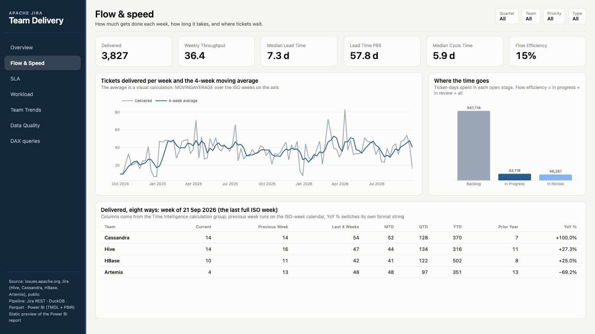
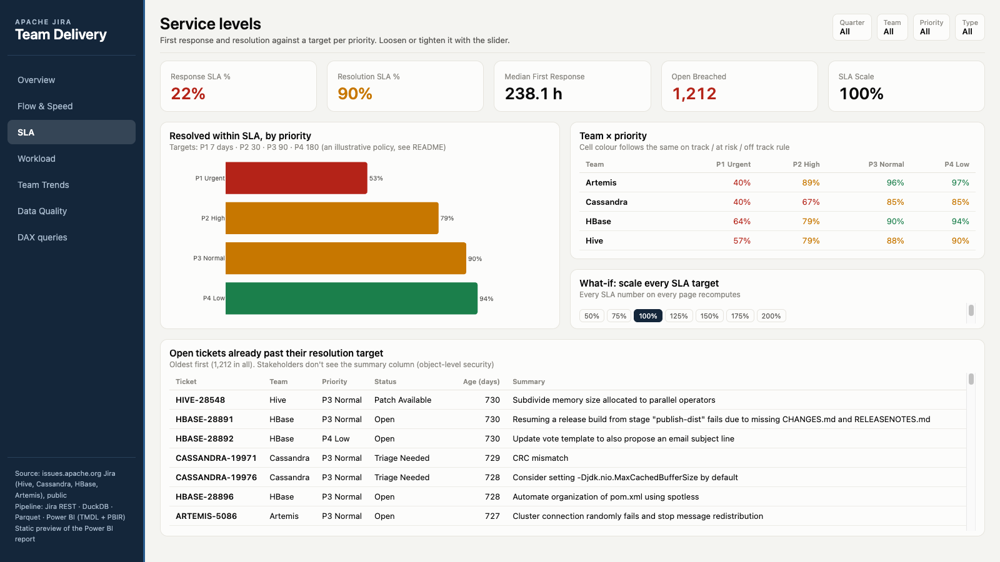
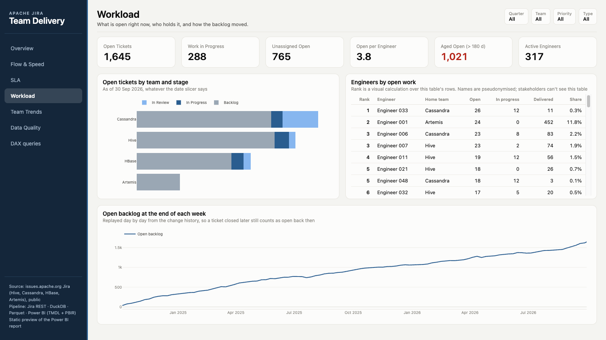
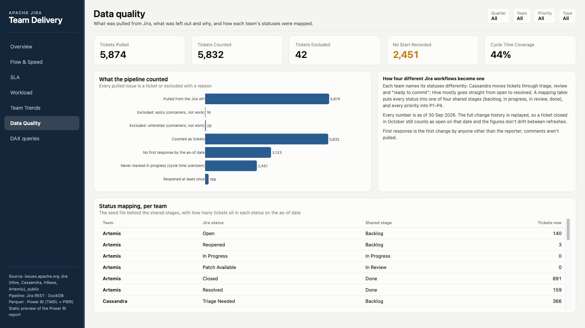
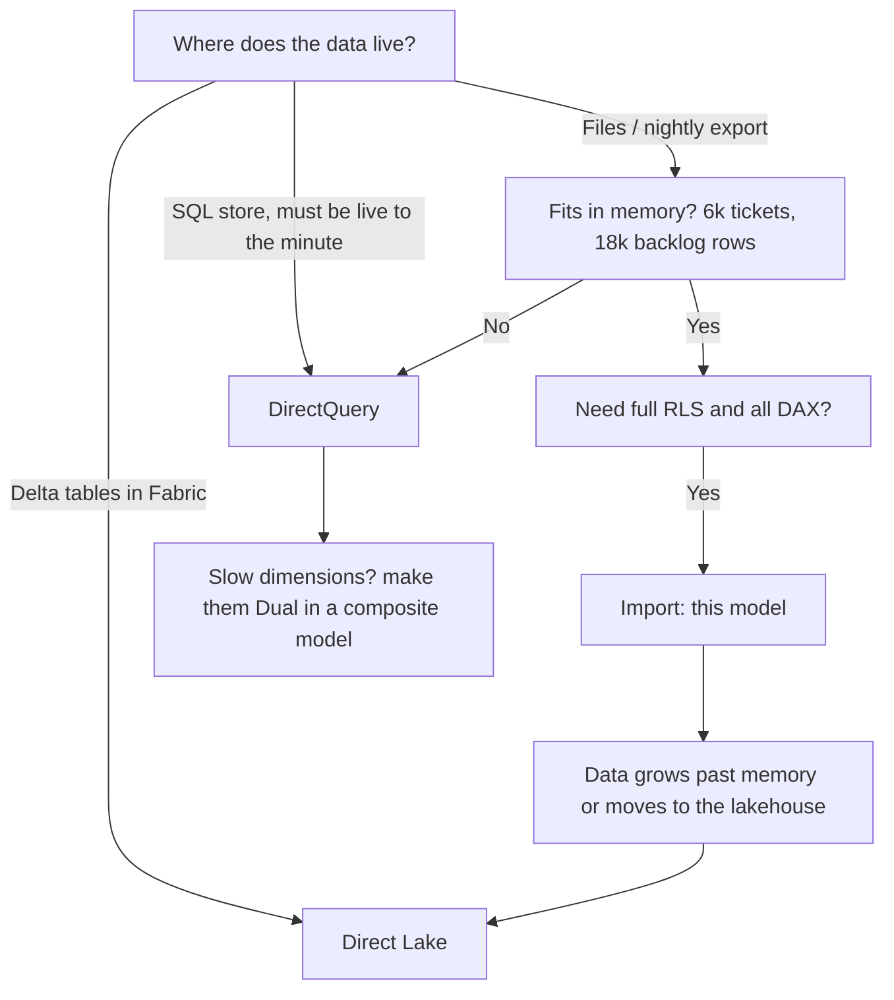
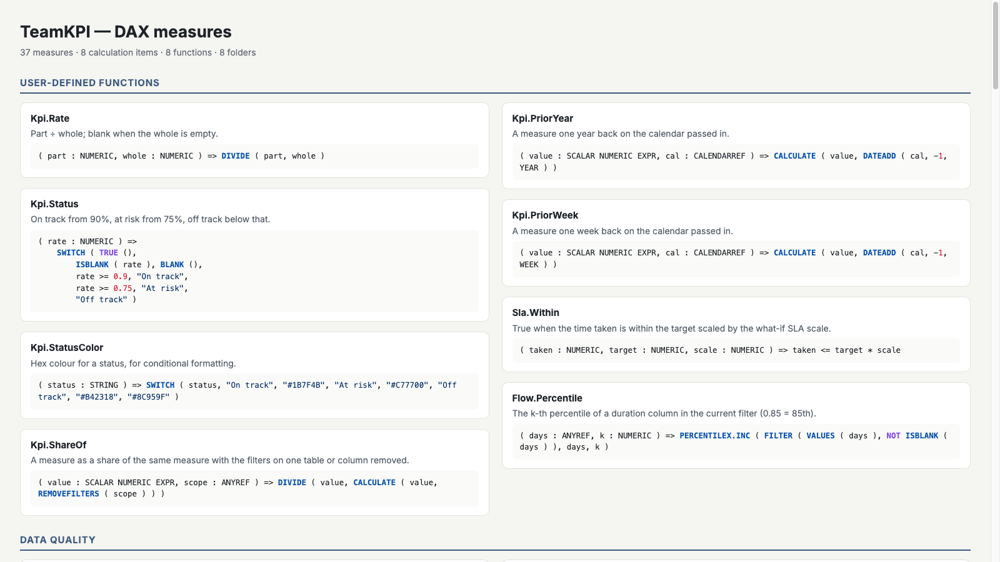
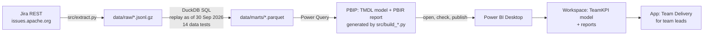

# Team Delivery KPIs: Jira to Power BI

An operations report for four engineering teams, built from their real Jira tickets. The teams are four Apache open-source projects (Hive, Cassandra, HBase, Artemis), and the source is their public Jira. Each team runs its own workflow with its own statuses, so the pipeline maps them onto one shared set of stages. Every number is replayed from the full change history as of 30 Sep 2026. The report answers four questions:

1. **How much gets done, and how fast?** Throughput, lead time, cycle time, where tickets wait.
2. **Are we meeting service levels?** First response and resolution against a target per priority.
3. **Who is carrying the open work?** Backlog by team, stage and engineer, and how it moved.
4. **Can we trust the numbers?** Every pulled issue is either counted or excluded with a reason.


## What the data shows (Oct 2024 – Sep 2026, as of 30 Sep 2026)

| | |
|---|---:|
| Tickets created | **5,832** |
| Resolved | 4,187 (3,827 delivered, 360 closed without change) |
| Backlog growth | **+1,645** open tickets |
| Median lead time (created → delivered) | **7.3 days** |
| Resolved within SLA | **90%** (89.6%) |
| Open tickets past their target | **1,212** |

| Team | Created | Delivered | Open | Median lead time | Within SLA |
|---|---:|---:|---:|---:|---:|
| Artemis | 1,193 | 982 | 143 | 2.3 d | 96% |
| HBase | 1,522 | 1,049 | 377 | 8.1 d | 90% |
| Hive | 1,410 | 803 | 525 | 10.7 d | 88% |
| Cassandra | 1,707 | 993 | 600 | 12.7 d | 84% |

- **Every team takes in more than it closes.** The open backlog grew steadily over the two years, to 1,645 tickets. 1,021 of them are older than 180 days.
- **Urgent tickets miss most often.** Only 53% of P1 tickets were resolved within 7 days, against 94% of P4 tickets within 180 days.
- **Artemis is fast but runs on one person.** It has the shortest lead time and the best SLA, but one engineer delivered 452 of its 982 tickets (46%).
- **Tickets mostly wait in the backlog.** Of all the days tickets spent open, 85% were in the backlog stage and only 15% in progress or in review.
- **Nearly half of the open tickets have no owner** (765 of 1,645).

## Report pages

| Page | What it shows |
|---|---|
| **Overview** | KPIs; tickets in vs tickets out, cumulative (running totals, drillable year → quarter → month); a one-sentence summary that follows the slicers; the SLA Scale slider; delivered tickets and SLA by a dimension the user picks (team / priority / type / engineer / stage), with the Team Tip tooltip. |
| **Flow & Speed** | Weekly throughput with a 4-week moving average (drillable to ISO year); a Deneb lead-time scatter with P50 / P85 lines; lead time median and P85; cycle time; days per stage and flow efficiency; one measure in eight time views from the calculation group; delivered tickets by lead time band. |
| **SLA** | Response and resolution SLA, plus P1 resolution SLA; SLA by team, drillable to priority; a gauge against the 90% target; team × priority coloured by status with the status written out; the open tickets already past their target, oldest first, with days past target and a Jira link. |
| **Workload** | Open tickets by team and stage; engineers ranked by open work, with their share of all tickets, their share of the engineers shown, and their rank inside their team; the open backlog at the end of every week; open tickets by component; open tickets by age band. |
| **Team Trends** | Delivered, 4-week average, change vs the previous week, goal attainment (synthetic goals); weekly delivered tickets as small multiples (one panel per team, shared axis); a metric picker; who carries each team (top engineer, their share, engineers with more than 20 open tickets); open tickets by team × priority, with two bookmark buttons that swap between a stacked bar and a matrix of the same numbers. |
| **Data Quality** | What was pulled, excluded and counted, and rows that failed their type on import; how each team's statuses map onto the shared stages, with a live ticket count per status. |
| **Diagnosis** | Why is the SLA slipping, in four steps: SLA per month vs target → waterfall of backlog growth per quarter split by team → decomposition tree of the breached tickets (team, priority, stage, type) → key influencers of a breach; a Q&A box; a button that drills through to the team's open tickets. |
| **Contributors** | Who carries the delivery: a Pareto chart of deliveries per engineer with the running share and an 80% line; ABC classes that follow the slicers; an RFM-style table (recency, active quarters, volume, scored 1–5) with a segment and an action per segment; engineers by open-load band; a first-quarter cohort matrix (share still delivering N quarters later). Cards: the period counted, then active, new and returning contributors in it (the last quarter when no dates are selected), engineers for 80%, at-risk and churned contributors. |
| **Stage Flow** | How tickets move: a from → to stage transition matrix (rework is a back-move), a funnel of created tickets that reached each stage plus the same per team, the weekly backlog with the built-in analytics-pane forecast (continuous Week Start axis) and its least-squares trend per week (`LINESTX`), each team × priority's share of the backlog growth, and new vs returning engineers per quarter. |
| *Team Detail* (hidden) | Drillthrough on a team: its KPIs, weekly deliveries, speed by priority against the team median, its engineers. |
| *Engineer Detail* (hidden) | Drillthrough on an engineer: delivered by type against the team median, lead-time bands, open tickets. |
| *Ticket List* (hidden) | Drillthrough on team, engineer or priority: the open tickets with age, days past target, Jira link and summary. Locked page filter `Stages[Is Open] = TRUE`. |
| *Team Tip* (hidden) | 320 × 240 report-page tooltip on the team bars (Overview, SLA): median lead time, SLA, open tickets, top engineer share. |

A **paginated report**, `reports/paginated/Breached Tickets.rdl` (RDL 2016, parameter Team), lists one team's breached open tickets for a Monday e-mail subscription. It reads the published model over XMLA (placeholder workspace `Team KPI [Prod]`).

### Report & UX: how it's wired

- **Filters on three levels.** Report: `Date ≤ 30 Sep 2026` (the as-of date), locked. Page: `Stages[Is Open] = TRUE` on Ticket List, locked. Visual: the existing filters (open, breached, delivered).
- **Edit interactions.** On Overview, picking a bar in *delivered by* filters the in-vs-out line, highlights the SLA bars and leaves the six cards alone. On Data Quality, the Team slicer doesn't touch *Tickets Pulled* (the whole extract).
- **Drill.** Date `Calendar` hierarchy on the in-vs-out line, `Weeks` hierarchy on weekly throughput, Team → Priority on the SLA bars.
- **Drillthrough** to Team Detail, Engineer Detail and Ticket List (each with a Back button), and a drillthrough button on Diagnosis.
- **Help.** Every visible page has a *How to read this page* button: a bookmark shows a hidden group with the help text and a Close button (`bm_help_<page>_on/_off`).
- **Accessibility.** Every visual has alt text (title + subtitle, else generated from its fields). Tab order is set per page: title, then the content top-to-bottom and left-to-right, then the header slicers, then the navigation. The status colours are checked at build time against white text for WCAG AA (≥ 4.5 : 1); amber went from `#C77700` (3.5) to `#A35F00` (5.0). The SLA matrix also writes *On track / At risk / Off track*, so colour isn't the only cue.
- **Mobile layouts** (`mobile.json`) for Overview and SLA. On SLA the phone shows the status first (cards, gauge), then where it breaks, then the breached list.
- **Custom visual.** Deneb is registered in `report.json` (`publicCustomVisuals`); its Vega-Lite spec is kept in `powerbi/deneb/lead-time-scatter.json` and embedded by the generator.
- **Export** is set to summarized and underlying data, so the ticket lists can be exported. Object-level security still hides the summary column from stakeholders.

Header slicers on every page: **Quarter**, **Team**, **Priority** and **Type**. The **SLA Scale** slider (50–200%) loosens or tightens every SLA target at once.

| | |
|---|---|
|  |  |
|  |  |

## How it works

```
issues.apache.org Jira REST API (/search with expand=changelog)
  → src/extract.py: tickets + full change history → data/raw/<TEAM>.jsonl.gz
  → DuckDB (sql/10_staging.sql, sql/20_marts.sql): replay as of 30 Sep 2026 → star schema
  → src/pipeline.py: the 14 data tests (sql/90_tests.sql), then data/marts/*.parquet
  → Power BI semantic model (TMDL, Power Query over the parquet folder) + report (PBIR)
```

### As of a fixed date

The API returns each ticket as it is today. The pipeline replays the change history backwards so every field (status, priority, type, resolution, assignee) is the value it had on 30 Sep 2026. A ticket resolved in October is still open in the report, and a ticket raised to Blocker in October still counts as P3. The numbers don't drift when the data is pulled again.

### One vocabulary for four workflows

Seed files in `seeds/` map each team's own words onto shared ones:

- **Status → stage:** Cassandra's *Triage Needed*, *Changes Suggested*, *Review In Progress*, *Needs Committer*, *Ready to Commit* and so on, and the others' *Open*, *In Progress*, *Patch Available*, *Resolved*, become Backlog / In Progress / In Review / Done.
- **Priority → P1–P4:** Blocker / Critical / Major / Minor (and Urgent / High / Normal / Low) become P1–P4. Each has a response and resolution target (P1: 24 h / 7 d, P2: 72 h / 30 d, P3: 1 week / 90 d, P4: 2 weeks / 180 d).
- **Type:** Bug, Feature (improvement, new feature, wish), Task (task, sub-task, test, dependency upgrade). Epics and umbrellas are containers, not work, and are excluded.
- **Resolution:** Fixed / Done / Implemented count as *delivered*; Duplicate / Won't Fix / Not A Problem etc. as *closed without change*.

### Semantic model: the advanced parts

- **DAX user-defined functions:** `Kpi.Rate`, `Kpi.Status`, `Kpi.StatusColor`, `Kpi.ShareOf`, `Kpi.PriorYear`, `Kpi.PriorWeek`, `Sla.Within` and `Flow.Percentile`. Status and colour rules live in one place, and every measure calls them.
- **Calendar-based time intelligence:** a Gregorian and an ISO-week calendar on the Date table, so "previous week" moves by real ISO weeks.
- **Calculation group** *Time Intelligence* (8 items: Current, Previous Week, Last 4 Weeks, MTD, QTD, YTD, Prior Year, YoY %). YoY % switches its format string dynamically.
- **Field parameter** *Analyze By*: team, priority, type, engineer or stage.
- **What-if parameter** *SLA Scale* (50–200%): every SLA measure recomputes against scaled targets.
- **Two date roles:** created date is the active relationship, resolved date is inactive and switched on with `USERELATIONSHIP` for throughput and lead time.
- **Visual calculations:** `RUNNINGSUM`, `MOVINGAVERAGE` and `RANK` computed on the visual rather than in the model.
- **Security:**
  - Row-level: a *Team Lead* sees only the teams mapped to their login in *Team Access* (`USERPRINCIPALNAME()`).
  - Object-level: a *Stakeholder* can't see the People table or the ticket summary column.
  - A static role, *HBase Readers*, sits next to it (see *Static vs dynamic RLS*).
- **Perspectives** (Delivery, Data Quality), descriptions on every measure, and synonyms for Q&A.
- **Housekeeping:** every key, foreign key and sort-by helper column is hidden, every decimal column has a format string, and measures sit in display folders. The model check fails the build if one slips.
- **Power Query parameters:** `DataFolder` (the parquet marts), `SeedFolder` (the Excel seed), `AsOfDate`, `TestUpn` and `LakehouseSqlEndpoint`; see *Power Query* below.

### Measure, calculated column or calculated table

All three are in the model, each where it fits:

- **Calculated column `Tickets[Lead Time Band]`** (up to 1 day, 2–7, 8–30, 31–90, over 90). A ticket's lead time never changes after it is resolved, so the band is computed once at refresh and stored. Being a column, it can go on an axis: the *Delivered tickets by lead time* chart on Flow & Speed. A hidden *Lead Time Band Order* column sorts it.
- **Measure `Open Breached`.** Whether an open ticket is past its target depends on the *SLA Scale* slider, which a user moves after refresh. A calculated column is fixed at refresh and can't see a slicer, so this has to be a measure.
- **Calculated tables:** *SLA Scale* (the what-if parameter), *Analyze By* and *Metric Picker* (field parameters), *Time Intelligence* (calculation group), and five disconnected tables for the analysis pages: *ABC Class*, *Load Band*, *Funnel Step*, *Contributor Segments* (`DATATABLE`) and *Quarter Offset* (`GENERATESERIES`). They have no relationship; each measure reads the row it is on (`MIN('Load Band'[Min Open])`, `SELECTEDVALUE('Funnel Step'[Step Order])`).

### Performance: the summary text in its own table

`Summary` is the only free-text column, almost unique per ticket, so it compresses worst. It moved from `Tickets` to a separate one-to-one table *Ticket Text*, used only by the breached-ticket table on SLA. Visuals that never show the summary no longer scan that column. Object-level security now hides `Ticket Text[Summary]` from the Stakeholder role. **Not measured:** the before/after size would come from VertiPaq Analyzer in DAX Studio, which needs Windows and Power BI Desktop. On the Mac, the gain is only argued, not shown.

### Static vs dynamic RLS

| | *HBase Readers* (static) | *Team Lead* (dynamic) |
|---|---|---|
| Filter | `Teams[Team Key] = "HBASE"`, fixed in the role | `Teams[Team Key]` in the teams mapped to `USERPRINCIPALNAME()` in *Team Access* |
| A new team or user | A new role per team, and someone assigns people to it | A new row in *Team Access*; no model change |
| Use when | Few, stable groups | Access varies per person, or changes often |

### DAX: problem → tool

The tools below are each used once in this model, by a measure on a page.

| Problem | Tool | Measure (page) |
|---|---|---|
| A filter should narrow the slicer, not replace it | `KEEPFILTERS` | `P1 Resolution SLA %` (SLA). With Priority = P2 selected it is blank, not P1's value. The *KEEPFILTERS* query tab shows both versions. |
| Share of what the visual shows, not of everything | `ALLSELECTED` | `Visible Delivered Share` (Workload engineer table), next to `Delivered Share` (`REMOVEFILTERS`) |
| Compare to the team, whatever else is filtered | `ALLEXCEPT` | `Lead Time vs Team Median` (drillthrough) |
| Filter by a row-level condition that uses a related table | `FILTER` + `RELATED` inside `CALCULATE` | `Open Breached`. `RELATED` works because the filtered table is expanded with its related tables. See the *Expanded table* query tab. |
| Each row as a filter | Context transition (a measure inside an iterator) | `Top Engineer Share`, `Overloaded Engineers` (Team Trends) |
| Join two tables that have no relationship | `TREATAS` | `Tickets in Status` (Data Quality) |
| The previous row in a sort order | `OFFSET` | `Throughput Δ vs Prev Week` (Team Trends) |
| A moving window | `WINDOW` | `Delivered 4W Avg` (Team Trends card) |
| Rank, or the first one, per group | `RANK` + `PARTITIONBY`, `INDEX` | `Engineer Rank in Team` (Workload), `Top Engineer` (Team Trends) |

**Window functions in the model vs visual calculations.** `OFFSET`, `WINDOW`, `INDEX` and `RANK` in a measure work anywhere the measure goes: a card, a tooltip, another measure. A visual calculation (`RUNNINGSUM`, `MOVINGAVERAGE`, `RANK` on Flow & Speed and Workload) is shorter, but only lives on that one visual, over the rows it shows. A card has no rows to move over, so the 4-week average card needs the model version.

### Relationships: regular, limited, one-to-one, bridge

- **Regular.** `Tickets[Created Date] → Date[Date]` is many-to-one on a unique key, so filters are exact and blanks are handled.
- **Limited (many-to-many).** *Quarter Goals* (synthetic, see *Honest notes*) holds one goal per team, work type and quarter. It joins Date on `Year Quarter`, which is not unique on either side, so the relationship is many-to-many: a limited relationship. Power BI joins it at query time and doesn't add a blank row for unmatched values. `Goal Attainment %` = delivered ÷ the summed goals.
- **One-to-one.** *Ticket Text* ↔ *Tickets*, filtering both ways.
- **Bridge.** A ticket can belong to several Jira components. *Ticket Components* (ticket, component) links *Tickets* to *Components*, filtering both ways, so *Open tickets by component* on Workload counts a ticket under each of its components. Component values are the **current** ones from Jira, not replayed to the as-of date.

### Incremental refresh (`Backlog`)

The daily backlog is append-only: once a day has passed, its row doesn't change. So `Backlog` has an incremental refresh policy: keep 24 months, refresh the last 7 days. The Power Query filters `Date` on the `RangeStart` and `RangeEnd` parameters (`>=` start, `<` end, so no day lands in two partitions). `Tickets` stays a full refresh, because the as-of replay can change an old ticket. **Not applied here:** the policy only creates partitions after publishing to the Service; Desktop loads the `RangeStart`–`RangeEnd` window.

### Power Query (`powerquery/*.pq`, the same M as the partitions)

Every query follows one recipe, and each step is named and commented so the Applied Steps pane reads top to bottom:

1. **Source:** read one parquet mart (`Parquet.Document(File.Contents(DataFolder & …))`).
2. **Kept:** `Table.SelectColumns` comes first. Parquet is columnar, so only those columns are read; on the lakehouse variant this becomes the `SELECT` list.
3. **Renamed:** business names.
4. **Typed:** types once the shape is final.

The extra work sits in a few queries:

- **`Tickets Source`:** a staging query. It's a shared expression in `expressions.tmdl`, so it has *enable load* off and isn't a table.
  - `Tickets` and `Import Errors` both *reference* it. A *duplicate* would copy its steps, and the parquet path would then live in two places that drift apart.
- **`Tickets`** builds on the staging query in this order:
  - `Table.ReplaceErrorValues`: a lead, cycle or response value that fails its type becomes null instead of failing the refresh.
  - It drops rows without a key and keeps tickets created up to `AsOfDate`.
  - Null assignee becomes 0 (the *Unassigned* person).
  - Text cleanup: `Text.Trim` and `Text.Clean` on Summary, `Text.Proper` on Status. "Ready to Commit" becomes "Ready To Commit"; DAX compares text case-insensitively, so the status mapping still matches.
  - `Table.SplitColumn`: HIVE-1234 becomes *Project* + *Issue Number*, and Ticket Key sorts by the number.
  - A *Jira URL* column (data category WebUrl).
  - **Age Band** (0–30 / 31–90 / 91–180 / over 180 days), used on Workload. 1,021 open tickets are over 180 days.
  - **Merge** with the priority targets (`Table.NestedJoin` on Priority Key, then expand) gives **Days Past Target**, a column in the breached-tickets table on SLA.
  - **Group By** on Stage Time (`Table.Group` per ticket) is merged back as **Stages Visited**. Stage Time holds one row per ticket and open stage, not one per transition, so this counts stages, not bounces.
- **`Import Errors`:** `Table.SelectRowsWithErrors` on the staging query keeps the rows Tickets nulled. It's shown as *Import Error Rows* on Data Quality, and it is 0 today.
- **`Stage Time`:** drops the 532 zero-length intervals.
- **`Backlog`:** keeps dates up to `AsOfDate`.
- **`Team Access`:** `Table.Combine` appends one row to the seed: the `TestUpn` login mapped to HBase, so the Team Lead role can be tested with a real account in the Service.
- **`Quarter Goals`** reads `seeds/quarter_goals.xlsx`. **The goals are synthetic:** they are the real quarterly delivered counts scaled by a fixed random factor, made by `src/seed_goals.py`. The sheet is laid out the way an ops team keeps one, so the query has these steps:
  - `Table.Skip` past the title and blank row.
  - `Table.PromoteHeaders`.
  - Drop the blank rows between blocks.
  - `Table.FillDown` the team, which is only written on each block's first row.
  - `Table.UnpivotOtherColumns`: the quarter columns become rows.
  - Turn "Q3 2026" into Year Quarter 20263.
  - `Table.Group` bug + other goals per team and quarter.
  - `Table.AddIndexColumn`.

**Folding and best practice.**

- Parquet has no query engine, so nothing folds: `Kept` is the optimisation (projection), and the steps after it run in the mashup engine on 5,832 rows.
- `powerquery/Lakehouse Tickets Source.pq` and `Lakehouse Backlog.pq` are the Fabric variant. They use the same steps over `Sql.Database(LakehouseSqlEndpoint, "teamkpi_lh")`, and every step there (select, rename, type) can fold into one `SELECT`.
- To use them, paste one into the Advanced Editor in place of the parquet source.
- **Not verified:** *View Native Query* needs Power BI Desktop and a real endpoint, and neither is available here.
- Rules followed:
  - Select columns first and set types last.
  - Don't add an index or buffer before a filter.
  - Keep one staging query per source file.
  - Use parameters for every path and server.

**What-if vs Power Query parameters.** *SLA Scale* is a what-if parameter: a DAX table that report users move with a slider. The Power Query parameters (`DataFolder`, `SeedFolder`, `AsOfDate`, `TestUpn`, `LakehouseSqlEndpoint`) are set by the model owner under *Transform data > Edit parameters*, or in the Service's dataset settings, and only take effect on refresh.

### Shared model, storage mode and refresh

- **One shared semantic model.** `TeamKPI.SemanticModel` holds every measure, RLS rule and relationship, and reports bind to it. Two report types are planned:
  - Thin reports connect live to the published model; a thin report has no model of its own.
  - A composite report adds its own tables (see *Storage modes*).
- **Why no dataflow or Dataverse.** The cleaning and the as-of replay already happen in DuckDB, and the marts are versioned files.
  - A dataflow would be a second place where the same logic lives.
  - Dataverse is a store for app data (Power Apps), not for an analytics pipeline's output.
  - A dataflow would make sense if several models needed the same Jira tables and the pipeline didn't exist.

| Storage mode | Used here? | Where it would fit |
|---|---|---|
| **Import** | Yes, every table | 6k tickets and 18k backlog rows from files: small, fast, and RLS works in full. |
| **DirectQuery** | No | Only if Jira data sat in a SQL store and had to be live to the minute; the source here is a nightly file. |
| **Dual** | No | Dimension tables in a composite model, so they can join both import and DirectQuery facts. |
| **Live connection** | Thin reports (planned) | A report with no model of its own, connected to the published TeamKPI model. |
| **Direct Lake** | Variant (planned) | Fabric: the marts as Delta tables in `teamkpi_lh`, read without an import copy. |

Every table in this model is Import. A composite variant (a thin report that adds a local table to the published model over DirectQuery) needs the model published to the Service first, so it isn't built here.



**Refresh: who refreshes what.**

1. `src/extract.py` pulls Jira (cached), and `src/pipeline.py` rebuilds the parquet marts and runs the 14 data tests. A failing test stops the export, so the model never loads bad data.
2. The semantic model then refreshes from the marts.
   - In the Service this would be a scheduled refresh after the pipeline's nightly run, through a gateway pointing at the marts folder (or no gateway on the lakehouse variant).
   - Not set up here: there is no published workspace.
3. `AsOfDate` caps what is loaded. Move it, together with the pipeline's as-of date, to roll the report forward.

### Checks (`.github/workflows/ci.yml`)

- **Data tests:**
  - 14 SQL tests run on every build and block the export if one fails. Replaying the history reproduces today's values exactly; every pulled issue is counted or excluded; every status, priority, type and resolution has a mapping; status intervals tile each ticket's life with no gaps; the last day's backlog equals the open tickets; stage days add up to lead time; every component bridge row points at a real ticket and component; every stage transition really changes stage.
  - 8 unit tests on hand-written Jira issues: a resolution after the as-of date doesn't leak, a later priority change doesn't leak, epics are excluded, a reopened duplicate counts as open, the reporter's own changes are not a response, the backlog counts the right days, and a reopen shows up as a Done → Backlog transition.
- **Best-practice rules on the model:** every reference resolves, every measure has a description and a format string, relationships point at key columns, foreign keys are hidden.
- **Power Query parses** with Microsoft's parser (`tools/m-check`): 21 queries (including the staging query and the lakehouse variants), 0 errors.
- **The model loads** in Microsoft's Tabular Object Model (`tools/tmdl-validate`): `Model.Validate()` passes, and the TMDL round-trips.
- **The report validates** with `pbir validate` against the schema and the model.

### Analysis: contributors and stage flow (sql/20_marts.sql, `Contributors` and `Stage Flow` pages)

Customer-analytics methods, applied to the people and tickets of an open-source project:

| Method | Here | How |
|---|---|---|
| Pareto 80/20 | `Delivered Cumulative %`, `Pareto Line` | Each engineer's deliveries plus everyone who delivered at least as many, over all engineers in `ALLSELECTED`. Result: 59 of 311 engineers deliver 80% of the tickets. |
| ABC classes | `ABC Class` table, `Engineers in Class`, `Engineers for 80%` | The same running share, bucketed A (to 80%), B (to 95%), C. Follows the slicers. |
| Dynamic segments | `Load Band` table, `Engineers in Band` | Engineers by open tickets on the as-of date: light 1–5, normal 6–20, overloaded over 20. |
| RFM | `Recency Days`, `Active Quarters`, `Delivered All Time`, `RFV Score` | Recency = days since the last delivery, frequency = quarters with a delivery, volume = all-time deliveries (contributor health in the spirit of CHAOSS). Each scored 1–5. |
| Segments with actions | `Contributor Segment`, `Contributor Segments` table | Core (R and F 4+), Rising (recent, few quarters), Fading (not recent, many quarters), Occasional. Each row carries an action (mentor, check in, hand over open tickets). |
| New vs returning | `New Contributors`, `Returning Contributors`, `Period Counted` | First delivery inside the period vs before it, in the teams in the filter. Over the whole extract everyone would be new, so when no dates are selected the cards count the last quarter (Q3 2026: 117 active, 33 new, 84 returning) and the `Period Counted` card names it. |
| Cohorts | `People[First Quarter]`, `Quarter Offset` table, `Cohort Retention %` | Engineers grouped by the quarter of their first delivery; the matrix is the share still delivering N quarters later. Q4 2024 is a catch-all cohort (everyone active when the extract starts). |
| Churn | `Churned Contributors`, `At Risk Contributors` | 5+ deliveries and none for over 90 days (churned) or 46–90 days (at risk). |
| Transition matrix | `fact_stage_transition` → `Stage Transitions`, `Transitions`, `Review Bounce Rate` | One row per move between shared stages, built from the replayed status intervals (consecutive intervals in the same stage merged). 7.6% of moves out of review go back to In Progress; 174 Done → Backlog moves are reopens. |
| Funnel | `Funnel Step` table, `Funnel Tickets`, `Funnel %` | Created → reached In Progress → reached In Review → delivered. Not a strict funnel: many tickets go from Backlog straight to Done, so fewer reach In Progress than In Review. |
| Contribution to change | `Net Flow Share` + the Diagnosis waterfall | Each team × priority's share of the backlog growth (+1,645). |
| Trend | `Backlog Trend /wk` | `LINESTX` slope of the week-end open backlog against the date, × 7: the backlog grows about 14 tickets a week. |
| Diagnosis flow | `Diagnosis` page | SLA per month → waterfall → decomposition tree → key influencers → drillthrough (built in the Report & UX phase). |

### Every DAX measure

`reports/dax.html` lists all 76 measures, 8 calculation items and 8 functions, with their descriptions and format strings. It is generated from the TMDL by `../tools/dax_gallery.py`.

[](reports/screenshots/dax.png)

### Saved DAX queries (`TeamKPI.SemanticModel/DAXQueries/`)

Seven tabs that open in Power BI's DAX query view, written by `src/dax_queries.py` (also shown with their expected results on the *DAX queries* page of `reports/dashboard.html`):

- **Delivery by team:** `SUMMARIZECOLUMNS` report query (created, delivered, lead time, SLA, open, breached per team).
- **Test key measures:** `DEFINE MEASURE … EVALUATE` test. Seven measures against totals computed from `data/marts` with DuckDB at build time; every row should say PASS.
- **KEEPFILTERS:** SLA by priority, with a query-defined P1 measure that replaces the filter next to the model's `KEEPFILTERS` one.
- **Expanded table:** `Open Breached` vs the same count written with `FILTER(Tickets, … RELATED(…))`, and open P1 tickets filtered through Priorities.
- **CLS test:** the top 5 rows of `Ticket Text`. Run it as the Stakeholder role (*View as*): it should fail on `Summary`. Not run: there is no Desktop or Service here.
- **Model measures / Model tables:** documentation from `INFO.VIEW.MEASURES()` and `INFO.VIEW.TABLES()`.

### Methods by level

- **Beginner:** cards, bar/line charts, slicers, tables, star schema with one Date table.
- **Intermediate:** bookmarks with buttons (chart ↔ table toggle), small multiples, conditional formatting by status, running totals, field parameter, what-if parameter, Power Query parameter.
- **Advanced:** calculation group with dynamic format strings, calendar-based (ISO-week) time intelligence, inactive relationship with `USERELATIONSHIP`, visual calculations, RLS on `USERPRINCIPALNAME()` plus object-level security, perspectives, saved DAX queries (report query, `DEFINE MEASURE` test, `INFO.VIEW` documentation).
- **Expert:** DAX user-defined functions (incl. a percentile), changelog replay to an as-of date with SQL tests, best-practice rules on the model, the whole model and report generated as code (TMDL + PBIR) and validated in CI with Microsoft's parser and TOM.

## End to end: from Jira to the people who read it



Steps 1–3 run and are checked here (CI: data tests, unit tests, TOM, M parser, `pbir validate`). Desktop, the workspace and the app are the Service phase of the plan and are not done yet.

### Who does what where

| Who | Where | What they own |
|---|---|---|
| Data engineer | `src/extract.py`, `sql/*.sql`, `src/pipeline.py` | Pulling Jira, the as-of replay, the marts and the data tests. |
| Analyst (model owner) | `src/build_model.py` → `TeamKPI.SemanticModel` | Tables, relationships, measures, RLS, perspectives. One model for every report. |
| Report author | `src/build_report.py` → `TeamKPI.Report` | Pages and visuals, bound to the shared model. |
| Team lead (viewer) | The app in the Service | Reads the report; sees only their team's rows through RLS. |

In this portfolio one person plays all four; the split is how the files are organised.

### Ownership pattern

One central model, owned by the analyst, certified once and reused. Each team lead can get a thin report connected live to that model (planned; see *Shared model, storage mode and refresh*), so a new chart never forks a measure. Changes to a measure go through the model's repo and CI, not through a report.

### Generative AI in this project

Claude (an LLM) wrote most of the generator code: the SQL, `build_model.py` (TMDL), `build_report.py` (PBIR) and the HTML twin. Nothing it wrote is trusted until it passes a gate a machine runs:

| Gate | Catches |
|---|---|
| 14 SQL data tests + 8 unit tests | Wrong replay logic, leaks past the as-of date, lost tickets. |
| Microsoft TOM `Model.Validate()` + TMDL round-trip | DAX that doesn't parse or references a missing column, broken relationships. |
| Microsoft's M parser (`tools/m-check`) | Power Query syntax. |
| `pbir validate` | Visuals bound to fields that don't exist, schema errors. |
| The `Test key measures` DAX query and the DuckDB twin | Numbers: seven measures compared with totals computed independently. |

What these gates don't prove, so don't trust it without a check in Power BI: that a visual looks right, that DAX gives the right number in every filter context (the twin only checks the default state), and that features like Q&A, key influencers or the analytics pane behave as described. The LLM also tends to write plausible but untested claims into prose; the honest notes below list what was not run.

### AI governance: what goes to the model

- Only metadata (table, column and measure names, DAX, M, code) and public data were sent to the LLM. The ticket data is public Apache Jira.
- People are pseudonymised before they reach the marts ("Engineer 001…", identified by a hashed key), so no names, logins or e-mail addresses are in the model, the twin or the prompts.
- No credentials are in the repo. The Service phase would add sensitivity labels and keep Copilot/MCP access to the published model at metadata plus aggregates.

## Dev lifecycle (pbi-kit)

The shared CI/CD kit is vendored at `tools/pbi-kit` (BPA rules + runner, DAX tests, fabric-cicd deploy, CI template, docs). Project-specific parts: `bpa/project-rules.json`, `powerbi/parameter.yml`, the `.assert.json` files next to two saved DAX queries (`src/dax_queries.py` → `ASSERTS`), and `.github/workflows/ci.yml`.

### Who does what (in the release flow)

The roles are the ones in *Who does what where* above; this is what each does in git and CI:

| Role | Changes | Gate before it reaches Prod |
|---|---|---|
| Data engineer | `sql/`, `src/pipeline.py`, `tests/` | unit tests + SQL data tests in `ci` |
| Analyst (model owner) | `src/build_model.py`, `src/dax_queries.py`, `bpa/project-rules.json` | BPA (no error), TOM, DAX tests offline, then the DAX asserts online in Test |
| Report author | `src/build_report.py` | `pbir validate` against the model |
| Workspace admin / approver | workspaces `Team KPI [Dev/Test/Prod]`, service principal, GitHub environments `Test`/`Prod` | approves the Prod deployment (required reviewer) |

### Ownership pattern

Unchanged from *Ownership pattern* above: one central `TeamKPI` model owned by the analyst, thin reports per team lead bound to it. In CI terms that means a measure change is a PR on `src/build_model.py` that the analyst reviews and that must pass BPA and the DAX asserts; a page change is a PR on `src/build_report.py` that only has to pass `pbir validate`.

### Daily git flow

```bash
git switch -c feat/rank-format                   # 1 branch per change
# edit src/build_model.py (never the generated TMDL)
uv run python src/build_model.py                 # regenerate model + DAXQueries
git diff powerbi/                                # the TMDL is plain text: review it like code
tools/pbi-kit/bpa/bpa.sh powerbi/TeamKPI.SemanticModel/definition --rules bpa/project-rules.json
python3 tools/pbi-kit/dax-tests/daxtest.py powerbi/TeamKPI.SemanticModel/DAXQueries --offline
git commit -am "Engineer Rank in Team: thousands format" && git push -u origin HEAD   # → PR, CI must pass
```

Lineage tags are uuid5 of the object's path (`tag()` in `src/build_model.py`), so a rebuild without a change leaves `git diff` empty and a one-measure edit shows as a one-measure diff. A real one, from this phase (BPA `INTEGER_FORMATTING` fix):

```diff
--- a/powerbi/TeamKPI.SemanticModel/definition/tables/_Measures.tmdl
+++ b/powerbi/TeamKPI.SemanticModel/definition/tables/_Measures.tmdl
@@ -268,7 +278,7 @@ table _Measures
 			IF ( ISINSCOPE ( People[Person] ) && NOT ISBLANK ( [Delivered] ),
 			    RANK ( DENSE, ALLSELECTED ( People[Person], People[Home Team] ), ORDERBY ( [Delivered], DESC ), LAST,
 			        PARTITIONBY ( People[Home Team] ) ) )
-		formatString: 0
+		formatString: #,0
 		displayFolder: Workload
 		lineageTag: b51af309-87bd-567b-bccb-16efd6530d89
```

### CI/CD: what runs and why this option

`.github/workflows/ci.yml`: **data tests** (unit tests incl. the SQL data tests on a fixture) → generate the model → **BPA** (fails on any error) → **TOM** validate → M parser → **DAX tests offline** → PBIR build + validate → `parameter.yml` check (Test and Prod) → *(main only)* **deploy Test** (fabric-cicd) → refresh → **DAX tests online** → **approval** (GitHub environment `Prod`, required reviewers) → **deploy Prod**.

Of the four Fabric CI/CD options (`tools/pbi-kit/docs/cicd-options.md`: Fabric Git integration, deployment pipelines, fabric-cicd, REST/PowerShell/Fabric CLI scripts), this project uses **PBIP in Git + fabric-cicd from GitHub Actions**:
- The model and report are generated from Python, so the repo is the single source of truth; Fabric Git integration as the main path would add a second writer (the Service) to the same files.
- A deployment pipeline alone can't run the data tests, BPA or DAX asserts before Prod; the Actions job can, and stops the release when one fails.
- One person / one small team, already on GitHub: no Azure DevOps to run. fabric-cicd swaps `DataFolder`, `SeedFolder`, `LakehouseSqlEndpoint` and `TestUpn` per environment from `powerbi/parameter.yml`; a deployment pipeline would need the same as deployment rules, set by hand per stage.
- Fabric Git integration on the Dev workspace and a deployment pipeline are still worth doing once, for people who edit in the Service (12-s9/12-s10/12-s16/12-s17 below).

### BPA

`tools/pbi-kit/bpa/bpa.sh` runs the 71 Microsoft rules + 3 kit rules + `bpa/project-rules.json` on TOM (no Tabular Editor needed). Project rule `PROJ_TEAMKPI_SLA_HONOURS_SCALE` (error): every measure named "… SLA %" must read `[SLA Scale %]` (directly or through `[Resolution SLA %]`), otherwise the SLA Scale what-if silently stops moving it. Checked by breaking `P1 Resolution SLA %` on a scratch copy: the rule fired.

| | error | warning | info |
|---|---:|---:|---:|
| before | 10 | 110 | 126 |
| after | 0 | 92 | 126 |

Fixed in `src/build_model.py`: `Tickets Now`, `Data Checks[Tickets]` and `Quarter Goals[Delivery Goal]` summarize by none (no visual sums them); 1-decimal percentages use `#,0.0%;-#,0.0%;#,0.0%`; `Engineer Rank in Team` uses `#,0`. Ignored on purpose (annotation `BestPracticeAnalyzer_IgnoreRules`, reasons in `BPA_IGNORE`): the 7 text measures (`Contributor Segment`, `Headline`, `Period Counted`, `RFV Score`, `SLA Color`, `SLA Status`, `Top Engineer`: a format string means nothing on text); `Net Flow`, `Throughput Δ vs Prev Week`, `Lead Time vs Team Median`, `Backlog Trend /wk` (signed formats like `+#,0;-#,0;0` on purpose); `Last Delivery` (a date). Left as warnings: whole-number percentages (`0%`, on purpose), hidden-FK and floating-point hints, `ISAVAILABLEINMDX`, relationship columns that aren't integers. Results: `evidence/bpa.json`, `evidence/bpa-after.txt` (before: `evidence/bpa-before.json`).

### DAX tests

`DAXQueries/Test key measures` and `Expanded table` have `.assert.json` files. The expected values are the DuckDB numbers `src/dax_queries.py` computes from `data/marts` at build time: 5,832 created, 4,187 resolved, 3,827 delivered, median lead 7.299 days, resolution SLA 89.59%, 1,645 open (= the 30 Sep backlog that `sql/90_tests.sql` checks), 1,212 open breached; every row must also say PASS. Offline they pass syntax, structure and model-reference checks; **the asserts have not been executed** (that needs the published model). `TeamKPI` has RLS roles, so the online step needs a user token (`PBI_ACCESS_TOKEN`): Microsoft rejects service principals on `executeQueries` for RLS models.

### Steps left for you (Service / Desktop)

1. **12-s8 repo + PR:** create the GitHub repo, push, open a PR (e.g. a measure change), let `ci` pass, merge.
2. **12-s15 branch protection:** `main` requires a PR and the status check `ci` (`tools/pbi-kit/ci/branch-protection.md`).
3. **14-s5 service principal:** app registration + federated credential for GitHub OIDC, tenant setting "Service principals can use Fabric APIs", add it as Member of the Test/Prod workspaces (`tools/pbi-kit/docs/service-principal.md`); screenshot → `evidence/14-s5.png`.
4. **Workspaces:** create `Team KPI [Dev]`, `[Test]`, `[Prod]`; GitHub environments `Test` (vars `FABRIC_WS_TEST`, `PBI_DATASET_NAME=TeamKPI`; secrets `AZURE_CLIENT_ID`, `AZURE_TENANT_ID`, `PBI_ACCESS_TOKEN`) and `Prod` (var `FABRIC_WS_PROD`, required reviewers).
5. **14-s7 parameter.yml:** replace the placeholder share paths, endpoint and UPNs in `powerbi/parameter.yml` with real ones; `deploy.py --dry-run` shows which file each one hits (`evidence/deploy-dry-run.txt`).
6. **12-s14 / 14-s6 / 14-s8:** merge to `main` → the workflow runs BPA, deploys Test, refreshes, runs the DAX asserts, waits for approval, deploys Prod.
7. **12-s9 / 12-s10 Fabric Git:** connect `Team KPI [Dev]` to a branch, folder `powerbi/`; change one measure in the Service → Commit; change one in the repo → Update (`evidence/12-s9.png`, `12-s10.png`).
8. **12-s16 / 12-s17 deployment pipeline:** Dev → Test → Prod on the three workspaces, Compare, deployment rule for `DataFolder` (`evidence/12-s16.png`, `12-s17.png`).
9. **8-s14 / 12-s12 / 12-s13 Tabular Editor (Windows):** run `tools/pbi-kit/bpa/te2-bpa.ps1 -Model powerbi/TeamKPI.SemanticModel/definition -ProjectRules bpa/project-rules.json > evidence/8-s14.txt` and compare with `evidence/bpa-after.txt`; look at the ignore annotations in the BPA window.
10. **14-s4:** the four options are in `tools/pbi-kit/docs/cicd-options.md`; the choice is above.

Not run here: the workflow itself (only YAML-parsed), any publish, refresh or online DAX query, Tabular Editor.

## Honest notes

- **The SLA policy is made up.** Apache projects are volunteers and have no SLA. The targets per priority are an illustrative policy, so read SLA % as "how this team would score against a typical policy".
- **First response is from the change history only.** Comments aren't pulled, so a reply in a comment doesn't count. That is why response SLA is low (22%) and should be read as "time until someone touched the ticket".
- **Cycle time coverage is uneven.** It needs a ticket to pass through an in-progress or in-review status. Cassandra does that for 79% of delivered tickets, HBase 62%, Hive 31% and Artemis 1%. Artemis almost always goes straight from open to resolved, so its cycle time is effectively unknown.
- **People are pseudonymised.** Assignees are shown as "Engineer 001…" ranked by workload, because they are volunteers. The pipeline identifies people by Jira's internal user key. The first build compared logins, and the replay test caught it: 866 assignee changes didn't match, because logins and display names get renamed (one person changed their surname mid-period). The data was pulled again with the stable key.
- **The backlog snapshot isn't cut by person or type.** The daily backlog table is stored by team, priority and stage to stay small. The weekly backlog line therefore ignores the Type slicer.
- **The period table on Flow & Speed is fixed to the last full ISO week (21–27 Sep 2026).** Without that filter, "previous week" would shift the whole two-year range back by a week, and the column would be meaningless.
- **Colours use the unrounded value.** 89.6% shows as "90%" but is amber, because the rule is on track from 90.0%.
- **DAX, UDFs and visual calculations are validated for structure only.** The TOM confirms that every reference resolves, and results are cross-checked against the DuckDB twin at the default state, not inside Power BI. `pbir validate` raises warnings on the visual calculations because its schema doesn't fully know them yet.
- **The report has not been opened in Power BI Desktop.** The screenshots come from `reports/dashboard.html`, an HTML twin of the default state (all slicers on All, SLA Scale 100%) computed with the same rules.
- **Bookmarks, small multiples and DAX queries have not run in Power BI.** The bookmark files, buttons and `.dax` files are written to Microsoft's schemas and pass `pbir validate`/TOM, but were never rendered in Desktop (Windows-only). `pbir validate` warns about the overlapping, hidden matrix on Team Trends; that is the bookmark toggle by design. In the HTML twin the toggle is two plain buttons (`#teams:table` opens the table).
- **The INFO.VIEW expected results are derived from the TMDL**, not from a live engine. Column values such as DataCategory and IsHidden are what the TMDL declares; Power BI may show them in a different form.
- **No Direct Lake or composite model yet.** The source is files, so the model is plain import. Both need a published model in the Service.
- **The week-based cards on Team Trends end on a partial week.** `Delivered 4W Avg` and `Throughput Δ vs Prev Week` are evaluated at the last week in the selection, which is the ISO week of 28 Sep 2026 with only 3 days of data. So the default change reads −26: the number is right, but the last week is short.
- **The quarter goals are synthetic.** `seeds/quarter_goals.xlsx` is made up (real delivered counts scaled by a random factor), so goal attainment shows the mechanics, not a real target.
- **Incremental refresh, the static role and the CLS test are written but not run.** They need the Service or Desktop.
- **The Metric Picker sits in a table, not in the small multiples.** `pbir validate` rejects a field parameter in a line chart's Y axis and in a matrix's values (it reads it as a column), and accepts it in a table. In Power BI it would also work in the chart.
- **Report & UX features have not run in Power BI.** Drillthrough, tooltip pages, edit interactions, mobile layouts, help bookmarks, the AI visuals (decomposition tree, key influencers, Q&A) and the Deneb visual are written to Microsoft's PBIR schemas and pass `pbir validate`, but were never rendered. `pbir validate` flags the Team → Priority drill bar (`ROLE_MAX_EXCEEDED`: two fields in Category), which is how a drill hierarchy is stored. The twin approximates them: Q&A is a placeholder, the decomposition tree is a team → priority list, and key influencers is the breach rate of each value ÷ the overall rate. The drillthrough pages show Artemis and the busiest engineer.
- **The paginated report has not been opened in Report Builder.** `Breached Tickets.rdl` is checked as well-formed XML only, and its data source points at a placeholder workspace.
- **Not done (needs the Service): Analyze in Excel, and the `Team KPI Pulse` dashboard with image and web tiles.**
- **Two placements differ from the plan.** The Net Flow waterfall is on Diagnosis, not Workload, because Workload is fixed to the as-of date and has no period to step through. The `Is Open` page filter is on Ticket List, not Workload, because on Workload it would zero the delivered columns.
- **Analysis pages: what differs from the plan and what isn't run.**
  - The weekly backlog line carries the built-in analytics-pane forecast (`objects.forecast`, one measure on a Scalar `Week Start` axis; passes `pbir validate`). Power BI computes it when the visual renders, so it is not in the HTML twin and has not been opened in Desktop. `Backlog Trend /wk` (`LINESTX`) is the separate straight-line slope.
  - The Pareto measure uses the classic `SUMX(FILTER(...))` pattern instead of `WINDOW`, because `WINDOW` can't order by a measure that isn't a column of the outer table.
  - Pareto, ABC and load bands are on the new *Contributors* page, not on Workload (no room, and they belong with the segments).
  - The cohort matrix uses each person's first delivery across all teams (stored in `People`), so it ignores the Team slicer. New vs returning uses the teams in the filter.
  - Stage transitions follow the ticket's created date through `Tickets`, not the transition date.
  - These measures are checked for structure (TOM) and against the DuckDB twin at the default state only.
- **Written by Claude, not the local AI builder.** This design has no template to copy from: a changelog replay, four workflows and a new model. So the files were written directly rather than handed to the local model.

## Run it

```bash
uv sync
uv run python src/extract.py         # Jira → data/raw (≈15 min, cached per page)
uv run python src/pipeline.py        # replay + 12 data tests → data/marts/*.parquet
uv run python -m unittest discover tests
uv run python src/seed_goals.py      # seeds/quarter_goals.xlsx (synthetic goals; already in the repo)
uv run python src/build_model.py     # powerbi/TeamKPI.SemanticModel (TMDL) + powerquery/*.pq
uv run python src/build_report.py    # powerbi/TeamKPI.Report (PBIR) + pbir validate + reports/paginated/*.rdl
uv run python src/build_preview.py   # reports/dashboard.html (offline HTML twin)
```

Open `powerbi/TeamKPI.pbip` in Power BI Desktop and point the `DataFolder` parameter at `data/marts` and `SeedFolder` at `seeds`.

## Service build (OneLake)

A pilot copy of the model and report for Power BI Service / Fabric, where the files come from a Fabric Lakehouse instead of this disk:

```bash
uv run python src/build_model.py --service    # powerbi-service/TeamKPI.SemanticModel + upload.json
uv run python src/build_report.py --service   # powerbi-service/TeamKPI.Report (byPath to the model above)
```

- `src/service_build.py` rewrites every `File.Contents(DataFolder|SeedFolder & "x")` in the generated TMDL to `fnOneLake("data/marts/x")` / `fnOneLake("seeds/x")`; every step after it (Parquet.Document, Excel.Workbook, …) is unchanged. `fnOneLake` reads the file through the ADLS Gen2 connector (`AzureStorage.DataLake`) under the `OneLakeFolder` parameter (`https://onelake.dfs.fabric.microsoft.com/WORKSPACE_ID/LAKEHOUSE_ID/Files/team-kpi/`; set the two ids before the first refresh).
- `powerbi-service/upload.json` lists exactly the files the model reads (`local` repo path → `remote` path under `Files/team-kpi/`, same layout). Upload them before refreshing; a missing file fails the refresh at `fnOneLake`.
- In the Service, sign in to the data source with an organisational account (OAuth2); no gateway needed.
- `powerbi/` is untouched by `--service`. The paginated report is not copied. `DataFolder` / `SeedFolder` stay in the model but nothing reads them.

## Source & licence

Tickets come from the public Jira of the Apache Software Foundation ([issues.apache.org/jira](https://issues.apache.org/jira)), projects HIVE, CASSANDRA, HBASE and ARTEMIS, pulled through its REST API. Apache Hive, Cassandra, HBase and ActiveMQ Artemis are trademarks of the Apache Software Foundation; this report is not affiliated with it.
